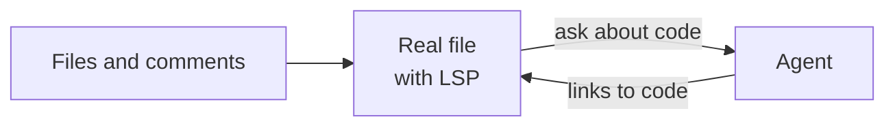
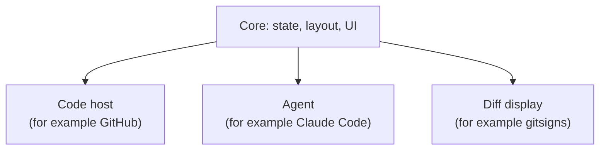

# Development

The project is at the start. Most design decisions are not made yet. We make them one at a time, and record them here.

For early ideas, see the [reference file](reference/design-prompt.md). It is not a spec.

## Concept

A review opens in its own tabpage, with the changed files, the real code and an agent side by side:



The core does not depend on one code host, agent or diff tool. Each of these is a replaceable integration:



## Decisions

| Topic | Decision |
| --- | --- |
| Minimum Neovim version | 0.12 |
| Test framework | mini.test. See [`TESTING.md`](TESTING.md). |
| Test layout | Unit tests mirror `lua/`. End-to-end tests are by feature. |
| Test kinds | Unit, end-to-end and integration tests. See [`TESTING.md`](TESTING.md). |
| Editor state in unit tests | A child Neovim. Prefer it to mocks of `vim.api` and `vim.fn`. |
| Test Neovim version | The installed Neovim. CI uses stable. |
| Network in tests | Unit and end-to-end tests do not use the network. Unit tests mock external dependencies. |
| Code host in end-to-end tests | The test provider. In the MVP, people test the GitHub provider by hand. See [#50](https://github.com/nickciaravella/didymus.nvim/issues/50). |
| GitHub provider in unit tests | A mock of `vim.system` gives recorded `gh` output from `tests/fixtures/github/`. |
| Picker in end-to-end tests | The test picker. Integration tests use the real snacks.nvim. |
| snacks.nvim in tests | A fixed commit: `SNACKS_COMMIT` in the `Makefile`. `make deps` checks it out. Only the integration tests put it on the `'runtimepath'`. |
| Test commands | `make test` runs all kinds of tests. CI runs `make test`. |
| Work tracking | Four epics: `agent`, `agentic-dev`, `diff`, `review`. Each epic is a GitHub label. See [`TASK_TRACKING.md`](TASK_TRACKING.md). |
| Infrastructure | Build it only when an epic needs it. |
| Agent design | See [`architecture/agent.md`](architecture/agent.md). |
| Review design | See [`architecture/review.md`](architecture/review.md). |
| First integrations | The GitHub provider, through `gh`, and the snacks.nvim picker. |
| Review workspace | The current checkout in the MVP. didymus asks before it checks out the PR over uncommitted changes. A worktree comes later. See [#48](https://github.com/nickciaravella/didymus.nvim/issues/48). |
| Review questions | The select role of the picker, because `vim.fn.confirm()` blocks the UI. See [`architecture/review.md`](architecture/review.md#workspace-flow). |
| Open reviews | One at a time, in its own tabpage. |
| Pickers | Only snacks.nvim in the MVP. The picker interface keeps the select role and the panel role apart, so that other pickers can come later. The health check reports a missing picker. See [`architecture/review.md`](architecture/review.md#picker-interface). |
| Review types | Only the fields that the MVP uses. A thread and a draft use a line range. A changed file has the raw patch from the code host. See [`architecture/review.md`](architecture/review.md#review-types). |
| Test provider | It keeps changes in memory, and calls each `cb` in `vim.schedule()`, as a real provider does. Its `checkout` runs `git checkout` in a temporary repo. |
| GitHub provider | `gh` with `vim.system`. A PR number or a PR URL. One GraphQL query and the REST files, at the same time. See [`architecture/review.md`](architecture/review.md#github-provider). |
| Review threads | A sign and a one-line summary at the line of each thread, and a hover float with all comments. Outdated threads, threads on the base side and threads on the file show only in the panel. See [`architecture/review.md`](architecture/review.md#inline-threads). |
| Thread navigation | `next` and `prev` go through the threads with a line, in the order of the panel, from the cursor. They do not wrap. See [`architecture/review.md`](architecture/review.md#thread-navigation). |
| Thread marks scope | The marks show only in the windows of the review tabpage, with `nvim__ns_set()`. Risk: Neovim 0.12 marks this API as experimental. The call is in one function. Without the API, the marks show in all windows, with no error. Outside the review tabpage, a buffer can have an empty sign column. |
| Hunk display | Not in the MVP. The patch from the code host gives the first hunk and the commentable lines. See [#51](https://github.com/nickciaravella/didymus.nvim/issues/51). |
| Agent scope | The agent works in all buffers, also outside a review. Only one agent session runs at a time. |
| Agent backends | `terminal` and `test` in v1. The interface must also fit ACP. |
| Agent views | A float, or a split on the right. |
| Agent commands | `start`, `toggle`, `focus`, `stop`, `append` and `send`. Most users only use `toggle`, `append` and `send`. |
| Agent context | The location and the code in a fenced block. Claude Code shows the paste as a short placeholder, also for a short context. |
| Agent in end-to-end tests | The `test` backend for the flows. A fake agent CLI for the terminal backend. |
| Manual tests | The agent prepares them: a setup file in `.manual-test/`, and a Herdr tab if possible. See [`TESTING.md`](TESTING.md#manual-tests). |
| Config for manual tests | The config of the user, with didymus.nvim from `$DIDYMUS_DIR`. Else `tests/minimal_init.lua`. |
| Agent in manual tests | The fake agent, unless a step needs the real agent. |
| Shared UI code | `lua/didymus/ui/`. It does not know about agents, diffs or reviews. Code that more than one part uses goes here, such as `ui/layout.lua`. |
| Agent expertise | Notebooks in `agents/expertise/`, one for each technology. They are Markdown files, not skills, so that all agents can read them. See [`agents/expertise/README.md`](../agents/expertise/README.md). |
| Notebook entries | Only facts that save effort in the future, are tricky, are not well documented, and have no other place. Each entry has a proof and the version that it was checked on. |
| Notebook changes | In the pull request of the task. An agent can make a new notebook or section without a question to the user. The reviewer examines it. |
| Local agent memory | Only for the preferences of one user. Facts about a technology go in a notebook. |
| Text | STE100. See [`AGENTS.md`](../AGENTS.md#writing-rules-ste100). |
| Format | stylua (`.stylua.toml`) |
| License | MIT |

## Open questions

- What is the diff interface? See [#51](https://github.com/nickciaravella/didymus.nvim/issues/51).
- How do we test the GitHub provider automatically? See [#50](https://github.com/nickciaravella/didymus.nvim/issues/50).

## Work in a worktree

To work on more than one issue at the same time, give each issue a worktree:

```sh
git fetch origin
git worktree add --no-track -b <type>/<slug> ../didymus.nvim-worktrees/<issue>-<slug> origin/main
```

The first `make test` in a worktree clones mini.nvim and snacks.nvim into its own `deps/`.

After the pull request merges, remove the worktree and the branch:

```sh
git worktree remove ../didymus.nvim-worktrees/<issue>-<slug>
git branch -D <type>/<slug>
```

## Code structure

```text
plugin/didymus.lua           :Didymus command and <Plug> mappings
lua/didymus/init.lua         setup()
lua/didymus/config.lua       defaults and user config
lua/didymus/command.lua      :Didymus subcommands and completion
lua/didymus/health.lua       :checkhealth didymus
lua/didymus/agent/           the agent. See architecture/agent.md.
lua/didymus/ui/              UI parts for all epics, such as the input float and window layout
lua/didymus/ui/picker/       the picker interface and its adapters: snacks, test
lua/didymus/review/          the review API, the review session, the files panel, the inline threads, the patch parser and the workspace. See architecture/review.md.
lua/didymus/review/provider/ the review types, the provider interface and its providers: github, test
tests/helpers.lua            helpers for all kinds of tests
tests/unit/didymus/          unit tests, mirror lua/didymus/
tests/e2e/                   end-to-end tests, by feature
tests/integration/           integration tests, with the real dependency
tests/fixtures/              files for tests, such as the fake agent
```
