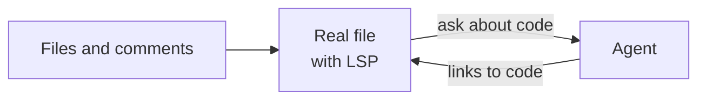
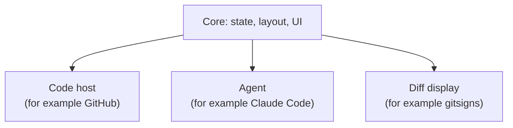

# Development

The project is at the start. Most design decisions are not made yet. We make them one at a time, and record them here.

For early ideas, see the [reference file](reference/design-prompt.md). It is not a spec.

## Concept

A review opens in its own tabpage, with the changed files, the real code and an agent side by side:



The core does not depend on one code host, agent or diff tool. Each of these is a replaceable integration:



## Decisions

| Topic | Decision |
| --- | --- |
| Minimum Neovim version | 0.12 |
| Test framework | mini.test. See [`TESTING.md`](TESTING.md). |
| Test layout | Unit tests mirror `lua/`. End-to-end tests are by feature. |
| Test kinds | Unit, end-to-end and integration tests. See [`TESTING.md`](TESTING.md). |
| Editor state in unit tests | A child Neovim. Prefer it to mocks of `vim.api` and `vim.fn`. |
| Test Neovim version | The installed Neovim. CI uses stable. |
| Network in tests | Unit and end-to-end tests do not use the network. Unit tests mock external dependencies. |
| Code host in end-to-end tests | The test provider. In the MVP, people test the GitHub provider by hand. See [#50](https://github.com/nickciaravella/didymus.nvim/issues/50). |
| GitHub provider in unit tests | A mock of `vim.system` gives recorded `gh` output from `tests/fixtures/github/`. |
| Picker in end-to-end tests | The test picker. Integration tests use the real snacks.nvim. |
| snacks.nvim and gitsigns in tests | Fixed commits: `SNACKS_COMMIT` and `GITSIGNS_COMMIT` in the `Makefile`. `make deps` checks them out. Only the integration tests put them on the `'runtimepath'`. |
| Test commands | `make test` runs all kinds of tests. CI runs `make test`. |
| Work tracking | Four epics: `agent`, `agentic-dev`, `diff`, `review`. Each epic is a GitHub label. See [`TASK_TRACKING.md`](TASK_TRACKING.md). |
| Infrastructure | Build it only when an epic needs it. |
| Agent design | See [`architecture/agent.md`](architecture/agent.md). |
| Review design | See [`architecture/review.md`](architecture/review.md). |
| Diff design | See [`architecture/diff.md`](architecture/diff.md). |
| Diff providers | A diff provider decorates the windows and buffers that the diff view gives it. It does not open windows. gitsigns and `test` in the MVP. Tools with their own tabpage, such as codediff and diffview, are a later `external` kind. See [`architecture/diff.md`](architecture/diff.md#interfaces). |
| Diff target | The review gives the base, the head and the files. In the MVP, the merge-base and the working tree. A later `local` review provider gives local diffs. The diff part does not know about code hosts. See [`architecture/diff.md`](architecture/diff.md#the-diff-target-of-a-review). |
| Diff scope | Only in the review tabpage, in the code window. gitsigns signs show in all windows of a buffer, so didymus puts the base back when the diff hides. See [`architecture/diff.md`](architecture/diff.md#decisions). |
| Diff commands | `toggle`, `layout [inline\|split]`, `side [both\|base\|head]`, `next` and `prev`. `diff next` uses the hunks of the diff provider. `review next hunk` keeps the hunks of the patch. See [`architecture/diff.md`](architecture/diff.md#api-and-commands). |
| Diff dependency | gitsigns is optional. With no gitsigns, the review works with no diff, and the health check reports a warning. An unknown `diff.provider` is an error. The gitsigns provider calls internal gitsigns modules. See [`architecture/diff.md`](architecture/diff.md#internal-gitsigns-calls). |
| First integrations | The GitHub provider, through `gh`, and the snacks.nvim picker. |
| Review workspace | The current checkout in the MVP. didymus asks before it checks out the PR over uncommitted changes. A worktree comes later. See [#48](https://github.com/nickciaravella/didymus.nvim/issues/48). |
| Review questions | The select role of the picker, because `vim.fn.confirm()` blocks the UI. See [`architecture/review.md`](architecture/review.md#workspace-flow). |
| Open reviews | One at a time, in its own tabpage. |
| Pickers | Only snacks.nvim in the MVP. The picker interface keeps the select role and the panel role apart, so that other pickers can come later. The health check reports a missing picker. See [`architecture/review.md`](architecture/review.md#picker-interface). |
| Picker config | `review.picker_config[kind][adapter_name]`, for the kinds `changes`, `choice` and `files`. The defaults of each adapter are in the adapter. See [`architecture/review.md`](architecture/review.md#picker-config). |
| Preview in the files panel | The code window shows the item under the cursor, only while the panel has the focus. |
| Review types | Only the fields that the MVP uses. A thread and a draft use a line range. A changed file has the raw patch from the code host. See [`architecture/review.md`](architecture/review.md#review-types). |
| Test provider | It keeps changes in memory, and calls each `cb` in `vim.schedule()`, as a real provider does. Its `checkout` runs `git checkout` in a temporary repo. |
| GitHub provider | `gh` with `vim.system`. A PR number or a PR URL. One GraphQL query and the REST files, at the same time. See [`architecture/review.md`](architecture/review.md#github-provider). |
| Review threads | A sign at the line of each thread, and the thread under the line, in `virt_lines`. A folded thread is one line. An unfolded thread shows all comments, wrapped at the window width. An active thread starts unfolded and a resolved thread starts folded, as on github.com. `fold` and `fold all` change the folds, and `next` unfolds. Outdated threads, threads on the base side and threads on the file show only in the panel, and in a hover float. An icon shows the state (`review.icons`). A panel key shows only the active threads. See [`architecture/review.md`](architecture/review.md#inline-threads). |
| Navigation | `next` and `prev` go to a thread, a changed file or a hunk of the patch, in the order of the panel, from the cursor. They do not wrap. See [`architecture/review.md`](architecture/review.md#navigation). |
| Review comments | A line or range comment on the head side, from the input float. "comment now" (`<C-s>`) posts it at once, if the user has no pending review. "add to review" (`<C-y>`) adds it to the pending review of the user, also one from github.com. didymus refuses a file that is different from the change head, and a range out of one hunk. If the code host refuses the comment, the next comment on the same lines starts with its text. See [`architecture/review.md`](architecture/review.md#comments). |
| Replies and resolve | They act on the thread at the cursor line, or on the thread of the open thread float. The float has the keys `r` and `x`. The reply float has the actions of the comment float: "reply now" posts the reply at once, if the user has no pending review, and "add to review" adds it to the pending review. didymus obeys the permissions of the code host, so it does not resolve a thread of a pending review. See [`architecture/review.md`](architecture/review.md#replies-and-resolve). |
| Submit and discard | `submit` takes a verdict, or asks for one in the picker. Then the body comes from the input float. A comment or a request for changes needs a body if the review has no pending comment. `discard` asks to confirm. After each action, didymus gets the threads again. See [`architecture/review.md`](architecture/review.md#submit-and-discard). |
| Refresh | `refresh` and `R` in the files panel get the change and the threads again. A new head gives a warning, and didymus does not check it out. A new comment needs `HEAD` at the change head. See [`architecture/review.md`](architecture/review.md#refresh). |
| Thread marks scope | The marks show only in the windows of the review tabpage, with `nvim__ns_set()`. Risk: Neovim 0.12 marks this API as experimental. The call is in one function. Without the API, the marks show in all windows, with no error. Outside the review tabpage, a buffer can have an empty sign column. |
| Hunk display | The review MVP has none. The patch from the code host gives the first hunk and the commentable lines. The `diff` epic shows the hunks. See [`architecture/diff.md`](architecture/diff.md). |
| Agent scope | The agent works in all buffers, also outside a review. Only one agent session runs at a time. |
| Agent backends | `terminal` and `test` in v1. The interface must also fit ACP. |
| Agent views | A float, or a split on the right. |
| Agent commands | `start`, `toggle`, `focus`, `stop`, `append` and `send`. Most users only use `toggle`, `append` and `send`. |
| Agent context | The location and the code in a fenced block. Claude Code shows the paste as a short placeholder, also for a short context. |
| Agent in end-to-end tests | The `test` backend for the flows. A fake agent CLI for the terminal backend. |
| Manual tests | The agent prepares them: a setup file in `.manual-test/`, and a Herdr tab if possible. See [`TESTING.md`](TESTING.md#manual-tests). |
| Config for manual tests | The config of the user, with didymus.nvim from `$DIDYMUS_DIR`. Else `tests/minimal_init.lua`. |
| Agent in manual tests | The fake agent, unless a step needs the real agent. |
| Shared UI code | `lua/didymus/ui/`. It does not know about agents, diffs or reviews. Code that more than one part uses goes here, such as `ui/layout.lua`. |
| Agent expertise | Notebooks in `agents/expertise/`, one for each technology. They are Markdown files, not skills, so that all agents can read them. See [`agents/expertise/README.md`](../agents/expertise/README.md). |
| Notebook entries | Only facts that save effort in the future, are tricky, are not well documented, and have no other place. Each entry has a proof and the version that it was checked on. |
| Notebook changes | In the pull request of the task. An agent can make a new notebook or section without a question to the user. The reviewer examines it. |
| Local agent memory | Only for the preferences of one user. Facts about a technology go in a notebook. |
| Text | STE100. See [`AGENTS.md`](../AGENTS.md#writing-rules-ste100). |
| Format | stylua (`.stylua.toml`) |
| License | MIT |

## Open questions

- How do we test the GitHub provider automatically? See [#50](https://github.com/nickciaravella/didymus.nvim/issues/50).

## Work in a worktree

To work on more than one issue at the same time, give each issue a worktree:

```sh
git fetch origin
git worktree add --no-track -b <type>/<slug> ../didymus.nvim-worktrees/<issue>-<slug> origin/main
```

The first `make test` in a worktree clones mini.nvim, snacks.nvim and gitsigns.nvim into its own `deps/`.

After the pull request merges, remove the worktree and the branch:

```sh
git worktree remove ../didymus.nvim-worktrees/<issue>-<slug>
git branch -D <type>/<slug>
```

## Code structure

```text
plugin/didymus.lua           :Didymus command and <Plug> mappings
lua/didymus/init.lua         setup()
lua/didymus/config.lua       defaults and user config
lua/didymus/command.lua      :Didymus subcommands and completion
lua/didymus/health.lua       :checkhealth didymus
lua/didymus/agent/           the agent. See architecture/agent.md.
lua/didymus/ui/              UI parts for all epics, such as the input float and window layout
lua/didymus/ui/picker/       the picker interface and its adapters: snacks, test
lua/didymus/review/          the review API, the review session, the files panel, the inline threads, the patch parser, the workspace and the diff target. See architecture/review.md.
lua/didymus/review/provider/ the review types, the provider interface and its providers: github, test
lua/didymus/diff/            the diff types, the hunk navigation, the diff provider interface and its providers: gitsigns, test. See architecture/diff.md.
tests/helpers.lua            helpers for all kinds of tests
tests/unit/didymus/          unit tests, mirror lua/didymus/
tests/e2e/                   end-to-end tests, by feature
tests/integration/           integration tests, with the real dependency
tests/fixtures/              files for tests, such as the fake agent
```
