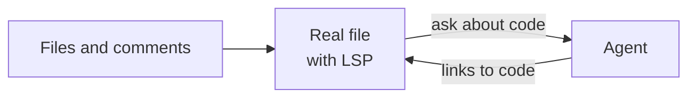
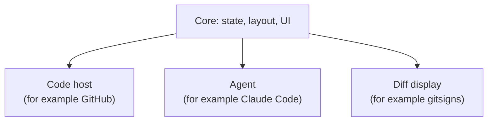

# Development

The project is at the start. Most design decisions are not made yet. We make them one at a time, and record them here.

For early ideas, see the [reference file](reference/design-prompt.md). It is not a spec.

## Concept

A review opens in its own tabpage, with the changed files, the real code and an agent side by side:



The core does not depend on one code host, agent or diff tool. Each of these is a replaceable integration:



## Decisions

| Topic | Decision |
| --- | --- |
| Minimum Neovim version | 0.12 |
| Test framework | mini.test. See [`TESTING.md`](TESTING.md). |
| Test layout | Unit tests mirror `lua/`. End-to-end tests are by feature. |
| Test kinds | Unit, end-to-end and integration tests. See [`TESTING.md`](TESTING.md). |
| Editor state in unit tests | A child Neovim. Prefer it to mocks of `vim.api` and `vim.fn`. |
| Test Neovim version | The installed Neovim. CI uses stable. |
| Network in tests | Unit and end-to-end tests do not use the network. Unit tests mock external dependencies. |
| Code host in end-to-end tests | The local provider. Integration tests check each real provider, such as GitHub, against the provider interface. |
| Work tracking | Three epics: `agent`, `diff`, `review`. Each epic is a GitHub label. See [`TASK_TRACKING.md`](TASK_TRACKING.md). |
| Infrastructure | Build it only when an epic needs it. |
| Agent design | See [`architecture/agent.md`](architecture/agent.md). |
| Agent scope | The agent works in all buffers, also outside a review. Only one agent session runs at a time. |
| Agent backends | `terminal` and `test` in v1. The interface must also fit ACP. |
| Agent views | A float, or a split on the right. |
| Agent commands | `start`, `toggle` and `stop`. Most users only use `toggle`. |
| Agent context | The location and the code in a fenced block. Claude Code shows the paste as a short placeholder, also for a short context. |
| Agent in end-to-end tests | The `test` backend for the flows. A fake agent CLI for the terminal backend. |
| Shared UI code | `lua/didymus/ui/`. It does not know about agents, diffs or reviews. Code that more than one part uses goes here, such as `ui/layout.lua`. |
| Text | STE100. See [`AGENTS.md`](../AGENTS.md#writing-rules-ste100). |
| Format | stylua (`.stylua.toml`) |
| License | MIT |

## Open questions

- How do we get the PR code: a git worktree, or the current checkout?
- Which integrations ship first?
- What are the interfaces between core and the integrations?
- Do the integration tests for the GitHub provider use the real GitHub, or recorded output?

## Work in a worktree

To work on more than one issue at the same time, give each issue a worktree:

```sh
git fetch origin
git worktree add --no-track -b <type>/<slug> ../didymus.nvim-worktrees/<issue>-<slug> origin/main
```

The first `make test` in a worktree clones mini.nvim into its own `deps/`.

After the pull request merges, remove the worktree and the branch:

```sh
git worktree remove ../didymus.nvim-worktrees/<issue>-<slug>
git branch -D <type>/<slug>
```

## Code structure

```text
plugin/didymus.lua           :Didymus command and <Plug> mappings
lua/didymus/init.lua         setup()
lua/didymus/config.lua       defaults and user config
lua/didymus/command.lua      :Didymus subcommands and completion
lua/didymus/health.lua       :checkhealth didymus
lua/didymus/agent/           the agent. See architecture/agent.md.
lua/didymus/ui/              UI parts for all epics, such as the input float and window layout
tests/unit/didymus/          unit tests, mirror lua/didymus/
tests/e2e/                   end-to-end tests, by feature
tests/fixtures/              files for tests, such as the fake agent
```
