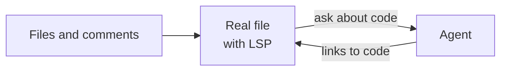
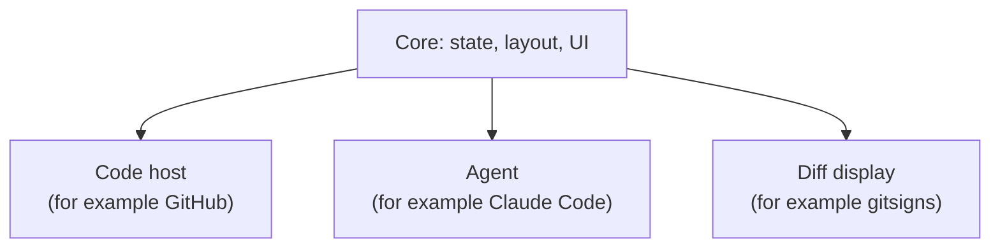

# Development

The project is at the start. Most design decisions are not made yet. We make them one at a time, and record them here.

For early ideas, see the [reference file](reference/design-prompt.md). It is not a spec.

## Concept

A review opens in its own tabpage, with the changed files, the real code and an agent side by side:



The core does not depend on one code host, agent or diff tool. Each of these is a replaceable integration:



## Decisions

| Topic | Decision |
| --- | --- |
| Minimum Neovim version | 0.12 |
| Test framework | mini.test. See [`TESTING.md`](TESTING.md). |
| Test layout | Unit tests mirror `lua/`. Integration tests are end to end, by feature. |
| Text | STE100. See [`AGENTS.md`](../AGENTS.md#writing-rules-ste100). |
| Format | stylua (`.stylua.toml`) |
| License | MIT |

## Open questions

- How do we get the PR code: a git worktree, or the current checkout?
- Which integrations ship first?
- What are the interfaces between core and the integrations?
- Should the agent panel also be a float?
- How do integration tests use a code host and an agent without the network?

## Code structure

```text
plugin/didymus.lua     :Didymus command (stub)
lua/didymus/init.lua   setup()
lua/didymus/health.lua :checkhealth didymus
tests/unit/didymus/    unit tests, mirror lua/didymus/
tests/integration/     end-to-end tests, by feature
```
