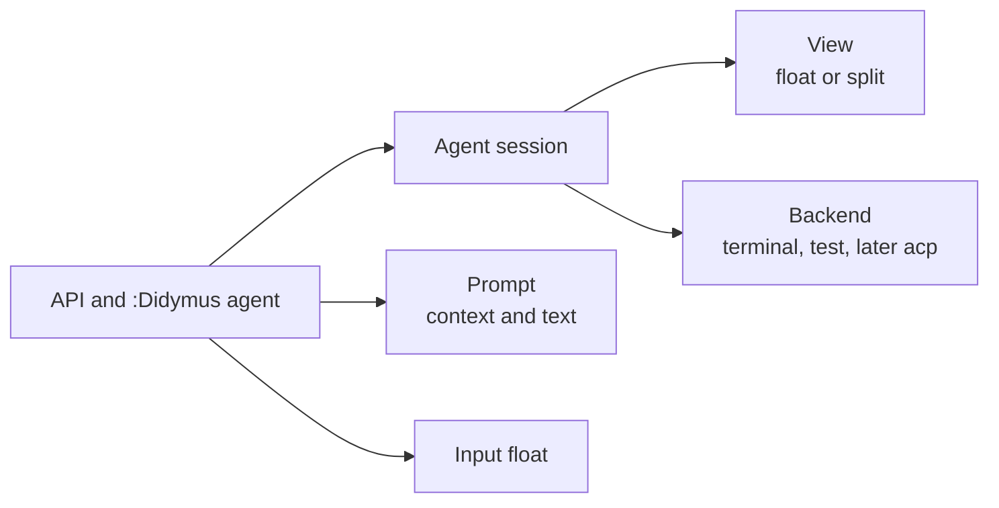
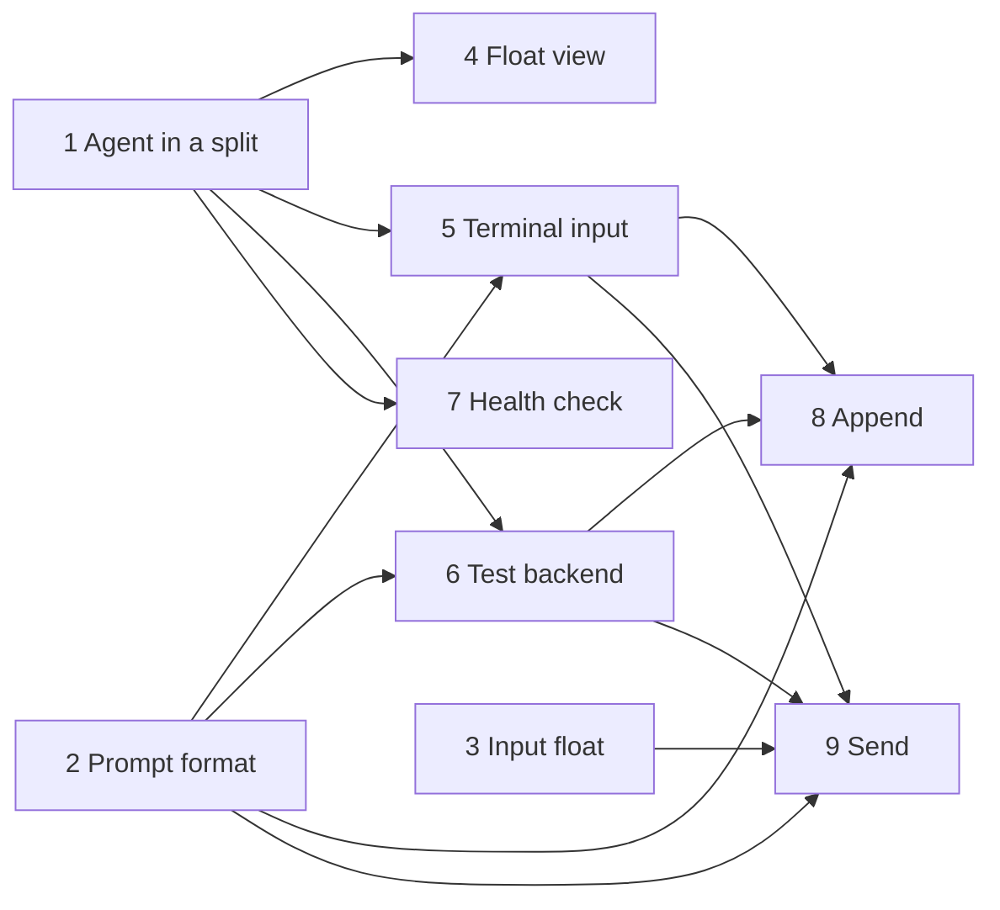

# Agent architecture

This file is the design of the `agent` epic. Read it before you work on the epic. Record changes to the design here.

## Scope

Version 1 has these features:

- Run one agent CLI in a terminal, in a float or in a split on the right.
- **Append**: put the current line or the selection in the agent input. Then type the rest of the prompt in the agent.
- **Send**: type a prompt in a small float at the code. didymus submits the prompt with the line or the selection. The agent stays hidden.

These features come later:

- Links from the agent output back to the code.
- Agents that do not use a terminal, such as ACP agents.
- More than one agent session at a time.
- An agent session for each review.

## Requirements

| ID | Requirement |
| --- | --- |
| A1 | The agent works in all buffers, also outside a review. It starts in the current directory. |
| A2 | Only one agent session runs at a time. |
| A3 | `agent.cmd` sets the agent command. The `cmd` option of the API and of the command overrides it. |
| A4 | The view is `float` or `split`. `agent.view` sets the default. The `view` option overrides it. |
| A5 | Append uses the current line in normal mode and the selection in visual mode. It puts the context in the agent input and focuses the agent. It does not submit. |
| A6 | Send opens an input float at the cursor. The float starts with one line and grows when the text wraps. `<CR>` adds a line. `<C-y>` submits. The keys are configurable. |
| A7 | Send submits the context and the prompt. It does not show the agent. |
| A8 | The context is the location and the code in a fenced block. |
| A9 | The backends are `terminal` and `test`. The interface must also fit an ACP backend. |

## Parts



| Part | Owns | Does not |
| --- | --- | --- |
| Agent session | The backend, the view, `cmd` and `cwd`. It starts, stops and restarts the agent. | Render prompts. |
| Backend | The agent process and its buffer. It renders prompts and gives them to the agent. | Open, close or focus windows. |
| View | The float or the split that shows the backend buffer. | Stop the agent. When the view hides, the buffer and the agent continue. |
| Prompt | The context (path, lines, text, filetype) and the user text. `to_text()` renders it as text. | Know about backends. |
| Input float | A small float for a prompt. It calls back with the text. | Know about agents. |

## Modules

```text
lua/didymus/
  config.lua                     defaults and user config
  command.lua                    :Didymus subcommands
  agent/
    init.lua                     public API
    session.lua                  agent session
    view.lua                     float and split
    prompt.lua                   context and text format
    backends/terminal.lua        agent CLI in a terminal buffer
    backends/test.lua            backend without a process, for tests
  ui/input.lua                   input float
tests/fixtures/fake_agent.lua    fake agent CLI
```

Calls go in one direction: `command` → `agent/init` → `session` → `view` and the backend.

- `view` does not know about backends. It shows a buffer.
- `ui/input` does not know about agents. It gives back text, so the review epic can use it too.
- Backends use only `prompt.to_text()`.
- `session.lua` finds the backend module by name in a fixed table. There is no registry yet.

## Interfaces

```lua
---@class didymus.agent.Context
---@field path string        Relative to the session cwd, or absolute if outside it.
---@field start_line integer 1-based, inclusive.
---@field end_line integer   1-based, inclusive.
---@field text string
---@field filetype string?

---@class didymus.agent.Prompt
---@field text string?       Nil for append.
---@field context didymus.agent.Context[]

---@class didymus.agent.BackendOpts
---@field cmd string|string[] A string runs through 'shell'.
---@field cwd string
---@field on_exit fun(code: integer)

--- A backend module returns `{ new = fun(opts: didymus.agent.BackendOpts): didymus.agent.Backend }`.
---@class didymus.agent.Backend
---@field append fun(self, prompt: didymus.agent.Prompt) Put the prompt in the agent input.
---@field send fun(self, prompt: didymus.agent.Prompt)   Put the prompt in the agent input and submit it.
---@field buf fun(self): integer?                         The buffer for the view. Nil means no view.
---@field focus? fun(self, win: integer)                  Called after the view focuses `win`.
---@field is_running fun(self): boolean
---@field stop fun(self)
```

A backend obeys these rules:

1. Queue `append` and `send` until the agent is ready. The caller does not wait.
2. Render the prompt in the format of the agent. The terminal backend uses `prompt.to_text()`. An ACP backend sends content blocks.
3. Do not open, close or focus windows.
4. Call `on_exit` one time.

The other parts have these interfaces:

```lua
---@alias didymus.agent.ViewKind "float"|"split"

--- session.lua. It is an object, so that a review can have its own session later.
---@class didymus.agent.Session
---@field new fun(opts: { cmd: string|string[], cwd: string, backend: string }): didymus.agent.Session Start the backend.
---@field show fun(self, kind: didymus.agent.ViewKind) Show the backend buffer in the view. Then call `backend:focus()`.
---@field hide fun(self)
---@field append fun(self, prompt: didymus.agent.Prompt)
---@field send fun(self, prompt: didymus.agent.Prompt)
---@field stop fun(self)
---@field is_running fun(self): boolean

--- view.lua. One window in the current tabpage.
---@class didymus.agent.View
---@field show fun(self, buf: integer, kind: didymus.agent.ViewKind): integer Return the window. Change its kind if necessary.
---@field hide fun(self) Close the window. The buffer stays.
---@field is_visible fun(self): boolean

--- prompt.lua
---@class didymus.agent.prompt
---@field context fun(opts: { buf: integer, range: integer[]? }): didymus.agent.Context With no range: the current line, or the selection in visual mode.
---@field to_text fun(prompt: didymus.agent.Prompt): string

--- ui/input.lua
---@class didymus.ui.input
---@field open fun(opts: { title: string?, on_submit: fun(text: string), on_cancel: fun()? })
```

`agent/init.lua` keeps the standalone session, and finds it with `current()`. Later, `current()` gives the review session in a review tabpage.

## API and commands

```lua
local agent = require("didymus.agent")
agent.open({ cmd = "codex", view = "float" }) -- start if necessary, show and focus
agent.toggle({ view = "split" })             -- show or hide
agent.stop()
agent.append()                               -- the current line, or the selection in visual mode
agent.send()                                 -- open the input float
agent.send({ text = "Explain this." })       -- submit at once, with no input float
```

All options are optional. `cmd` and `view` use the config if you do not give them.

```text
:Didymus agent open [float|split] [cmd]
:Didymus agent toggle [float|split]
:Didymus agent stop
:[range]Didymus agent append
:[range]Didymus agent send [text]
```

- `[cmd]` is the rest of the line. It runs through 'shell'.
- Each action has a `<Plug>(didymus-agent-…)` mapping for normal and visual mode.
- There are no default keymaps.

The config defaults:

```lua
agent = {
  cmd = "claude",
  view = "split", -- "split" or "float"
  backend = "terminal", -- "terminal" or "test"
  split = { width = 0.4 },
  float = { width = 0.8, height = 0.8 },
  input = { width = 60, max_height = 10, keys = { submit = "<C-y>", cancel = "q" } },
  terminal = { ready_delay = 500, submit_delay = 50 }, -- milliseconds
}
```

A size below 1 is a fraction of the editor size.

## Flows

### Open

1. If no session runs, start the backend with `cmd` and the current directory.
2. Show the backend buffer in the view, and focus the window.
3. Call `backend:focus(win)`. The terminal backend starts terminal mode.

If a session runs with a different `cmd`, keep it and show a warning. To change the command, stop the session first.

### Append

1. Make the context from the current line, the command range or the selection.
2. If no session runs, start one.
3. Call `backend:append()` with no prompt text.
4. Show and focus the view. The user types the rest of the prompt and submits it in the agent.

### Send

1. Make the context. Open the input float at the cursor.
2. On submit, start a session if no session runs. Do not show the view.
3. Call `backend:send()`. Show the message "Sent to `<cmd>`".

### Exit

1. The backend calls `on_exit(code)`. Show the exit code.
2. Keep the buffer, so that the user can read the last output.
3. The next open, append or send starts a new session. Tell the user that it is a new conversation.

## Text format

`prompt.to_text()` writes each context as a location and a fenced block. The prompt text comes after the contexts:

````text
lua/didymus/init.lua:10-12
```lua
local M = {}
```

Explain this.
````

- The location of one line is `path:10`.
- The fence is longer than the longest backtick run in the code.
- For append, the text ends with a newline, so the user types under the block.

## Terminal backend

| Step | Behavior |
| --- | --- |
| Start | Make a buffer with `bufhidden=hide`. Call `jobstart(cmd, { term = true, cwd = cwd })` in it with `nvim_buf_call()`. This works with no window, so send can start a hidden agent. |
| Ready | Queue input until the first output, plus `terminal.ready_delay`. |
| Input | Write the text with `chansend()` in bracketed paste (`ESC[200~` … `ESC[201~`). Without bracketed paste, each newline submits. |
| Submit | Send `\r` after `terminal.submit_delay`. Some TUIs ignore an Enter that comes in the same write as the paste. |
| Focus | `startinsert`. |

## Test backend

- It starts no process. Its buffer is a scratch buffer.
- `append` and `send` keep each prompt in a list and write the text of the prompt to the buffer. Tests check the list or the screen.
- It is ready at once.
- The test helper `exit(code)` calls `on_exit(code)`.

## Fake agent

`tests/fixtures/fake_agent.lua` acts like an agent CLI. It runs with `nvim --clean -l`, so CI needs nothing new.

- It turns on bracketed paste and shows a prompt.
- It shows each key and each paste.
- A `\r` outside a paste shows `submitted: <text>`.

## Tests

| Part | Test |
| --- | --- |
| `prompt` | Unit tests for the context and the text format. |
| Input float | End-to-end tests with screenshots. |
| Open, toggle, stop, views and exit | End-to-end tests with the terminal backend and the fake agent. |
| Terminal input | End-to-end tests with the fake agent. |
| Append and send | End-to-end tests with the test backend. |
| Real agents | A manual check with `claude` and `codex` in each task that changes the terminal backend. |

## Future direction

- **ACP backend.** `session/prompt` takes a list of content blocks. The backend changes each context into a `resource` or `resource_link` block. It shows the answer (`session/update`) in its own buffer. It also owns the input box, so `append` fills that box.
- **Other backends.** Possible backends are `codex app-server` (JSON-RPC), `codex queue` and a tmux pane. A backend with no buffer has no view.
- **Review sessions.** A review starts its own agent session in the review tabpage, with the review workspace as its cwd. Commands in that tabpage go to that session. For this reason, the session is an object and not a module global.
- **More sessions.** A list of sessions, for example as tabs in the view.
- **Links.** Find `path:line` and similar text in the agent buffer. Record OSC 8 links from `TermRequest`. Open the target in the last normal window, never in a new window. A test showed that an `expr` terminal-mode mapping for `<LeftMouse>` gets the click position. The mapping can follow a link, or give the click to the agent.

## Work plan

Each task is one GitHub issue with the `agent` label, and one pull request. Each task adds its tests and updates the docs. The issue has the full scope and the tests.



| Task | Content | Needs |
| --- | --- | --- |
| 1. [Agent in a split](https://github.com/nickciaravella/didymus.nvim/issues/4) | `config.lua` and `command.lua`. `:Didymus agent open`, `toggle` and `stop`. The session, the split view, the start and exit of the terminal backend, and the fake agent (output only). | None |
| 2. [Prompt format](https://github.com/nickciaravella/didymus.nvim/issues/5) | `prompt.lua`: the context from a line, a range or a selection, and `to_text()`. | None |
| 3. [Input float](https://github.com/nickciaravella/didymus.nvim/issues/6) | `ui/input.lua`: one line that grows, `<CR>`, `<C-y>`, cancel and the keys config. Make sure that `<C-y>` submits when blink.cmp or nvim-cmp is installed. | None |
| 4. [Float view](https://github.com/nickciaravella/didymus.nvim/issues/7) | `view = "float"` and the `view` option. A session can move between the views. | 1 |
| 5. [Terminal input](https://github.com/nickciaravella/didymus.nvim/issues/8) | `append` and `send` in the terminal backend: bracketed paste, the ready queue and the submit delay. The fake agent reads input. A manual check with `claude` and `codex`, also with a long paste. | 1, 2 |
| 6. [Test backend](https://github.com/nickciaravella/didymus.nvim/issues/9) | `backends/test.lua` and the `agent.backend` option. | 1, 2 |
| 7. [Health check](https://github.com/nickciaravella/didymus.nvim/issues/10) | `:checkhealth didymus` checks that the program in `agent.cmd` is on `$PATH`. | 1 |
| 8. [Append](https://github.com/nickciaravella/didymus.nvim/issues/11) | `:Didymus agent append` and its `<Plug>` mapping. | 2, 5, 6 |
| 9. [Send](https://github.com/nickciaravella/didymus.nvim/issues/12) | `:Didymus agent send` and its `<Plug>` mapping. A hidden start, and the "Sent" message. | 2, 3, 5, 6 |

Tasks 1, 2 and 3 can start at the same time. Then tasks 4 to 7 can go in parallel. Tasks 8 and 9 come last.
