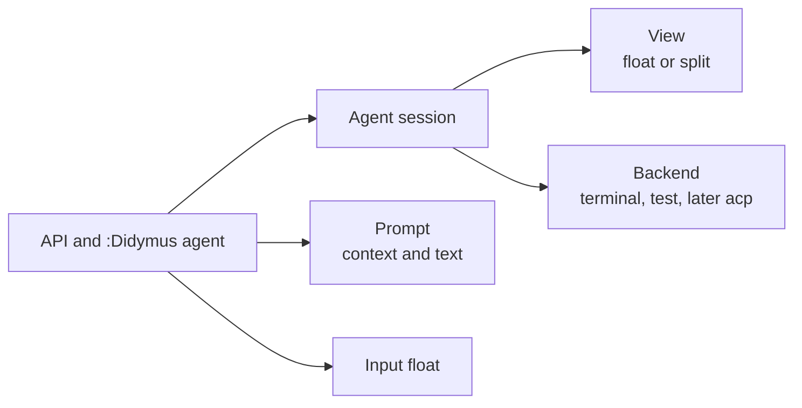
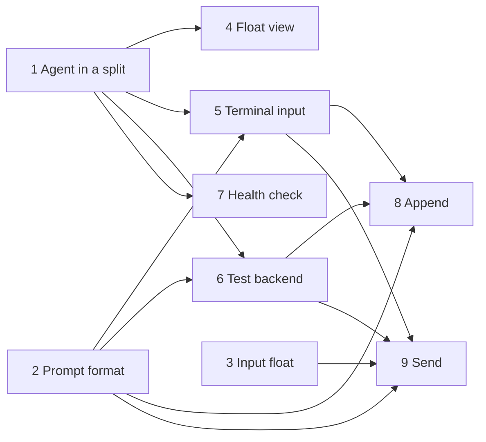

# Agent architecture

This file is the design of the `agent` epic. Read it before you work on the epic. Record changes to the design here.

## Scope

Version 1 has these features:

- Run one agent CLI in a terminal, in a float or in a split on the right.
- **Append**: put the current line or the selection in the agent input. Then type the rest of the prompt in the agent.
- **Send**: type a prompt in a small float at the code. didymus submits the prompt with the line or the selection. The agent stays hidden.

These features come later:

- Links from the agent output back to the code.
- Agents that do not use a terminal, such as ACP agents.
- More than one agent session at a time.
- An agent session for each review.

## Requirements

| ID | Requirement |
| --- | --- |
| A1 | The agent works in all buffers, also outside a review. It starts in the current directory. |
| A2 | Only one agent session runs at a time. |
| A3 | `agent.cmd` sets the agent command. The `cmd` option of the API and of the command overrides it. |
| A4 | The view is `float` or `split`. Only one view is visible at a time. `toggle` with a `view` shows or hides that view. `toggle` with no `view` uses the last view, then `agent.view`. |
| A5 | Append uses the current line in normal mode and the selection in visual mode. It puts the context in the agent input and focuses the agent. It does not submit. |
| A6 | Send opens an input float above the code, in the center of the current window. The code has a highlight while the float is open. The float starts with one line and grows when the text wraps. `<CR>` adds a line. `<C-y>` submits. The keys are configurable. |
| A7 | Send submits the context and the prompt. It does not show the agent. |
| A8 | The context is the location and the code in a fenced block. |
| A9 | The backends are `terminal` and `test`. The interface must also fit an ACP backend. |
| A10 | `start` starts the agent and does not show it. `toggle` starts the agent if necessary, and shows or hides the view. `focus` starts the agent if necessary, and shows and focuses the view. `stop` ends the agent and closes the view. |
| A11 | If the agent runs, `start` and `toggle` do not start a new agent. If their `cmd` is different, they show a warning. |

## Parts



| Part | Owns | Does not |
| --- | --- | --- |
| Agent session | The backend, the view, `cmd` and `cwd`. It starts, stops and restarts the agent. | Render prompts. |
| Backend | The agent process and its buffer. It renders prompts and gives them to the agent. | Open, close or focus windows. |
| View | The float or the split that shows the backend buffer. | Stop the agent. When the view hides, the buffer and the agent continue. |
| Prompt | The context (path, lines, text, filetype) and the user text. `to_text()` renders it as text. | Know about backends. |
| Input float | A small float for a prompt. It calls back with the text. | Know about agents. |

## Modules

```text
lua/didymus/
  config.lua                     defaults and user config
  command.lua                    :Didymus subcommands
  agent/
    init.lua                     public API
    session.lua                  agent session
    view.lua                     float and split
    prompt.lua                   context and text format
    backends/terminal.lua        agent CLI in a terminal buffer
    backends/test.lua            backend without a process, for tests
  ui/input.lua                   input float
  ui/layout.lua                  sizes and positions of windows
tests/fixtures/fake_agent.lua    fake agent CLI
```

Calls go in one direction: `command` → `agent/init` → `session` → `view` and the backend.

- `view` does not know about backends. It shows a buffer.
- `ui/input` does not know about agents. It gives back text, so the review epic can use it too.
- `ui/layout` has the window sizes and positions that more than one part uses, such as a centered float.
- Backends use only `prompt.to_text()`.
- `session.lua` finds the backend module by name in a fixed table. There is no registry yet.

## Interfaces

```lua
---@class didymus.agent.Context
---@field path string        Relative to the current directory, or absolute if outside it.
---@field start_line integer 1-based, inclusive.
---@field end_line integer   1-based, inclusive.
---@field text string
---@field filetype string?

---@class didymus.agent.Prompt
---@field text string?       Nil for append.
---@field context didymus.agent.Context[]

---@class didymus.agent.BackendOpts
---@field cmd string|string[] A string runs through 'shell'.
---@field cwd string
---@field width integer       The size before a view shows the buffer.
---@field height integer
---@field on_exit fun(code: integer)

--- A backend module returns `{ new = fun(opts: didymus.agent.BackendOpts): didymus.agent.Backend }`.
--- `new()` throws an error if the agent cannot start.
---@class didymus.agent.Backend
---@field append fun(self, prompt: didymus.agent.Prompt) Put the prompt in the agent input.
---@field send fun(self, prompt: didymus.agent.Prompt)   Put the prompt in the agent input and submit it.
---@field buf fun(self): integer?                         The buffer for the view. Nil means no view.
---@field focus? fun(self, win: integer)                  Called after the view focuses `win`.
---@field is_running fun(self): boolean
---@field stop fun(self)                                  Stop the agent and delete the buffer.
```

A backend obeys these rules:

1. Queue `append` and `send` until the agent is ready. The caller does not wait.
2. Render the prompt in the format of the agent. The terminal backend uses `prompt.to_text()`. An ACP backend sends content blocks.
3. Do not open, close or focus windows.
4. Call `on_exit` one time.

The other parts have these interfaces:

```lua
---@alias didymus.agent.ViewKind "float"|"split"

--- session.lua. It is an object, so that a review can have its own session later.
---@class didymus.agent.Session
---@field cmd string|string[]
---@field new fun(opts: { cmd: string|string[], cwd: string, backend: string, view: didymus.agent.ViewKind }): didymus.agent.Session Start the backend. `view` sets the size.
---@field restart fun(self, opts: { cmd: string|string[], cwd: string, view: didymus.agent.ViewKind }) Start a new backend. Delete the buffer of the old backend.
---@field show fun(self, kind: didymus.agent.ViewKind) Show the backend buffer in the view. Then call `backend:focus()`.
---@field hide fun(self)
---@field is_visible fun(self, kind: didymus.agent.ViewKind?): boolean With `kind`, true only if that view is visible.
---@field view_kind fun(self): didymus.agent.ViewKind? The last view that showed the agent.
---@field append fun(self, prompt: didymus.agent.Prompt)
---@field send fun(self, prompt: didymus.agent.Prompt)
---@field stop fun(self) Hide the view and stop the backend.
---@field is_running fun(self): boolean

--- view.lua. One window in the current tabpage.
---@class didymus.agent.View
---@field kind didymus.agent.ViewKind? The kind of the last window that `show()` opened.
---@field size fun(kind: didymus.agent.ViewKind): integer, integer The width and height of the window that `show()` opens.
---@field show fun(self, buf: integer, kind: didymus.agent.ViewKind): integer Return the window. Close the window of the other kind.
---@field hide fun(self) Close the window. The buffer stays.
---@field leave fun(self) Go back to the window before the agent.
---@field is_visible fun(self, kind: didymus.agent.ViewKind?): boolean

--- prompt.lua
---@class didymus.agent.prompt
---@field context fun(opts: { buf: integer, range: integer[]? }): didymus.agent.Context With no range: the current line, or the selection in visual mode. Throws an error if the buffer has no file.
---@field location fun(context: didymus.agent.Context): string `path:10`, or `path:10-12` for more lines.
---@field to_text fun(prompt: didymus.agent.Prompt): string

--- ui/input.lua
---@class didymus.ui.input
---@field open fun(opts: didymus.ui.input.Opts)

---@class didymus.ui.input.Opts
---@field title string?
---@field on_submit fun(text: string)
---@field on_cancel fun()?
---@field width number?      Default 60. A width below 1 is a fraction of the current window width.
---@field max_height integer? Default 10.
---@field keys { submit: string?, cancel: string? }? Default `{ submit = "<C-y>", cancel = "q" }`.
---@field range integer[]?   The first and the last line of the code, 1-based. These lines have a highlight. Default: the cursor line.

--- ui/layout.lua
---@class didymus.ui.layout
---@field resolve_size fun(size: number, total: integer): integer A size below 1 is a fraction of `total`.
---@field editor_area fun(): didymus.ui.layout.Area The editor rows above the command line.
---@field border_size fun(border: string|table): integer, integer The columns and rows of a border from `nvim_win_get_config()`.
---@field center_offset fun(size: integer, total: integer): integer The offset that puts `size` in the center of `total`.
---@field center fun(area: didymus.ui.layout.Area, width: integer, height: integer, border: string|table): { row, col, width, height } Make the float smaller if it does not fit.
```

`agent/init.lua` keeps the standalone session, and finds it with `current()`. Later, `current()` gives the review session in a review tabpage.

## API and commands

```lua
local agent = require("didymus.agent")
agent.start({ cmd = "codex" })                  -- start if necessary, do not show
agent.toggle({ cmd = "codex", view = "float" }) -- start if necessary, then show and focus the float, or hide it
agent.focus({ view = "float" })                 -- start if necessary, then show and focus the float
agent.stop()                                    -- end the agent and close the view
agent.append()                                  -- the current line, or the selection in visual mode
agent.append({ range = { 10, 12 }, view = "float", cmd = "codex" })
agent.send()                                    -- open the input float
agent.send({ text = "Explain this." })          -- submit at once, with no input float
agent.send({ range = { 10, 12 }, cmd = "codex" })
```

Most users only use `toggle`. Use `start` to start the agent before you show it.

All options are optional. `cmd` and `view` use the config if you do not give them.

```text
:Didymus agent start [cmd]
:Didymus agent toggle [float|split] [cmd]
:Didymus agent focus [float|split] [cmd]
:Didymus agent stop
:[range]Didymus agent append
:[range]Didymus agent send [text]
```

- `[cmd]` is the rest of the line. It runs through 'shell'. If the agent runs, didymus does not use it.
- `append` and `send` take a range. Other actions ignore it. `append` has no arguments, so that it is the same as `send`, whose argument is `[text]`.
- Each action has a `<Plug>(didymus-agent-…)` mapping. `start`, `toggle`, `focus` and `stop` work in normal and terminal mode. `append` and `send` work in normal and visual mode. Their mappings call a Lua function, so that the function sees the selection. A `:` mapping gives only full lines.
- There are no default keymaps. `agent.keys` sets two optional keys:
  - `focus`: a global normal-mode key for `focus`.
  - `leave`: a key in the agent buffer, in terminal and normal mode. It goes back to the window before the agent. If that window is not valid, it goes to the previous window.

The config defaults:

```lua
agent = {
  cmd = "claude",
  view = "split", -- "split" or "float"
  backend = "terminal", -- "terminal" or "test"
  split = { width = 0.4 },
  float = { width = 0.85, height = 0.85 },
  keys = { focus = false, leave = false }, -- for example "<C-a>"
  input = { width = 60, max_height = 10, keys = { submit = "<C-y>", cancel = "q" } },
  terminal = { ready_delay = 500, submit_delay = 50 }, -- milliseconds
}
```

A size below 1 is a fraction of the editor size. For `input.width`, it is a fraction of the current window width.

## Flows

### Start

1. If no session runs, start the backend with `cmd` and the current directory. Use the size of the view.
2. Show the message "started `<cmd>`".

If a session runs with a different `cmd`, keep it and show a warning. To change the command, stop the session first.

### Toggle

1. Find the view: the `view` option, else the last view, else `agent.view`.
2. If that view is visible, hide it. Stop here. The agent continues. With no `view` option, hide each visible view.
3. If no session runs, start one, as in Start.
4. Show the backend buffer in the view, and focus the window. If the other view is visible, close it. The buffer and the agent stay the same.
5. Call `backend:focus(win)`. The terminal backend starts terminal mode.

For example, with the split visible, `toggle float` closes the split and shows the float. Then `toggle split` closes the float and shows the split.

### Focus

1. Find the view, as in Toggle.
2. Do steps 3 to 5 of Toggle. A visible view does not hide.

### Leave

1. The `leave` key goes back to the window before the agent.
2. The float hides, because the focus left it. The split stays.

### Stop

1. Hide the view.
2. Stop the backend. The backend deletes its buffer.

### Append

1. Make the context from the current line, the command range or the selection. Leave visual mode, also on an error. If the buffer has no file, show the error and stop.
2. If no session runs, start one, as in Focus.
3. Call `backend:append()` with no prompt text.
4. Show and focus the view. The user types the rest of the prompt and submits it in the agent.

### Send

1. Make the context, as in Append. Open the input float above the line or the selection, with the location as the title. Give the lines as `range`. With `text`, go to step 2 at once.
2. On submit, start a session if no session runs. Do not show the view. The last view or `agent.view` sets the size.
3. Call `backend:send()`. Show the message "didymus: sent to `<cmd>`".

### Exit

1. The backend calls `on_exit(code)`. Show the exit code.
2. Keep the buffer, so that the user can read the last output. The terminal backend leaves terminal mode, because the next key in terminal mode deletes the buffer.
3. The next start, toggle, append or send restarts the session. Restart deletes the old buffer. Tell the user that it is a new conversation.

## Float view

| Behavior | Decision |
| --- | --- |
| Position | In the center of the editor, above the command line. |
| Size | `agent.float.width` and `agent.float.height`, without the border. If the float and its border do not fit, the float becomes smaller. |
| Border | `'winborder'` and `FloatBorder`. If `'winborder'` is empty or `none`, `rounded`, because the inside has the code background. |
| Inside | `DidymusAgentFloat`, which links to `Normal`. The code background is better for the agent text than the float background. |
| Resize | On `VimResized`, the float gets its size and its center again. |
| Focus | When the focus goes to a different window, the float hides. The agent continues. |

## Input float

| Behavior | Decision |
| --- | --- |
| Position | Above the first line of `range`, and the float grows up. If the space above is less than `max_height` and less than the space under the last line, the float goes under the last line and grows down. |
| Column | The center of the current window. |
| Highlight | The lines of `range` have the `DidymusInputContext` highlight while the float is open. It links to `Visual`. It covers full lines, also for a part of a line in a selection. It shows only in the current window, also when other windows show the buffer. An extmark shows in all windows of its buffer, so a decoration provider draws the highlight. |
| Window | The float, with its border, stays in the current window, so it does not cover the agent split. If the window is too narrow for `width`, the float uses the window width. |
| Wrapped line | The float goes above the first screen row of the first line, or under the last screen row of the last line. It does not cover the code. |
| Size | One line at the start. It grows when the text wraps, up to `max_height`. Then it scrolls. |
| Border | `'winborder'`. If it is empty or `none`, `rounded`, because a title needs a border. |
| Footer | The keys, for example `<C-y> submit  q cancel`. Only if it fits in the width. |
| Buffer | `buftype=nofile`, `bufhidden=wipe` and `filetype=didymus_input`. Users can use the filetype to configure the float. |
| Submit | `<C-y>` in insert and normal mode. The text is the lines joined with `\n`, with no blank lines at the end. If the text is empty, submit does nothing. |
| Cancel | `q` and `<Esc>` in normal mode. To leave or close the float also cancels. `<Esc>` is not configurable. |
| Callbacks | Only one callback runs, after the float closes. On submit and on cancel with a key, the original window is current and in normal mode. |
| Second float | `open()` cancels the open float first. |
| Completion | Off. The float sets `'autocomplete'` off and `b:completion = false`, which blink.cmp reads. nvim-cmp has no buffer variable. Users of nvim-cmp exclude the `didymus_input` filetype. |
| Submit mapping | Some completion plugins set a buffer `<C-y>` mapping on `InsertEnter` with no fallback. So the float sets its submit mapping again after `InsertEnter`. |

## Text format

`prompt.to_text()` writes each context as a location and a fenced block. The prompt text comes after the contexts:

````text
lua/didymus/init.lua:10-12
```lua
local M = {}
```

Explain this.
````

- The location of one line is `path:10`.
- A blank line goes between two contexts.
- The fence is longer than the longest backtick run in the code, and has the filetype.
- Each context has a file. `context()` throws an error for a buffer with no file.
- For append, the text ends with a newline, so the user types under the block.

## Terminal backend

| Step | Behavior |
| --- | --- |
| Start | Make a buffer with `bufhidden=hide`. Call `jobstart(cmd, { term = true, cwd = cwd, width = width, height = height })` in it with `nvim_buf_call()`. This works with no window, so `start` and send can start a hidden agent. Without `width` and `height`, the pty gets the size of a small hidden window. |
| Ready | Queue input until the first output (`on_stdout`), plus `terminal.ready_delay`. The queue is serial, so the next prompt comes after the submit. |
| Input | Write the text with `chansend()` in bracketed paste (`ESC[200~` … `ESC[201~`). Without bracketed paste, each newline submits. Remove `ESC[201~` from the text, because it ends the paste. Lines end with `\n`, as in the terminal paste of Neovim. |
| Submit | Send `\r` after `terminal.submit_delay`. Some TUIs ignore an Enter that comes in the same write as the paste. |
| Focus | `startinsert`. |
| Exit | Drop the queued input. If the agent buffer is current in terminal mode, `stopinsert`. Call `on_exit` after the mode change, because the mode change clears the message area. |
| Stop | Drop the queued input. Stop the job and delete the buffer. |

## Test backend

- It starts no process. Its buffer is a scratch buffer. It does not use `cmd`.
- `append` and `send` add `{ kind = "append"|"send", prompt = prompt }` to `backend.prompts`. Tests check the list or the screen.
- The buffer shows a line `append:` or `send:` for each prompt, then the lines of `prompt.to_text()`.
- It is ready at once. It has no `focus`.
- `backend:exit(code)` calls `on_exit(code)`. The buffer stays. Only the test backend has this method.
- `stop` deletes the buffer. If `on_exit` was not called, it calls `on_exit(0)`.

## Fake agent

`tests/fixtures/fake_agent.lua` acts like an agent CLI. It runs with `nvim --clean -l`, so CI needs nothing new.

- It sets the pty to raw mode, turns on bracketed paste and shows a prompt. It does this before its first output.
- It shows one row for each event: `paste: "<text>"` and `key: "<byte>"`. The text goes through `vim.inspect()`, so a newline shows as `\n`.
- A `\r` or a `\n` outside a paste shows `submitted: "<text>"`. The `\n` makes sure that a test fails if a newline is not in a paste.

## Health check

`:checkhealth didymus` has a `didymus agent` section. It checks that the program of `agent.cmd` is on `$PATH`. It does not start the program.

- A string `cmd` gives its first word. The check does not parse shell quotes.
- A list `cmd` gives its first item.
- A missing or empty program gives a warning, not an error, because the `[cmd]` of a command can replace `agent.cmd`.
- The check uses only the config. It ignores the `cmd` of a running session.

## Tests

| Part | Test |
| --- | --- |
| `prompt` | Unit tests for the context and the text format. |
| Input float | End-to-end tests with screenshots. |
| Health check | End-to-end tests of the `:checkhealth` report. |
| Start, toggle, stop, views and exit | End-to-end tests with the terminal backend and the fake agent. |
| Terminal input | End-to-end tests with the fake agent. |
| Append and send | End-to-end tests with the test backend. |
| Real agents | A manual check with `claude` and `codex` in each task that changes the terminal backend. |

## Future direction

- **ACP backend.** `session/prompt` takes a list of content blocks. The backend changes each context into a `resource` or `resource_link` block. It shows the answer (`session/update`) in its own buffer. It also owns the input box, so `append` fills that box.
- **Other backends.** Possible backends are `codex app-server` (JSON-RPC), `codex queue` and a tmux pane. A backend with no buffer has no view.
- **Review sessions.** A review starts its own agent session in the review tabpage, with the review workspace as its cwd. Commands in that tabpage go to that session. For this reason, the session is an object and not a module global.
- **More sessions.** A list of sessions, for example as tabs in the view.
- **Links.** Find `path:line` and similar text in the agent buffer. Record OSC 8 links from `TermRequest`. Open the target in the last normal window, never in a new window. A test showed that an `expr` terminal-mode mapping for `<LeftMouse>` gets the click position. The mapping can follow a link, or give the click to the agent.

## Work plan

Each task is one GitHub issue with the `agent` label, and one pull request. Each task adds its tests and updates the docs. The issue has the full scope and the tests.



| Task | Content | Needs |
| --- | --- | --- |
| 1. [Agent in a split](https://github.com/nickciaravella/didymus.nvim/issues/4) | `config.lua` and `command.lua`. `:Didymus agent start`, `toggle` and `stop`. The session, the split view, the start and exit of the terminal backend, and the fake agent (output only). | None |
| 2. [Prompt format](https://github.com/nickciaravella/didymus.nvim/issues/5) | `prompt.lua`: the context from a line, a range or a selection, and `to_text()`. | None |
| 3. [Input float](https://github.com/nickciaravella/didymus.nvim/issues/6) | `ui/input.lua`: one line that grows, `<CR>`, `<C-y>`, cancel and the keys config. Make sure that `<C-y>` submits when blink.cmp or nvim-cmp is installed. | None |
| 4. [Float view](https://github.com/nickciaravella/didymus.nvim/issues/7) | `view = "float"` and the `view` option. A session can move between the views. | 1 |
| 5. [Terminal input](https://github.com/nickciaravella/didymus.nvim/issues/8) | `append` and `send` in the terminal backend: bracketed paste, the ready queue and the submit delay. The fake agent reads input. A manual check with `claude` and `codex`, also with a long paste. | 1, 2 |
| 6. [Test backend](https://github.com/nickciaravella/didymus.nvim/issues/9) | `backends/test.lua` and the `agent.backend` option. | 1, 2 |
| 7. [Health check](https://github.com/nickciaravella/didymus.nvim/issues/10) | `:checkhealth didymus` checks that the program in `agent.cmd` is on `$PATH`. | 1 |
| 8. [Append](https://github.com/nickciaravella/didymus.nvim/issues/11) | `:Didymus agent append` and its `<Plug>` mapping. | 2, 5, 6 |
| 9. [Send](https://github.com/nickciaravella/didymus.nvim/issues/12) | `:Didymus agent send` and its `<Plug>` mapping. A hidden start, and the "Sent" message. | 2, 3, 5, 6 |

Tasks 1, 2 and 3 can start at the same time. Then tasks 4 to 7 can go in parallel. Tasks 8 and 9 come last, in one pull request, because they change the same files.
