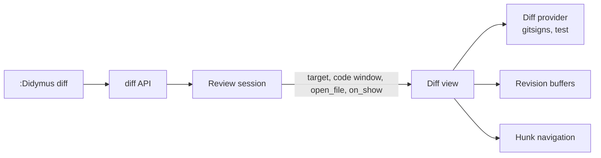
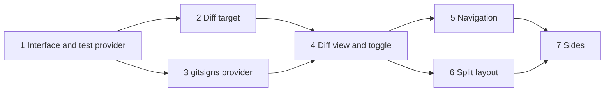

# Diff architecture

This file is the design of the `diff` epic, with gitsigns as the first diff provider. Read it before you work on the epic. Record changes to the design here.

## Scope

The MVP shows the diff of the change on the real file, in the review tabpage:

- Show or hide the diff.
- Show the diff inline, or base and head side by side.
- Show only the base side, only the head side, or both sides.
- Go to the next or the previous hunk, also in the next file.
- Get the base and the head from the review. In the MVP, a GitHub PR gives them: the merge-base and the current checkout.

These features come later:

- Local diffs: unstaged against staged, staged against `HEAD`, a commit against a commit. A `local` review provider gives them. See [Post-MVP tasks](#post-mvp-tasks).
- Diff tools that open their own tabpage, such as codediff and diffview. See [External providers](#external-providers).
- Threads on the base side, in the base view.

The diff in the preview of the files panel came after the MVP. See [Preview](#preview).

## Requirements

| ID | Requirement |
| --- | --- |
| D1 | The diff is display and navigation only. The patch of the code host decides which lines are commentable. |
| D2 | The core does not depend on one diff tool. A diff provider connects it to a tool, as a review provider connects it to a code host. |
| D3 | The diff shows only in the review tabpage. A provider must not change the diff state of a window outside it. |
| D4 | The diff follows the code window: after `<CR>` in the panel, `gd`, `gf` or `:e` to a file of the change, the diff shows for that file. |
| D5 | The layout is `inline` or `split`. The sides are `both`, `base` or `head`. The review session keeps them. |
| D6 | `next` and `prev` go to the hunks of the diff provider, in the order of the panel, also in other files. They do not wrap. |
| D7 | The review gives a diff target: the base, the head, and the files. The diff part does not know about code hosts. |
| D8 | All calls to git and to the diff tool are async. The UI does not block. |
| D9 | A user can give a provider table, as for the review provider and the picker. |

## Research

The facts in this section were checked on 2026-11-15 in the source of each plugin.

| Plugin | Commit | Kind |
| --- | --- | --- |
| gitsigns.nvim | `fd78092` (2026-10-13) | Marks on the real buffer. |
| codediff.nvim (was vscode-diff.nvim) | `eee54e7` (2026-11-13) | Its own tabpage, with an explorer. |
| diffview.nvim | `4516612` (2024-06-13) | Its own tabpage, with a file panel. No commits since 2024. |
| lazygit.nvim | `9ffc610` (2026-09-19) | The lazygit TUI in a float. |

### Compare the tools

| Need | gitsigns | codediff | diffview | lazygit.nvim |
| --- | --- | --- | --- | --- |
| Base is a commit, head is the real file | `change_base(sha)`, for the current buffer only | `:CodeDiff file <sha>`. The working buffer stays editable. | `:DiffviewOpen <a>...<b> --imply-local` | No. You select the diff in the TUI. |
| Index and commits as head | `show(":0:path")` gives an index buffer. `nav_hunk` has `target = "staged"`. | `--staged`, `:CodeDiff file <a> <b>` | `--cached`, `<a>..<b>` | In the TUI only. |
| Inline | `diffthis(base, { unified = true })`. Deleted lines show in the window. | `diff.layout = "inline"` | No | No |
| Side by side | `diffthis(base, { vertical = true })` opens a split. Native diff mode also works. | `diff.layout = "side-by-side"` (default) | `diff2_horizontal` (default) | No |
| Hunks of a buffer | `get_hunks(buf)`: `added` and `removed`, each with `start` and `count`. | Internal only. | Native diff mode (`]c`). | No |
| Next and previous hunk | `nav_hunk("next"\|"prev", opts, cb)` | `next_hunk()`, `prev_hunk()`, `next_file()`, `prev_file()` | `]c`, `[c`, and `select_next_entry` for files | No |
| Windows | None for inline. `diffthis` opens one split. | A new tabpage. | A new tabpage. | A float. |
| Fit for didymus | Buffer provider. MVP. | External provider. A buffer provider is possible with its internal renderer. | External provider. | External provider that only opens the TUI. |

### gitsigns API facts

The notebook [`agents/expertise/gitsigns.md`](../../agents/expertise/gitsigns.md) has these facts, each with a proof. Task 3 corrected facts 2, 3 and 7.

1. `change_base(base, global, cb)` acts on the current buffer. It has no buffer argument. So call it in `nvim_buf_call()`. `async.run()` starts the task at once, so the task reads the buffer before it yields.
2. `change_base(nil)` sets the index as the base, not the `base` of the gitsigns config. So `detach` uses `config.base`. The signs of a buffer show in all windows, also outside the review tabpage, until then.
3. `diffthis(base, { unified = true })` shows the deleted lines in the current window. A second call closes the view. The public API cannot tell if a view is open, and cannot close a view after the window shows a different buffer.
4. The unified view uses `nvim__ns_set()` with only its window. It closes on `WinClosed`, and on `BufWinLeave` only if no other window shows the buffer. So didymus shows it again after the code window shows a new buffer.
5. `toggle_linehl()`, `toggle_word_diff()` and `toggle_signs()` change the global config. didymus must not call them (D3).
6. `toggle_deleted()` and the option `show_deleted` are deprecated. Use the unified view.
7. The `cb` of `change_base()` is not a signal that the hunks are ready. If an update runs, `cb` comes before the new hunks. An update that reads the base text during `change_base()` keeps the text of the old base. `User GitSignsUpdate` has a buffer in its data, but it fires only when the status changes.
8. gitsigns computes the hunks only for a buffer in a window of the current tabpage.

## Parts



| Part | Owns | Does not |
| --- | --- | --- |
| Review session | The diff target, the code window, the diff view of the review. It opens files, and checks the local changes. | Know about diff providers. |
| Diff view | The state (on, layout, sides), the base window, the revision buffers, the attached buffers. It calls the provider. | Know about code hosts or threads. |
| Diff provider | The marks of the diff on the buffers and windows that it gets, and the hunks of a buffer. | Open, close or focus windows. Change state outside the windows that it gets. |
| Revision buffers | Read-only buffers with `git show <sha>:<path>`. | Know about providers. |
| Hunk navigation | The next or the previous hunk from a cursor. | Use editor state. |

The diff view gets a target, not a change. So a later `local` review provider can give a target with the index or the working tree, with no change to the diff part.

## Modules

```text
lua/didymus/
  diff/
    init.lua               public API: toggle, layout, side, next, prev
    view.lua               the diff view of one review
    target.lua             the types Revision, Target, File, and their checks
    revision.lua           revision buffers, async, with git show
    hunks.lua              pure: find the next or the previous hunk, map a line to the other side, the hunks of a deleted file
    provider/init.lua      the provider interface and get(spec)
    provider/gitsigns.lua  the gitsigns provider
    provider/test.lua      a provider with no tool, for tests
  review/
    diff_target.lua        pure: make the diff target of a review session
  command.lua              the diff group of :Didymus
  config.lua               the diff options
  health.lua               the didymus diff section
plugin/didymus.lua         the <Plug>(didymus-diff-…) mappings
tests/unit/didymus/diff/   hunks, target
tests/e2e/diff/            the flows, with the test provider
tests/integration/diff/    the gitsigns provider and the diff view, with the real gitsigns
```

Calls go in one direction: `command` → `diff/init` → `review` (for the current session) → `diff/view` → the provider.

- `diff/` does not require `review/`. The review session gives the diff view a target and three functions: `get_code_win()`, `open_file(path, line, opts)` and `on_show()`. With `opts.keepjumps`, `open_file()` does not change the jumplist and the alternate file. With `opts.buf`, it shows that buffer in place of the file, such as the base buffer of a deleted file.
- The files panel calls `View:open_deleted_file(path)` for `<CR>` on a deleted file. See [Deleted files](#deleted-files).
- The files panel calls `session:preview_diff(win, ready)` after each preview, and the session calls `set_preview(win, ready)` of the diff view. See [Preview](#preview).
- The diff view calls `on_show()` each time the diff shows. The session checks the local changes in it, one time for each review.
- `diff/init.lua` gets the diff view from `require("didymus.review").current()`. This is the only link from `diff/` to `review/`.
- Providers can use `diff/hunks.lua` and `diff/target.lua`. They do not use `diff/view.lua`.

## Interfaces

```lua
---@alias didymus.diff.Layout "inline"|"split"
---@alias didymus.diff.Sides "both"|"base"|"head"

---@class didymus.diff.Revision
---@field kind "commit"|"index"|"worktree"
---@field sha string? Only for "commit".

---@class didymus.diff.File
---@field path string        The head path, relative to `Target.cwd`.
---@field base_path string?  The base path of a renamed file. Default `path`.
---@field status "added"|"modified"|"deleted"|"renamed"

---@class didymus.diff.Target
---@field cwd string
---@field base didymus.diff.Revision
---@field head didymus.diff.Revision
---@field files didymus.diff.File[] In the order of the panel.

--- 1-based lines. For a deletion, `head.count` is 0 and `head.start` is the line before the deleted
--- lines, as in a unified diff. It is 0 at the start of the file. The same applies to `base`.
---@class didymus.diff.Hunk
---@field kind "add"|"change"|"delete"
---@field base { start: integer, count: integer }
---@field head { start: integer, count: integer }

--- The windows and buffers that the provider decorates. The diff view makes them.
---@class didymus.diff.Display
---@field layout didymus.diff.Layout
---@field sides didymus.diff.Sides
---@field file didymus.diff.File
---@field target didymus.diff.Target
---@field head_win integer?  The code window with the head buffer. Nil if the sides are "base".
---@field head_buf integer?  The attached head buffer, which has the hunks. Also for "base", when it is hidden. Nil for a deleted file.
---@field base_win integer?  The window with the base revision buffer. The code window if the sides are "base", except for a deleted file in the split layout.
---@field base_buf integer?  Nil for inline "both" and for "head".

---@class didymus.diff.Capabilities
---@field layouts table<didymus.diff.Layout, boolean>
---@field sides table<didymus.diff.Sides, boolean>
---@field bases table<"commit"|"index"|"worktree", boolean>  The base revisions that `attach` accepts.
---@field heads table<"commit"|"index"|"worktree", boolean>  The head revisions that `attach` accepts.

--- All async methods take a final `cb(err)` and do not block the UI.
---@class didymus.diff.Provider
---@field capabilities didymus.diff.Capabilities
---@field attach fun(self, buf: integer, file: didymus.diff.File, target: didymus.diff.Target, cb: fun(err: string?)) Compute the hunks of the head buffer against the base. Call `cb` when `hunks()` has them.
---@field detach fun(self, buf: integer) Remove the diff state of the buffer. Put back the state from before `attach`.
---@field hunks fun(self, buf: integer): didymus.diff.Hunk[]? Nil before `attach` calls its `cb`.
---@field render fun(self, display: didymus.diff.Display, cb: fun(err: string?)) Show the diff in the windows of `display`.
---@field clear fun(self, win: integer) Remove the diff from the window.
---@field health fun() Report the dependencies with `vim.health`.
```

A provider obeys these rules:

1. Do not open, close or focus windows. The diff view owns them.
2. Decorate only the windows and buffers that `render()` gets. Scope window marks with `nvim__ns_set()`, as the threads do.
3. Buffer state, such as the gitsigns base, is permitted. `detach()` puts it back.
4. Call each `cb` in the main loop, one time.
5. Do not decide which lines are commentable (D1).
6. A deleted file has no head buffer. Its display has the `base` sides and no `head_buf`. Mark all lines of the base buffer, with the hunks of `hunks.get_deleted_file_hunks()`.

`diff.provider` in the config is `"gitsigns"` (the default), `"test"` or a provider table. `require("didymus.diff.provider").get(spec)` gives the provider, as `review.provider` does.

`didymus.diff.target` has the checks `check_revision()`, `check_file()` and `check_target()`. Each one gives an error message or nil. They do not raise an error, because a provider table of a user can give the data. A `sha` is necessary for a `"commit"` revision, and not permitted for other kinds. `base_path(file)` gives `file.base_path or file.path`.

### The diff target of a review

`review/diff_target.lua` makes the target from the review session:

| Field | MVP value |
| --- | --- |
| `cwd` | `session.cwd` |
| `base` | `{ kind = "commit", sha = session.merge_base }`. With no merge-base, the diff is not available, and a warning tells why. |
| `head` | `{ kind = "worktree" }`, because the MVP reviews in the current checkout at the change head. |
| `files` | `change.files`, with `base_path` from a new field `ChangedFile.old_path`. |

1. A provider can set `change.diff = { base = Revision, head = Revision }`. Then the target uses them. The `local` review provider uses this later. The GitHub provider does not set it.
2. GitHub REST gives `previous_filename` for a renamed file. The GitHub provider puts it in `ChangedFile.old_path`.
3. If `HEAD` is not the change head, or a file of the change has local changes, the diff shows them too. A warning shows once for each review, because the diff then is not the diff of the code host. See [Show](#show).

`make(session)` gives the target, or nil and an error with no `didymus:` prefix. The diff view adds the prefix when it shows the warning.

- With no merge-base and no `change.diff`, the error is `the diff is not available: git found no merge-base of <base> and <head>`, with 7 characters of each sha. The open flow already showed the error of git.
- `change.diff` does not need a merge-base.
- `make()` checks the target with `check_target()`, because a provider table of a user can give a wrong `change.diff`.
- The GitHub provider sets `old_path` for each file with `previous_filename`, also for a copied file.
- The target has its own tables. Fields such as `patch` stay in the review (D7).

## API and commands

```lua
local diff = require("didymus.diff")
diff.toggle()                     -- show or hide the diff
diff.layout({ layout = "split" }) -- with no layout, change to the other layout
diff.side({ side = "base" })      -- with no side, go to the next: both, head, base
diff.next()                       -- the next hunk, also in the next file
diff.prev()
```

| Command | Action |
| --- | --- |
| `:Didymus diff toggle` | Show or hide the diff in the review tabpage. |
| `:Didymus diff layout [inline\|split]` | Set the layout. With no argument, change to the other layout. |
| `:Didymus diff side [both\|base\|head]` | Set the sides. With no argument, go to the next sides: `both`, `head`, `base`. |
| `:Didymus diff next` | Go to the next hunk of the diff provider. At the last hunk of a file, go to the first hunk of the next file. |
| `:Didymus diff prev` | Go to the previous hunk. At the first hunk of a file, go to the last hunk of the previous file. |

| `<Plug>` mapping | Action |
| --- | --- |
| `<Plug>(didymus-diff-toggle)` | `toggle` |
| `<Plug>(didymus-diff-layout)` | Change to the other layout. |
| `<Plug>(didymus-diff-layout-inline)`, `<Plug>(didymus-diff-layout-split)` | Set the layout. |
| `<Plug>(didymus-diff-side)` | Go to the next sides. |
| `<Plug>(didymus-diff-side-both)`, `-base`, `-head` | Set the sides. |
| `<Plug>(didymus-diff-next)`, `<Plug>(didymus-diff-prev)` | `next`, `prev` |

There are no default keymaps.

The config defaults:

```lua
diff = {
  provider = "gitsigns", -- "gitsigns", "test" or a provider table. See lua/didymus/diff/provider/.
  enabled = true,        -- The diff shows when a review opens.
  layout = "inline",     -- "inline" or "split"
  sides = "both",        -- "both" or "head". Only `:Didymus diff side base` shows the base side.
  split = { width = 0.5 }, -- The width of the base window. Below 1, a fraction of the code window.
}
```

`diff` is a top-level key, next to `agent` and `review`, because it is a separate epic.

## Flows

### Show

1. The diff shows when a review opens, if `diff.enabled` is true. `toggle` shows it later.
2. If `diff.provider` is unknown, or the review gives no target, a warning shows at the open and at each `toggle`. The review opens with no diff.
3. The diff view attaches the provider to the buffer of the code window, if it is a file of the target. It renders the display in `cb`.
4. An error of `attach` or `render` shows as `didymus: cannot show the diff of <path>: <err>`. Each different error shows once in a review. So a missing gitsigns gives one warning, not one for each file. See [Health check](#health-check).
5. A progress message shows if `attach` takes more than 500 milliseconds.
6. In a different tabpage, `toggle` goes to the review tabpage first. With no review, a warning shows: `didymus: no review is open`.
7. At the first show in a review, the session runs `git status` async. If `HEAD` is not the change head, or a file of the change has uncommitted changes, a warning tells it. Changes in other files do not count. Edits after the check give no warning (decision 8).

### Follow the code window

1. On `BufWinEnter` in the code window, the diff view clears the old display. If the new buffer is a file of the target, it attaches and renders again.
2. The diff view attaches only when the review tabpage is current (fact 8). On `TabEnter`, it checks the code window again.
3. The callbacks of an old display do nothing. For example, a slow `attach` does not render after the code window shows a different file.
4. A buffer stays attached until the diff hides or the review closes. Then the diff view detaches all buffers. So a return to a file is fast. An unloaded buffer is detached.
5. A deleted file is not in the checkout. The code window shows its base buffer, or its empty head buffer in the split layout. See [Deleted files](#deleted-files).
6. The target does not change at a refresh, because the checkout does not change. See rule 5 of [the review refresh](review.md#refresh).

### Preview

The snacks `sidebar` layout shows the preview in a float over the code window, not in the code window. For a file that is not loaded, snacks shows a copy in a scratch buffer, so gitsigns cannot attach to it. So the panel gives the preview its own previewer.

1. The files panel sets `on_preview` of the picker panel. Then the adapter shows the real buffer of the file in the preview, and calls `on_preview(item, win)` after each preview.
2. `set_preview(win)` clears the old preview display. If `win` shows a file of the target, it attaches the buffer and renders it in `win`. Only the callbacks of the newest preview apply.
3. The preview has no room for a base window, and the panel owns its buffer. So the display is `inline`, with the `head` sides if the sides are `head`, else `both`. It has `head_win` and `head_buf`, and no base window.
4. When the panel loses the focus, snacks closes the preview window, and the adapter calls `on_preview(nil, nil)`. Then the diff view clears the preview display. `WinClosed` of the preview window and a hide of the diff also clear it.
5. A preview attach shows no progress message, because each move of the cursor in the panel previews a file. Its errors show once, as in rule 4 of [Show](#show).
6. The display of the code window does not change. `next` and `prev` do not use the preview.
7. The preview window shows the file only together with its full diff. `on_preview` returns true, and the adapter hides the window in the same tick as the new buffer. `set_preview(win, ready)` calls `ready()` after the render, after an error, or when the preview display clears. Then the adapter shows the window. The gitsigns unified view blocks the redraw while it makes the deleted lines, so without this, the file shows first with only its signs.
8. A buffer stays attached, as in rule 4 of [Follow the code window](#follow-the-code-window). When the preview leaves a buffer that only it loaded, the adapter unloads it, so it keeps no LSP client. Then the diff view detaches it.
9. A header row and a deleted file show no diff in the preview.

### Hide and close

1. `toggle` of a shown diff clears all displays, closes the base window and detaches all buffers. The layout and the sides stay in the session.
2. `:Didymus review close` and `:tabclose` do the same.
3. `layout` and `side` of a hidden diff set the value and show the diff. `toggle` with the `base` sides shows the head buffer first, because the base buffers are deleted.

### Layout

1. `inline`: the code window only. The provider shows the base lines in it, for example as virtual lines.
2. `split`: the diff view opens the base window on the left of the code window, with the base revision buffer. The provider decorates both windows.
3. The base window has `'diff'`, `'scrollbind'` and `'cursorbind'` if the provider uses native diff mode. It is not the code window, so the panel and `next` do not open files in it.
4. If the code window shows a file that is not in the target, the base window closes. It opens again with the next file of the target.
5. If the user closes the base window, the layout changes to `inline`, and the message `didymus: the base window closed, so the diff layout is inline` shows.
6. The width of a new base window is `diff.split.width`. Below 1, it is a fraction of the width of the code window. The base window does not get the focus when it opens.
7. If the user shows a different buffer in the base window, the layout changes to `inline`, and a message tells it. The window stays, because it is a window of the user now. The provider removes its diff state from the window.
8. The diff view gets the base buffer with `git show`, and shows it when it is ready. It renders when the attach and the base buffer are both ready. A `git show` error shows once, as for the errors of the provider, and closes the base window.
9. The base buffers stay while the diff shows, so a return to a file is fast. The diff view deletes them when the diff hides or the review closes.
10. If the provider does not have a layout, `layout` shows `didymus: the diff provider does not have the <layout> layout`, and the layout does not change. If `diff.layout` has such a layout, the diff shows `inline`, with this warning once.
11. `:tabclose` and `review close` close the base window with no message.

The revision buffers of `diff/revision.lua` have the name `didymus://<sha7>/<path>`, `buftype=nofile`, `bufhidden=hide`, no swap file, and the filetype of the path. They are unlisted and not modifiable. `nofile` keeps LSP off, because `vim.lsp.enable()` attaches only to buffers with an empty `buftype`. gitsigns also skips them. An added file has an empty base buffer, with no `git show`. A deleted file has an empty head buffer, `didymus://deleted/<path>`, for the split layout. A renamed file uses its base path.

### Sides

1. `both` uses the layout.
2. `head` shows only the code window, with the marks of the added and changed lines, such as signs. It ignores the layout.
3. `base` shows the base revision buffer in the code window, with the marks of the deleted lines. It ignores the layout. The base buffer is read-only, has the filetype of the file, and has no LSP.
4. `next` and `prev` keep the `base` sides. They use the base lines of the hunks, and open the base buffer of the next file.
5. Any other buffer in the code window ends the `base` sides. Then the sides go back to the value before `base`. So `<CR>` in the panel and `review next` open the head file at the head line, as before. The base buffer of any file of the target keeps the `base` sides, so `<C-o>` to an older base buffer works.
6. A comment needs the head file, so `review comment` on a base buffer shows `didymus: the current window shows the base of <path>. A comment needs the head side.` Threads do not show on the base buffer in the MVP.
7. A change of the sides puts the cursor at the matching line of the other side, with `hunks.map_line()`. It does not change the jumplist.
8. The diff view shows the base buffer with `:keepjumps keepalt hide buffer`. So the head buffer stays loaded and attached, also with `'nohidden'`. The display of the `base` sides has this `head_buf`, and no `head_win`.
9. `base` needs a file of the target in the code window. Else, `didymus: the code window does not show a file of the diff` shows, and the sides do not change.
10. `diff.sides` accepts only `both` and `head`, because the `base` sides are temporary. With a different value, a warning shows when the review opens, and the diff shows `both`.
11. If the provider does not have the sides, `side` shows `didymus: the diff provider does not have the <sides> sides`, and the sides do not change.
12. `head` and `base` close the base window of the split layout. The layout stays `split`, so `both` opens the base window again.

### Navigation

`diff/hunks.lua` finds the stop. `diff/view.lua` moves the cursor. The rules follow [the review navigation](review.md#navigation).

1. The stop of a hunk is its first head line, or its first base line with the `base` sides. A deletion stops at the line after the deleted lines, or at line 1. A deletion at the end of the file stops at the last line, as in rule 5 of the review navigation.
2. With no hunk after the cursor, `next` goes to the next file of the target that has hunks, at its first hunk. It opens the file with `open_file()` of the review, waits for `attach`, then moves the cursor. `prev` does the same backward, at the last hunk.
3. A file with no hunks, such as a binary file, has no stops. A deleted file has one stop, at base line 1. See [Deleted files](#deleted-files).
4. With the `base` sides, `next` and `prev` use the base lines in the code window. In a different file, they open the head file with `keepjumps` to get its hunks, as in rule 10. Then the code window shows the base buffer of the stop, and the jumplist gets only the start position. The head files on the way do not end the `base` sides.
5. In the base window of the split layout, `next` and `prev` move the cursor in the base window, with the base lines. The stops are in the order of the base lines. In a different file, the code window goes to the head stop of the hunk, as in rule 11. Then the base window shows the new base buffer, its cursor goes to the base stop, and it gets the focus. Only a jump in the same file adds the old position to the jumplist of the base window. A jump to a different file changes the base buffer with `keepjumps`, because `<C-o>` to an old base buffer would end the split layout (rule 7 of [Layout](#layout)).
6. Each jump adds the old position to the jumplist.
7. At the last or the first stop, `didymus: no next hunk` or `didymus: no previous hunk` shows, and the cursor does not move.
8. A hidden diff has no hunks, so `next` shows `didymus: the diff is hidden`. If the diff is not available, `next` shows why.
9. `next` and `prev` move the cursor in the code window, also from the panel or a split, because only the code window has the diff (decision 10).
10. With no file of the target in the code window, `next` goes to the first stop, and `prev` goes to the last stop.
11. To get the hunks of a file, `next` opens it with `keepjumps` and waits for `attach`. A buffer that is attached and ready gives its hunks with no open. At the stop, the code window shows the start position again with `:keepjumps buffer`. Then `open_file()` opens the file of the stop. So the jumplist gets one entry: the start position.
12. If no file after the cursor has hunks, the code window shows the start position again with `keepjumps`, and the message of rule 7 shows.
13. An error of `attach` stops the jump at that file, and shows each time. `next` is a command of the user, so each one gives a message. The display of the diff shows each error only once.
14. The newest `next` or `prev` wins. The callbacks of an old jump do nothing. A jump also stops if the code window shows a different buffer, or the user goes to a different tabpage, while it waits for `attach`.
15. `:Didymus review next hunk` does not change. It uses the hunks of the patch of the code host, which are the commentable blocks. `diff next` uses the hunks of the diff provider, which are each change.

`hunks.next(hunks, opts)` and `hunks.prev(hunks, opts)` take `opts = { line, side, line_count }`. `side` is `"head"` or `"base"`. They give the line of the stop and its hunk, or nil.

- `next` gives the first stop after `line`. `prev` gives the last stop before `line`. So in a hunk, `prev` goes to the stop of that hunk.
- The hunks do not have to be in order.
- `hunks.stop(hunk, side, line_count)` gives the stop of one hunk. The stop is in the range 1 to `line_count`.
- `hunks.map_line(hunks, { line, side, line_count })` gives the line on the other side that matches `line` on `side`. `line_count` is the number of lines on the other side. A line moves by the line counts of the hunks before it. A line in a hunk goes to the same line of the hunk on the other side, or to its last line. If the hunk has no lines on the other side, the line goes to its stop. The split layout does not use it, because native diff mode binds the cursors.

`nvim_win_set_buf()` adds the old position to the jumplist. `:keepjumps edit` and `:keepjumps buffer` do not. See [the Neovim notebook](../../agents/expertise/neovim.md#windows).

### Deleted files

A deleted file is not in the checkout, so it has no head buffer. The diff shows its base buffer in the code window. In the split layout with both sides, the base window shows the base buffer, and the code window shows an empty head buffer, as for an added file on the other side.

1. With the diff shown, `<CR>` on a deleted file in the panel calls `View:open_deleted_file(path)`. The view gets the base buffer with `git show`, then shows it with `open_file(path, 1, { buf = base_buf })`. So the jumplist, the focus and a closed code window act as for a head file.
2. A newer buffer in the code window wins over the open. A `git show` error shows each time, because the user gave the command.
3. With the diff hidden or not available, `<CR>` shows `didymus: <path> is deleted in <label>`, and opens nothing.
4. The diff view makes the hunks: one `delete` hunk with all base lines, from `hunks.get_deleted_file_hunks()`. The provider does not attach.
5. The base buffer of a deleted file always shows the `base` display: all lines in `DiffDelete`. `diff.sides` and the layout do not change, so the next file shows as before. With the inline layout, or the `head` or `base` sides, the code window shows the base buffer, and there is no base window.
6. In the split layout with both sides, the diff view shows the base buffer in the base window, and the empty head buffer in the code window. The display has the `base` sides, the base window as `base_win`, and no `head_win`. The provider marks only the base window, with no native diff mode. The empty head buffer is `nofile` and not modifiable.
7. A change between the two arrangements moves the base buffer, and keeps its cursor line. The focus goes with the base buffer, because the empty head buffer has no text. So `<CR>` and `next` in the split layout put the focus in the base window. A close of the base window changes the layout to `inline`, and the code window shows the base buffer.
8. `side base` on a deleted file starts the temporary `base` sides. `side both` and `side head` set the sides for the next file. The base buffer stays, and `didymus: <path> is deleted, so only its base side shows` shows. `layout` changes with no message.
9. The base buffer of a deleted file is a base buffer of the target, so it keeps the `base` sides (rule 5 of [Sides](#sides)). It does not start them.
10. `next` and `prev` stop at base line 1 of a deleted file, with all sides. From the base buffer in the code window, `next` goes to the next file with the current sides. From the base window, `next` uses the base lines, as in rule 5 of [Navigation](#navigation).
11. A hide of the diff keeps the base buffer of a deleted file in the code window, with no marks. It gets `bufhidden=wipe`, so it goes when the code window shows a different buffer or the review closes. A new show uses it again. In the split layout, the code window shows the base buffer first, and the empty head buffer is deleted.
12. `review next file`, `hunk` and `thread` skip deleted files. The panel preview of a deleted file has no location. The base buffer shows no threads (#82).

## gitsigns provider

`lua/didymus/diff/provider/gitsigns.lua`.

| Method | gitsigns call |
| --- | --- |
| `attach` | `attach({ bufnr = buf }, cb)`. Wait until gitsigns knows the buffer. Then `change_base(sha, false, cb)` in `nvim_buf_call(buf, …)`. Then wait until the hunks are against `sha`. |
| `detach` | Close the unified views that the provider opened for the buffer. `change_base(config.base)` in `nvim_buf_call(buf, …)`. |
| `hunks` | `get_hunks(buf)`, changed into `didymus.diff.Hunk`. Nil until `attach` calls `cb`. |
| `render`, inline `both` | `diffthis(sha, { unified = true })` in `nvim_win_call(head_win, …)`, if that window has no unified view. |
| `render`, `split` | Close the unified view that the provider opened in the code window. Then `:diffthis` in the base window and in the code window. The signs of the head buffer stay. |
| `render`, `head` | Close the unified view. The signs show the hunks. |
| `render`, `base` | Line highlights `DiffDelete` on the base lines of the hunks of `head_buf`, in the namespace `didymus.diff.gitsigns.base.<win>`, scoped to the window. For a deleted file, on all lines of the base buffer. `clear` removes them. |
| `clear` | Close the unified view. If the provider set `'diff'` in the window, `:diffoff`, and put back the window options. |
| `health` | See [Health check](#health-check). |

Capabilities: layouts `inline` and `split`, sides `both`, `head` and `base`, base `commit`, head `worktree`. The index and a head commit come with the local diffs.

1. `attach` calls `cb` one time. After `timeout` (5 seconds), `cb` gets an error, for example if gitsigns does not attach to an untracked file.
2. `attach` gives an error if gitsigns is not set up, or if the buffer is not in a window of the current tabpage (fact 8). The provider does not call `setup()`.
3. The `change_base()` calls of a buffer go in a queue. Each call waits until gitsigns does not compute the hunks (fact 7). Two calls at the same time can end in any order, and the last one to end sets the base.
4. A `detach` during `attach` gives the error `the buffer was detached` to the `cb` of `attach`, and puts back the base.
5. gitsigns tells if a window has a unified view. The provider keeps only the windows where it opened a view, so that `detach` does not close a view of the user (D3).

The gitsigns view of the user, such as `:Gitsigns diffthis`, can conflict with the diff view. The provider does not detect it in the MVP.

### Native diff mode

1. Neovim computes the diff of the split layout with the `'diffopt'` of the user. So it can show a hunk differently from the gitsigns hunks. `next` and `prev` use the gitsigns hunks.
2. Before `:diffthis`, the provider saves the window options that diff mode changes: `'diff'`, `'scrollbind'`, `'cursorbind'`, `'wrap'`, `'foldmethod'`, `'foldcolumn'`, `'foldenable'` and `'foldlevel'`. `clear` sets them again after `:diffoff`, because `:diffoff` does not put back `'foldenable'`. It also puts back the global `'scrollopt'`.
3. Neovim keeps the window options of each buffer. So diff mode comes back when the buffer comes back to the window, also after `clear`. The provider turns it off in `BufWinEnter`, and the diff view renders again if necessary.
4. A hidden buffer stays in the diff of the tabpage (`:h diff-mode`). So the provider runs `:diffoff` in `BufWinLeave`, while the window shows the buffer. Else, the next file compares three or more buffers, and its highlights are wrong. See [the Neovim notebook](../../agents/expertise/neovim.md#windows).
5. The provider turns off only the diff mode that it turned on. A new buffer in the window has no diff options. See [the Neovim notebook](../../agents/expertise/neovim.md#windows).
6. Diff mode folds the lines that did not change. The inline threads stay in the code window, as virtual lines. A thread on a line in a closed fold shows when the fold opens.

### Internal gitsigns calls

The public API of gitsigns cannot do some things that the diff must do. The provider calls internal modules for them. All the calls are in one set of local functions, `internal`, at the top of `diff/provider/gitsigns.lua`.

| Call | Reason |
| --- | --- |
| `require("gitsigns.cache").cache[buf]` | Tell when the hunks are against the base (fact 7). `get_hunks()` gives `{}` also while gitsigns computes the hunks. |
| `require("gitsigns.unified").get_view(win)` | Tell if a window has a unified view (fact 3). |
| `require("gitsigns.unified").close(win)` | Close the view, also after the window shows a different buffer (fact 3). |
| `require("gitsigns.config").config.base` | The base that `detach` puts back (fact 2). |

Risk: a new gitsigns version can change or remove these modules. Then:

1. Each call is in `pcall`. A failed call gives an error in the `cb` of `attach` or `render`, and the review works with no diff.
2. The health check reports a warning if a function is missing.
3. The integration tests use the pinned commit `GITSIGNS_COMMIT`. Run them after a change of the commit.

A public API in gitsigns can replace these calls later.

One race stays. If a git operation in the repo, such as a commit, starts an update during `change_base()`, the hunks can be against the old base until the next update.

## Test provider

`lua/didymus/diff/provider/test.lua` acts like a provider with no tool. It is the same idea as the test provider of the review and the test picker.

1. Tests give it the hunks of each path: `provider.hunks_by_path[path]`.
2. `attach` calls `cb` in `vim.schedule()`. `delays[path]` makes it wait.
3. `render` puts one extmark at the stop of each hunk, with the virtual text `diff <layout> <sides>`. So an end-to-end test can check the screen. It marks `head_win` with the head stops and `base_win` with the base stops.
4. Each window has its own namespace, `didymus.diff.test.<win>`, scoped to that window with `nvim__ns_set()`. So `clear(win)` removes only the marks of that window. A second window with the same buffer keeps its marks.
5. `render` uses the hunks of `display.head_buf`, also with the `base` sides. A deleted file has the hunks of `hunks.get_deleted_file_hunks()`.
6. It records each call in `provider.calls`, as plain data, such as `{ method = "attach", buf = 3, path = "a.lua" }`. `errors.attach` and `errors.render` make the next call fail.
7. Its capabilities accept all layouts, sides, bases and heads.

## External providers

codediff, diffview and lazygit.nvim open their own tabpage or float. They do not fit the buffer provider, because the threads and the LSP of the review tabpage are not in their view. They can come later as a second kind of provider:

```lua
---@class didymus.diff.ExternalProvider
---@field kind "external"
---@field open fun(self, target: didymus.diff.Target, file: didymus.diff.File?, cb: fun(err: string?)) Open the tool at the target.
---@field close fun(self)
---@field next_hunk? fun(self)
---@field prev_hunk? fun(self)
```

| Tool | `open` |
| --- | --- |
| codediff | `:CodeDiff <base_sha>...` for all files, or `:CodeDiff file <base_sha>` for one file. It has `next_hunk()` and `prev_hunk()`. |
| diffview | `:DiffviewOpen <base_sha> --imply-local --selected-file=<path>`. |
| lazygit.nvim | Opens the TUI. It cannot open at a target. |

The MVP does not build this kind. The diff view does not depend on it.

## Health check

`:checkhealth didymus` has a `didymus diff` section.

1. If `diff.provider` is not a built-in provider or a table, the section reports an error, as for `review.provider`.
2. Else, it calls `health()` of the provider.
3. The gitsigns provider reports a warning in these cases. It is a warning, not an error, because the review works with no diff. The advice tells the user to install, update or set up gitsigns, or to set `diff.provider`.
   - gitsigns is not on the `'runtimepath'`.
   - gitsigns has no unified view: `lua/gitsigns/unified.lua` is not on the `'runtimepath'`.
   - gitsigns is not set up: there is no `:Gitsigns` command.
   - A function of the [internal gitsigns calls](#internal-gitsigns-calls) is missing.

## Tests

| Part | Test |
| --- | --- |
| `diff/hunks.lua`, `review/diff_target.lua` | Unit tests. |
| Diff flows | End-to-end tests with the test provider, the test review provider and the test picker, in a temporary git repo. |
| gitsigns provider | Integration tests with the real gitsigns, in `tests/integration/diff/`. `make deps` clones gitsigns at a fixed commit, as for snacks. CI runs them. |

## Decisions

The user approved these decisions on 2026-11-15.

1. **Local diffs come from a review provider.** A `local` review provider gives unstaged, staged and commit diffs, with `change.diff`. There is no `:Didymus diff open <range>` outside a review.
2. **The diff is only in the review tabpage.** Outside a review, the commands show a warning.
3. **Words.** "Base" is the left side, and "head" is the right side, as in the glossary. The layouts are `inline` and `split`.
4. **The sides ignore the layout, except `both`.** `base` or `head` in the split layout shows one window.
5. **`base` sides are temporary.** Only `diff next` and `prev` keep them. Any other buffer in the code window ends them.
6. **Two kinds of hunk navigation.** `review next hunk` keeps the hunks of the patch. `diff next` uses the hunks of the diff provider.
7. **The diff shows by default.** `diff.enabled = true`.
8. **The diff includes local changes.** The head is the working tree. If the user edits a file, the diff shows the edit.
9. **gitsigns signs show outside the review tabpage.** `change_base()` is for each buffer, and signs show in all windows. didymus puts the base back when the diff hides or the review closes.
10. **Only the code window has the diff.** Other windows of the review tabpage with a file of the change show only the signs. Decision 39 adds the preview of the files panel.
11. **No diff in the panel preview.** The diff shows after `<CR>`. Decision 39 replaces it.
12. **gitsigns is the default provider, and an optional dependency.** With no gitsigns, the review works with no diff. The health check reports a provider that is not available. See [Health check](#health-check).
13. **The side by side of gitsigns uses native diff mode,** not `diffthis()`, because `diffthis()` opens its own window (provider rule 1).
14. **This plan replaces [#51](https://github.com/nickciaravella/didymus.nvim/issues/51).**

The user approved these decisions of task 3 on 2026-11-15.

15. **gitsigns is pinned at `fd78092`.** No tag has the unified view.
16. **The gitsigns provider calls internal gitsigns modules** for the hunks, the unified view and the base of the config, because the diff must be correct and D3 must hold. See [Internal gitsigns calls](#internal-gitsigns-calls).
17. **The capabilities of a provider list only what it does now.** Tasks 6 and 7 add `split` and `base` to the gitsigns provider.

The user approved these decisions of task 4 on 2026-11-15.

18. **The local changes warning comes at the first show of the diff in a review.** It uses `git status` and counts only the files of the change. The session does the check in `on_show()`.
19. **Each different error of the diff provider shows once in a review.**
20. **Task 4 shows only `inline` with `both` sides.** It ignores `diff.layout` and `diff.sides`. The README documents `diff.provider` and `diff.enabled`. Task 6 adds `diff.layout` and `diff.split` to the README, and task 7 adds `diff.sides`.
21. **The target stays the target of the open,** also after a refresh.

The user approved these decisions of task 5 on 2026-11-15.

22. **`next` and `prev` use only the code window.** See rule 8 of [Navigation](#navigation).
23. **`next` opens a file to get its hunks, and skips a file with no hunks.** The jumplist gets only the start position (rule 10).
24. **With no stop, the cursor goes back to the start position** (rule 11).
25. **An attach error at a jump shows each time** (rule 12).
26. **Rule 4 of [Navigation](#navigation) is a part of task 6.**

The user approved these decisions of task 6 on 2026-11-15.

27. **The base buffers are `didymus://<sha7>/<path>`**, and the diff view deletes them when the diff hides.
28. **A different buffer in the base window ends the split layout,** as a close of the base window does. See rules 5 and 7 of [Layout](#layout).
29. **A provider without a layout gives a warning,** and the layout does not change (rule 10).
30. **`next` and `prev` in the base window use the base lines,** and go to the base window of the next file (rule 4 of [Navigation](#navigation)).
31. **Task 7 adds the map of a line to the other side.** The split layout uses the cursor binding of native diff mode.
32. **The diff of native diff mode can be different from the gitsigns hunks.** See [Native diff mode](#native-diff-mode).

The user approved these decisions of task 7 on 2026-11-15.

33. **The display of the `base` sides has `head_buf`,** the attached head buffer, and no `head_win`. So the provider knows which buffer has the hunks.
34. **The base buffer shows with `:hide buffer`,** so the head buffer keeps its hunks, also with `'nohidden'` (rule 8 of [Sides](#sides)).
35. **A change of the sides does not change the jumplist.** `next` and `prev` with the `base` sides add only the start position.
36. **A base buffer of a file of the target keeps the `base` sides.** Other buffers end them (rule 5 of [Sides](#sides)).
37. **`diff.sides` accepts only `both` and `head`** (rule 10 of [Sides](#sides)).
38. **The gitsigns `base` marks are `DiffDelete` line highlights** on all base lines of the hunks.

The user approved these decisions of [#81](https://github.com/nickciaravella/didymus.nvim/issues/81) (deleted files) on 2026-11-18.

39. **The diff view makes the hunks of a deleted file:** one `delete` hunk with all base lines. The display has no `head_buf`.
40. **A deleted file always shows the `base` display,** and does not change `diff.sides` or the layout.
41. **`side both` and `side head` on a deleted file** set the sides for the next file, keep the base buffer, and show a message.
42. **The base buffer of a deleted file keeps the `base` sides,** but does not start them.
43. **`<CR>` on a deleted file acts as `<CR>` on a head file,** with `open_file()` and `opts.buf`.
44. **`next` and `prev` stop at base line 1 of a deleted file.**
45. **A hide keeps the base buffer of a deleted file in the code window,** with `bufhidden=wipe`.
46. **`review next`, the panel preview and the threads do not change** for deleted files.

The user asked for these changes after the manual test of #81 on 2026-11-19.

47. **The split layout shows a deleted file in two windows:** the base buffer on the left, and an empty head buffer on the right. The focus goes with the base buffer.
48. **The gitsigns provider runs `:diffoff` in `BufWinLeave`,** so that a hidden buffer leaves the diff. Before, each split diff after the first one also compared the hidden buffers of the files before it.

The user approved these decisions of [#84](https://github.com/nickciaravella/didymus.nvim/issues/84) on 2026-11-18.

49. **The preview of the files panel shows the diff.** It shows the real buffer of the file, because gitsigns cannot attach to the copy of snacks. See [Preview](#preview).
50. **A buffer that only the preview loaded unloads when the preview leaves it.** It keeps no LSP client. A buffer that a window shows, or that the user opened, stays. The cleanup of snacks deletes only its own buffers, and only when the preview window closes.
51. **The preview is always `inline`.** It keeps the `head` sides. The `base` sides and the `split` layout show `both`.
52. **A preview attach shows no progress message.** Its errors show once.
53. **`next` and `prev` do not use the preview.** A header row and a deleted file have no preview.
54. **The preview window stays hidden until its diff shows** (rule 7 of [Preview](#preview)). A manual test showed the deleted lines about one second after the file. The user asked for this fix on 2026-11-19.

## Work plan

Each task is one GitHub issue and one pull request. Each task adds its tests and updates the docs. After each task, a person can do a manual test.



| Task | Content | Needs | Manual test |
| --- | --- | --- | --- |
| 1. [Interface and test provider](https://github.com/nickciaravella/didymus.nvim/issues/71) | `diff/target.lua`, `diff/provider/init.lua`, the `test` provider, `diff/hunks.lua` with unit tests, the `diff` config. | None | None. Tests only. |
| 2. [Diff target](https://github.com/nickciaravella/didymus.nvim/issues/72) | `review/diff_target.lua`. `ChangedFile.old_path` in the GitHub and test providers. | 1 | None. Tests only. |
| 3. [gitsigns provider](https://github.com/nickciaravella/didymus.nvim/issues/73) | `attach`, `detach`, `hunks`, inline `render`, `clear`, `health`. The `didymus diff` section of the health check. gitsigns in `make deps`. Integration tests. The gitsigns notebook. | 1 | A setup file shows the inline diff of a file. `:checkhealth didymus` with and without gitsigns. |
| 4. [Diff view and toggle](https://github.com/nickciaravella/didymus.nvim/issues/74) | `diff/view.lua` and `diff/init.lua` for the inline layout with `both` sides. `:Didymus diff toggle`. Show at the review open. Follow the code window. Hide at close. The warning for local changes. | 2, 3 | Open a real PR, go through the files, toggle. |
| 5. [Navigation](https://github.com/nickciaravella/didymus.nvim/issues/75) | `:Didymus diff next` and `prev`, across files, with the wait for `attach`. | 4 | Go through all hunks of a PR. |
| 6. [Split layout](https://github.com/nickciaravella/didymus.nvim/issues/76) | `diff/revision.lua`. The base window. `:Didymus diff layout`. `next` and `prev` in the base window. Split `render` in the gitsigns and test providers, and `split` in the capabilities of the gitsigns provider. `diff.layout` and `diff.split` in the README. | 4 | Change the layout on a few files. |
| 7. [Sides](https://github.com/nickciaravella/didymus.nvim/issues/77) | `:Didymus diff side`. The base buffer in the code window. The `head` and `base` marks. `base` in the capabilities of the gitsigns provider. `next` and `prev` with the `base` sides. `diff.sides` in the README. | 5, 6 | Look at each side of a file, then go to the next hunk. |

Task 1 can start now. After task 1, tasks 2 and 3 can go in parallel. After task 4, tasks 5 and 6 can go in parallel.

Task 1 does not add gitsigns to the built-in providers. Task 3 adds it and the health check, before task 4 shows the diff to users.

Task 1 adds the `diff` options to the config. Task 4 reads `diff.provider` and `diff.enabled`, and adds them to the README. Tasks 6 and 7 read the other options, and add them to the README.

### Post-MVP tasks

| Task | Epic | Content | Needs |
| --- | --- | --- | --- |
| [Local review provider](https://github.com/nickciaravella/didymus.nvim/issues/78) | `review` | Review the working tree against the index, the index against `HEAD`, or a commit against a commit. It sets `change.diff`. | 2 |
| [Local revisions in the diff](https://github.com/nickciaravella/didymus.nvim/issues/79) | `diff` | The index and a commit as head, in the target and in the gitsigns provider. A head commit uses a revision buffer in the code window. | #78, 7 |
| [External providers](https://github.com/nickciaravella/didymus.nvim/issues/80) | `diff` | The `external` kind, and providers for codediff and diffview. | 4 |
| [Deleted files](https://github.com/nickciaravella/didymus.nvim/issues/81) | `diff` | `<CR>` on a deleted file shows its base buffer. | 7 |
| [Base-side threads](https://github.com/nickciaravella/didymus.nvim/issues/82) | `review` | Threads on the base side show on the base buffer. | 7, [#53](https://github.com/nickciaravella/didymus.nvim/issues/53) |
| [Own renderer](https://github.com/nickciaravella/didymus.nvim/issues/83) | `diff` | A `native` provider with `vim.text.diff()` and extmarks, with no plugin. | 7 |
| [Diff in the panel preview](https://github.com/nickciaravella/didymus.nvim/issues/84) | `diff` | The preview of the files panel shows the diff. | 4 |
