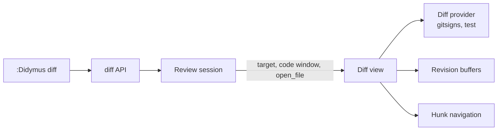
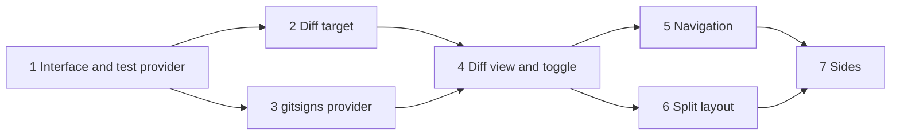

# Diff architecture

This file is the design of the `diff` epic, with gitsigns as the first diff provider. Read it before you work on the epic. Record changes to the design here.

## Scope

The MVP shows the diff of the change on the real file, in the review tabpage:

- Show or hide the diff.
- Show the diff inline, or base and head side by side.
- Show only the base side, only the head side, or both sides.
- Go to the next or the previous hunk, also in the next file.
- Get the base and the head from the review. In the MVP, a GitHub PR gives them: the merge-base and the current checkout.

These features come later:

- Local diffs: unstaged against staged, staged against `HEAD`, a commit against a commit. A `local` review provider gives them. See [Post-MVP tasks](#post-mvp-tasks).
- Diff tools that open their own tabpage, such as codediff and diffview. See [External providers](#external-providers).
- Deleted files, and threads on the base side, in the base view.

## Requirements

| ID | Requirement |
| --- | --- |
| D1 | The diff is display and navigation only. The patch of the code host decides which lines are commentable. |
| D2 | The core does not depend on one diff tool. A diff provider connects it to a tool, as a review provider connects it to a code host. |
| D3 | The diff shows only in the review tabpage. A provider must not change the diff state of a window outside it. |
| D4 | The diff follows the code window: after `<CR>` in the panel, `gd`, `gf` or `:e` to a file of the change, the diff shows for that file. |
| D5 | The layout is `inline` or `split`. The sides are `both`, `base` or `head`. The review session keeps them. |
| D6 | `next` and `prev` go to the hunks of the diff provider, in the order of the panel, also in other files. They do not wrap. |
| D7 | The review gives a diff target: the base, the head, and the files. The diff part does not know about code hosts. |
| D8 | All calls to git and to the diff tool are async. The UI does not block. |
| D9 | A user can give a provider table, as for the review provider and the picker. |

## Research

The facts in this section were checked on 2026-11-15 in the source of each plugin.

| Plugin | Commit | Kind |
| --- | --- | --- |
| gitsigns.nvim | `fd78092` (2026-10-13) | Marks on the real buffer. |
| codediff.nvim (was vscode-diff.nvim) | `eee54e7` (2026-11-13) | Its own tabpage, with an explorer. |
| diffview.nvim | `4516612` (2024-06-13) | Its own tabpage, with a file panel. No commits since 2024. |
| lazygit.nvim | `9ffc610` (2026-09-19) | The lazygit TUI in a float. |

### Compare the tools

| Need | gitsigns | codediff | diffview | lazygit.nvim |
| --- | --- | --- | --- | --- |
| Base is a commit, head is the real file | `change_base(sha)`, for the current buffer only | `:CodeDiff file <sha>`. The working buffer stays editable. | `:DiffviewOpen <a>...<b> --imply-local` | No. You select the diff in the TUI. |
| Index and commits as head | `show(":0:path")` gives an index buffer. `nav_hunk` has `target = "staged"`. | `--staged`, `:CodeDiff file <a> <b>` | `--cached`, `<a>..<b>` | In the TUI only. |
| Inline | `diffthis(base, { unified = true })`. Deleted lines show in the window. | `diff.layout = "inline"` | No | No |
| Side by side | `diffthis(base, { vertical = true })` opens a split. Native diff mode also works. | `diff.layout = "side-by-side"` (default) | `diff2_horizontal` (default) | No |
| Hunks of a buffer | `get_hunks(buf)`: `added` and `removed`, each with `start` and `count`. | Internal only. | Native diff mode (`]c`). | No |
| Next and previous hunk | `nav_hunk("next"\|"prev", opts, cb)` | `next_hunk()`, `prev_hunk()`, `next_file()`, `prev_file()` | `]c`, `[c`, and `select_next_entry` for files | No |
| Windows | None for inline. `diffthis` opens one split. | A new tabpage. | A new tabpage. | A float. |
| Fit for didymus | Buffer provider. MVP. | External provider. A buffer provider is possible with its internal renderer. | External provider. | External provider that only opens the TUI. |

### gitsigns API facts

Each task that uses one of these facts adds it to a new notebook, `agents/expertise/gitsigns.md`, with a proof.

1. `change_base(base, global, cb)` acts on the current buffer. It has no buffer argument. So call it in `nvim_buf_call()`. `async.run()` starts the task at once, so the task reads the buffer before it yields. Check this with a test.
2. `change_base(nil)` goes back to the original base. The signs of a buffer show in all windows, also outside the review tabpage, until then.
3. `diffthis(base, { unified = true })` shows the deleted lines in the current window. A second call closes the view. There is no public function that tells if the view is open, so the provider keeps the state.
4. The unified view uses `nvim__ns_set()` with only its window. It closes on `BufWinLeave` and `WinClosed`. So didymus shows it again after the code window shows a new buffer.
5. `toggle_linehl()`, `toggle_word_diff()` and `toggle_signs()` change the global config. didymus must not call them (D3).
6. `toggle_deleted()` and the option `show_deleted` are deprecated. Use the unified view.
7. `User GitSignsUpdate` has no buffer in its data. The `cb` of `change_base()` is the signal that the hunks are ready. Check this with a test.

## Parts



| Part | Owns | Does not |
| --- | --- | --- |
| Review session | The diff target, the code window, the diff view of the review. It opens files. | Know about diff providers. |
| Diff view | The state (on, layout, sides), the base window, the revision buffers, the attached buffers. It calls the provider. | Know about code hosts or threads. |
| Diff provider | The marks of the diff on the buffers and windows that it gets, and the hunks of a buffer. | Open, close or focus windows. Change state outside the windows that it gets. |
| Revision buffers | Read-only buffers with `git show <sha>:<path>`. | Know about providers. |
| Hunk navigation | The next or the previous hunk from a cursor. | Use editor state. |

The diff view gets a target, not a change. So a later `local` review provider can give a target with the index or the working tree, with no change to the diff part.

## Modules

```text
lua/didymus/
  diff/
    init.lua               public API: toggle, layout, side, next, prev
    view.lua               the diff view of one review
    target.lua             the types Revision, Target, File, and their checks
    revision.lua           revision buffers, async, with git show
    hunks.lua              pure: find the next or the previous hunk, map a line to the other side
    provider/init.lua      the provider interface and get(spec)
    provider/gitsigns.lua  the gitsigns provider
    provider/test.lua      a provider with no tool, for tests
  review/
    diff_target.lua        pure: make the diff target of a review session
  command.lua              the diff group of :Didymus
  config.lua               the diff options
  health.lua               the didymus diff section
plugin/didymus.lua         the <Plug>(didymus-diff-…) mappings
tests/unit/didymus/diff/   hunks, target
tests/e2e/diff/            the flows, with the test provider
tests/integration/diff/    the gitsigns provider, with the real gitsigns
```

Calls go in one direction: `command` → `diff/init` → `review` (for the current session) → `diff/view` → the provider.

- `diff/` does not require `review/`. The review session gives the diff view a target and two functions: `get_code_win()` and `open_file(path, line)`.
- `diff/init.lua` gets the diff view from `require("didymus.review").current()`. This is the only link from `diff/` to `review/`.
- Providers can use `diff/hunks.lua` and `diff/target.lua`. They do not use `diff/view.lua`.

## Interfaces

```lua
---@alias didymus.diff.Layout "inline"|"split"
---@alias didymus.diff.Sides "both"|"base"|"head"

---@class didymus.diff.Revision
---@field kind "commit"|"index"|"worktree"
---@field sha string? Only for "commit".

---@class didymus.diff.File
---@field path string        The head path, relative to `Target.cwd`.
---@field base_path string?  The base path of a renamed file. Default `path`.
---@field status "added"|"modified"|"deleted"|"renamed"

---@class didymus.diff.Target
---@field cwd string
---@field base didymus.diff.Revision
---@field head didymus.diff.Revision
---@field files didymus.diff.File[] In the order of the panel.

--- 1-based lines. For a deletion, `head.count` is 0 and `head.start` is the line before the deleted
--- lines, as in a unified diff. It is 0 at the start of the file. The same applies to `base`.
---@class didymus.diff.Hunk
---@field kind "add"|"change"|"delete"
---@field base { start: integer, count: integer }
---@field head { start: integer, count: integer }

--- The windows and buffers that the provider decorates. The diff view makes them.
---@class didymus.diff.Display
---@field layout didymus.diff.Layout
---@field sides didymus.diff.Sides
---@field file didymus.diff.File
---@field target didymus.diff.Target
---@field head_win integer?  The code window with the head buffer. Nil if the sides are "base".
---@field head_buf integer?
---@field base_win integer?  The window with the base revision buffer. The code window if the sides are "base".
---@field base_buf integer?  Nil for inline "both" and for "head".

---@class didymus.diff.Capabilities
---@field layouts table<didymus.diff.Layout, boolean>
---@field sides table<didymus.diff.Sides, boolean>
---@field bases table<"commit"|"index"|"worktree", boolean>  The base revisions that `attach` accepts.
---@field heads table<"commit"|"index"|"worktree", boolean>  The head revisions that `attach` accepts.

--- All async methods take a final `cb(err)` and do not block the UI.
---@class didymus.diff.Provider
---@field capabilities didymus.diff.Capabilities
---@field attach fun(self, buf: integer, file: didymus.diff.File, target: didymus.diff.Target, cb: fun(err: string?)) Compute the hunks of the head buffer against the base. Call `cb` when `hunks()` has them.
---@field detach fun(self, buf: integer) Remove the diff state of the buffer. Put back the state from before `attach`.
---@field hunks fun(self, buf: integer): didymus.diff.Hunk[]? Nil before `attach` calls its `cb`.
---@field render fun(self, display: didymus.diff.Display, cb: fun(err: string?)) Show the diff in the windows of `display`.
---@field clear fun(self, win: integer) Remove the diff from the window.
---@field health fun() Report the dependencies with `vim.health`.
```

A provider obeys these rules:

1. Do not open, close or focus windows. The diff view owns them.
2. Decorate only the windows and buffers that `render()` gets. Scope window marks with `nvim__ns_set()`, as the threads do.
3. Buffer state, such as the gitsigns base, is permitted. `detach()` puts it back.
4. Call each `cb` in the main loop, one time.
5. Do not decide which lines are commentable (D1).

`diff.provider` in the config is `"gitsigns"` (the default), `"test"` or a provider table. `require("didymus.diff.provider").get(spec)` gives the provider, as `review.provider` does.

`didymus.diff.target` has the checks `check_revision()`, `check_file()` and `check_target()`. Each one gives an error message or nil. They do not raise an error, because a provider table of a user can give the data. A `sha` is necessary for a `"commit"` revision, and not permitted for other kinds. `base_path(file)` gives `file.base_path or file.path`.

### The diff target of a review

`review/diff_target.lua` makes the target from the review session:

| Field | MVP value |
| --- | --- |
| `cwd` | `session.cwd` |
| `base` | `{ kind = "commit", sha = session.merge_base }`. With no merge-base, the diff is not available, and a warning tells why. |
| `head` | `{ kind = "worktree" }`, because the MVP reviews in the current checkout at the change head. |
| `files` | `change.files`, with `base_path` from a new field `ChangedFile.old_path`. |

1. A provider can set `change.diff = { base = Revision, head = Revision }`. Then the target uses them. The `local` review provider uses this later. The GitHub provider does not set it.
2. GitHub REST gives `previous_filename` for a renamed file. The GitHub provider puts it in `ChangedFile.old_path`.
3. If `HEAD` is not the change head, or the file has local changes, the diff shows them too. A warning shows once for each review, because the diff then is not the diff of the code host.

`make(session)` gives the target, or nil and an error with no `didymus:` prefix. The diff view adds the prefix when it shows the warning.

- With no merge-base and no `change.diff`, the error is `the diff is not available: git found no merge-base of <base> and <head>`, with 7 characters of each sha. The open flow already showed the error of git.
- `change.diff` does not need a merge-base.
- `make()` checks the target with `check_target()`, because a provider table of a user can give a wrong `change.diff`.
- The GitHub provider sets `old_path` for each file with `previous_filename`, also for a copied file.
- The target has its own tables. Fields such as `patch` stay in the review (D7).

## API and commands

```lua
local diff = require("didymus.diff")
diff.toggle()                     -- show or hide the diff
diff.layout({ layout = "split" }) -- with no layout, change to the other layout
diff.side({ side = "base" })      -- with no side, go to the next: both, head, base
diff.next()                       -- the next hunk, also in the next file
diff.prev()
```

| Command | Action |
| --- | --- |
| `:Didymus diff toggle` | Show or hide the diff in the review tabpage. |
| `:Didymus diff layout [inline\|split]` | Set the layout. With no argument, change to the other layout. |
| `:Didymus diff side [both\|base\|head]` | Set the sides. With no argument, go to the next sides: `both`, `head`, `base`. |
| `:Didymus diff next` | Go to the next hunk of the diff provider. At the last hunk of a file, go to the first hunk of the next file. |
| `:Didymus diff prev` | Go to the previous hunk. At the first hunk of a file, go to the last hunk of the previous file. |

| `<Plug>` mapping | Action |
| --- | --- |
| `<Plug>(didymus-diff-toggle)` | `toggle` |
| `<Plug>(didymus-diff-layout)` | Change to the other layout. |
| `<Plug>(didymus-diff-layout-inline)`, `<Plug>(didymus-diff-layout-split)` | Set the layout. |
| `<Plug>(didymus-diff-side)` | Go to the next sides. |
| `<Plug>(didymus-diff-side-both)`, `-base`, `-head` | Set the sides. |
| `<Plug>(didymus-diff-next)`, `<Plug>(didymus-diff-prev)` | `next`, `prev` |

There are no default keymaps.

The config defaults:

```lua
diff = {
  provider = "gitsigns", -- "gitsigns", "test" or a provider table. See lua/didymus/diff/provider/.
  enabled = true,        -- The diff shows when a review opens.
  layout = "inline",     -- "inline" or "split"
  sides = "both",        -- "both", "base" or "head"
  split = { width = 0.5 }, -- The width of the base window. Below 1, a fraction of the code window.
}
```

`diff` is a top-level key, next to `agent` and `review`, because it is a separate epic.

## Flows

### Show

1. The diff shows when a review opens, if `diff.enabled` is true. `toggle` shows it later.
2. If the provider is not available, a warning shows, and the review opens with no diff. See [Health check](#health-check).
3. The diff view attaches the provider to the buffer of the code window, if it is a file of the target. It renders the display in `cb`.
4. A progress message shows if `attach` takes more than 500 milliseconds.
5. In a different tabpage, `toggle` goes to the review tabpage first. With no review, a warning shows: `didymus: no review is open`.

### Follow the code window

1. On `BufWinEnter` in the code window, the diff view clears the old display. If the new buffer is a file of the target, it attaches and renders again.
2. A buffer stays attached until the diff hides or the review closes. Then the diff view detaches all buffers. So a return to a file is fast.
3. A deleted file is not in the checkout. It has no diff in the MVP.

### Hide and close

1. `toggle` of a shown diff clears all displays, closes the base window and detaches all buffers. The layout and the sides stay in the session.
2. `:Didymus review close` and `:tabclose` do the same.
3. `layout` and `side` of a hidden diff set the value and show the diff.

### Layout

1. `inline`: the code window only. The provider shows the base lines in it, for example as virtual lines.
2. `split`: the diff view opens the base window on the left of the code window, with the base revision buffer. The provider decorates both windows.
3. The base window has `'diff'`, `'scrollbind'` and `'cursorbind'` if the provider uses native diff mode. It is not the code window, so the panel and `next` do not open files in it.
4. If the code window shows a file that is not in the target, the base window closes. It opens again with the next file of the target.
5. If the user closes the base window, the layout changes to `inline`, and a message tells it.

### Sides

1. `both` uses the layout.
2. `head` shows only the code window, with the marks of the added and changed lines, such as signs. It ignores the layout.
3. `base` shows the base revision buffer in the code window, with the marks of the deleted lines. It ignores the layout. The base buffer is read-only, has the filetype of the file, and has no LSP.
4. `next` and `prev` keep the `base` sides. They use the base lines of the hunks, and open the base buffer of the next file.
5. Any other buffer in the code window ends the `base` sides. Then the sides go back to the value before `base`. So `<CR>` in the panel and `review next` open the head file at the head line, as before.
6. A comment needs the head file, so `review comment` on a base buffer shows a warning. Threads do not show on the base buffer in the MVP.

### Navigation

`diff/hunks.lua` finds the stop. `diff/view.lua` moves the cursor. The rules follow [the review navigation](review.md#navigation).

1. The stop of a hunk is its first head line, or its first base line with the `base` sides. A deletion stops at the line after the deleted lines, or at line 1. A deletion at the end of the file stops at the last line, as in rule 5 of the review navigation.
2. With no hunk after the cursor, `next` goes to the next file of the target that has hunks, at its first hunk. It opens the file with `open_file()` of the review, waits for `attach`, then moves the cursor. `prev` does the same backward, at the last hunk.
3. A file with no hunks, such as a binary file, has no stops.
4. In the base window of the split layout, `next` and `prev` move the cursor in the base window, with the base lines.
5. Each jump adds the old position to the jumplist.
6. At the last or the first stop, `didymus: no next hunk` shows, and the cursor does not move.
7. A hidden diff has no hunks, so `next` shows `didymus: the diff is hidden`.
8. `:Didymus review next hunk` does not change. It uses the hunks of the patch of the code host, which are the commentable blocks. `diff next` uses the hunks of the diff provider, which are each change.

`hunks.next(hunks, opts)` and `hunks.prev(hunks, opts)` take `opts = { line, side, line_count }`. `side` is `"head"` or `"base"`. They give the line of the stop and its hunk, or nil.

- `next` gives the first stop after `line`. `prev` gives the last stop before `line`. So in a hunk, `prev` goes to the stop of that hunk.
- The hunks do not have to be in order.
- `hunks.stop(hunk, side, line_count)` gives the stop of one hunk. The stop is in the range 1 to `line_count`.
- The map of a line to the other side is not in `hunks.lua` yet. Task 6 or task 7 adds it.

## gitsigns provider

`lua/didymus/diff/provider/gitsigns.lua`.

| Method | gitsigns call |
| --- | --- |
| `attach` | Wait for gitsigns to attach to the buffer (`attach(buf, cb)`). Then `change_base(sha, false, cb)` in `nvim_buf_call(buf, …)`. |
| `detach` | `change_base(nil)` in `nvim_buf_call(buf, …)`. Close the unified view of the buffer. |
| `hunks` | `get_hunks(buf)`, changed into `didymus.diff.Hunk`. |
| `render`, inline `both` | `diffthis(sha, { unified = true })` in `nvim_win_call(head_win, …)`, if the provider has no unified view on that window. |
| `render`, `split` | `:diffthis` in the base window and in the code window. The signs of the head buffer stay. |
| `render`, `head` | Nothing more. The signs show the hunks. |
| `render`, `base` | Line highlights `DiffDelete` on the base buffer, from the `base` ranges of `hunks()`, in a namespace scoped to the window. |
| `clear` | Close the unified view, or `:diffoff` in the window. |
| `health` | gitsigns is on the `'runtimepath'`, and `diffthis` accepts `unified`. |

Capabilities: layouts `inline` and `split`, all sides, base `commit`, head `worktree`. The index and a head commit come with the local diffs.

The gitsigns view of the user, such as `:Gitsigns diffthis`, can conflict with the diff view. The provider does not detect it in the MVP.

## Test provider

`lua/didymus/diff/provider/test.lua` acts like a provider with no tool. It is the same idea as the test provider of the review and the test picker.

1. Tests give it the hunks of each path: `provider.hunks_by_path[path]`.
2. `attach` calls `cb` in `vim.schedule()`. `delays[path]` makes it wait.
3. `render` puts one extmark at the stop of each hunk, with the virtual text `diff <layout> <sides>`. So an end-to-end test can check the screen. It marks `head_win` with the head stops and `base_win` with the base stops.
4. Each window has its own namespace, `didymus.diff.test.<win>`, scoped to that window with `nvim__ns_set()`. So `clear(win)` removes only the marks of that window. A second window with the same buffer keeps its marks.
5. With the `base` sides, the display has no head buffer. Then `render` uses the hunks of an attached buffer of `display.file`.
6. It records each call in `provider.calls`, as plain data, such as `{ method = "attach", buf = 3, path = "a.lua" }`. `errors.attach` and `errors.render` make the next call fail.
7. Its capabilities accept all layouts, sides, bases and heads.

## External providers

codediff, diffview and lazygit.nvim open their own tabpage or float. They do not fit the buffer provider, because the threads and the LSP of the review tabpage are not in their view. They can come later as a second kind of provider:

```lua
---@class didymus.diff.ExternalProvider
---@field kind "external"
---@field open fun(self, target: didymus.diff.Target, file: didymus.diff.File?, cb: fun(err: string?)) Open the tool at the target.
---@field close fun(self)
---@field next_hunk? fun(self)
---@field prev_hunk? fun(self)
```

| Tool | `open` |
| --- | --- |
| codediff | `:CodeDiff <base_sha>...` for all files, or `:CodeDiff file <base_sha>` for one file. It has `next_hunk()` and `prev_hunk()`. |
| diffview | `:DiffviewOpen <base_sha> --imply-local --selected-file=<path>`. |
| lazygit.nvim | Opens the TUI. It cannot open at a target. |

The MVP does not build this kind. The diff view does not depend on it.

## Health check

`:checkhealth didymus` has a `didymus diff` section.

1. If `diff.provider` is not a built-in provider or a table, the section reports an error, as for `review.provider`.
2. Else, it calls `health()` of the provider.
3. The gitsigns provider reports a warning if gitsigns is not on the `'runtimepath'`, or if its `diffthis()` does not accept `unified`. It is a warning, not an error, because the review works with no diff. The advice tells the user to install gitsigns, or to set `diff.provider`.

## Tests

| Part | Test |
| --- | --- |
| `diff/hunks.lua`, `review/diff_target.lua` | Unit tests. |
| Diff flows | End-to-end tests with the test provider, the test review provider and the test picker, in a temporary git repo. |
| gitsigns provider | Integration tests with the real gitsigns, in `tests/integration/diff/`. `make deps` clones gitsigns at a fixed commit, as for snacks. CI runs them. |

## Decisions

The user approved these decisions on 2026-11-15.

1. **Local diffs come from a review provider.** A `local` review provider gives unstaged, staged and commit diffs, with `change.diff`. There is no `:Didymus diff open <range>` outside a review.
2. **The diff is only in the review tabpage.** Outside a review, the commands show a warning.
3. **Words.** "Base" is the left side, and "head" is the right side, as in the glossary. The layouts are `inline` and `split`.
4. **The sides ignore the layout, except `both`.** `base` or `head` in the split layout shows one window.
5. **`base` sides are temporary.** Only `diff next` and `prev` keep them. Any other buffer in the code window ends them.
6. **Two kinds of hunk navigation.** `review next hunk` keeps the hunks of the patch. `diff next` uses the hunks of the diff provider.
7. **The diff shows by default.** `diff.enabled = true`.
8. **The diff includes local changes.** The head is the working tree. If the user edits a file, the diff shows the edit.
9. **gitsigns signs show outside the review tabpage.** `change_base()` is for each buffer, and signs show in all windows. didymus puts the base back when the diff hides or the review closes.
10. **Only the code window has the diff.** Other windows of the review tabpage with a file of the change show only the signs.
11. **No diff in the panel preview.** The diff shows after `<CR>`.
12. **gitsigns is the default provider, and an optional dependency.** With no gitsigns, the review works with no diff. The health check reports a provider that is not available. See [Health check](#health-check).
13. **The side by side of gitsigns uses native diff mode,** not `diffthis()`, because `diffthis()` opens its own window (provider rule 1).
14. **This plan replaces [#51](https://github.com/nickciaravella/didymus.nvim/issues/51).**

## Work plan

Each task is one GitHub issue and one pull request. Each task adds its tests and updates the docs. After each task, a person can do a manual test.



| Task | Content | Needs | Manual test |
| --- | --- | --- | --- |
| 1. [Interface and test provider](https://github.com/nickciaravella/didymus.nvim/issues/71) | `diff/target.lua`, `diff/provider/init.lua`, the `test` provider, `diff/hunks.lua` with unit tests, the `diff` config. | None | None. Tests only. |
| 2. [Diff target](https://github.com/nickciaravella/didymus.nvim/issues/72) | `review/diff_target.lua`. `ChangedFile.old_path` in the GitHub and test providers. | 1 | None. Tests only. |
| 3. [gitsigns provider](https://github.com/nickciaravella/didymus.nvim/issues/73) | `attach`, `detach`, `hunks`, inline `render`, `clear`, `health`. The `didymus diff` section of the health check. gitsigns in `make deps`. Integration tests. The gitsigns notebook. | 1 | A setup file shows the inline diff of a file. `:checkhealth didymus` with and without gitsigns. |
| 4. [Diff view and toggle](https://github.com/nickciaravella/didymus.nvim/issues/74) | `diff/view.lua` and `diff/init.lua` for the inline layout with `both` sides. `:Didymus diff toggle`. Show at the review open. Follow the code window. Hide at close. The warning for local changes. | 2, 3 | Open a real PR, go through the files, toggle. |
| 5. [Navigation](https://github.com/nickciaravella/didymus.nvim/issues/75) | `:Didymus diff next` and `prev`, across files, with the wait for `attach`. | 4 | Go through all hunks of a PR. |
| 6. [Split layout](https://github.com/nickciaravella/didymus.nvim/issues/76) | `diff/revision.lua`. The base window. `:Didymus diff layout`. Split `render` in the gitsigns and test providers. | 4 | Change the layout on a few files. |
| 7. [Sides](https://github.com/nickciaravella/didymus.nvim/issues/77) | `:Didymus diff side`. The base buffer in the code window. The `head` and `base` marks. `next` and `prev` with the `base` sides. | 5, 6 | Look at each side of a file, then go to the next hunk. |

Task 1 can start now. After task 1, tasks 2 and 3 can go in parallel. After task 4, tasks 5 and 6 can go in parallel.

Task 1 does not add gitsigns to the built-in providers. Task 3 adds it and the health check, before task 4 shows the diff to users.

Task 1 adds the `diff` options to the config, but no code reads them. Task 4 adds them to the README, when the diff shows.

### Post-MVP tasks

| Task | Epic | Content | Needs |
| --- | --- | --- | --- |
| [Local review provider](https://github.com/nickciaravella/didymus.nvim/issues/78) | `review` | Review the working tree against the index, the index against `HEAD`, or a commit against a commit. It sets `change.diff`. | 2 |
| [Local revisions in the diff](https://github.com/nickciaravella/didymus.nvim/issues/79) | `diff` | The index and a commit as head, in the target and in the gitsigns provider. A head commit uses a revision buffer in the code window. | #78, 7 |
| [External providers](https://github.com/nickciaravella/didymus.nvim/issues/80) | `diff` | The `external` kind, and providers for codediff and diffview. | 4 |
| [Deleted files](https://github.com/nickciaravella/didymus.nvim/issues/81) | `diff` | `<CR>` on a deleted file shows its base buffer. | 7 |
| [Base-side threads](https://github.com/nickciaravella/didymus.nvim/issues/82) | `review` | Threads on the base side show on the base buffer. | 7, [#53](https://github.com/nickciaravella/didymus.nvim/issues/53) |
| [Own renderer](https://github.com/nickciaravella/didymus.nvim/issues/83) | `diff` | A `native` provider with `vim.text.diff()` and extmarks, with no plugin. | 7 |
| [Diff in the panel preview](https://github.com/nickciaravella/didymus.nvim/issues/84) | `diff` | The preview of the files panel shows the diff. | 4 |
