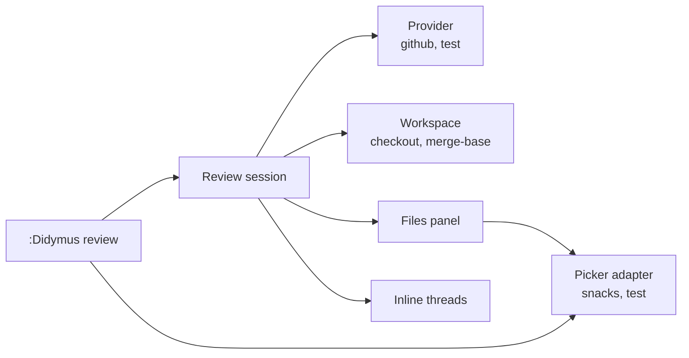
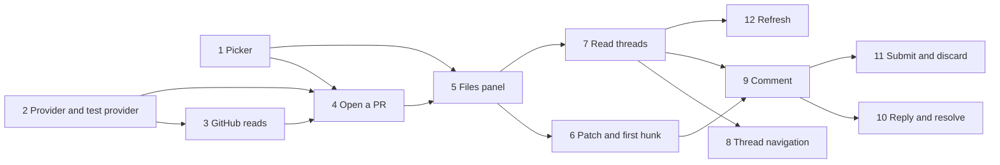

# Review architecture

This file is the design of the `review` epic, with GitHub as the first provider. Read it before you work on the epic. Record changes to the design here.

## Research

The facts in this section were checked on 2026-11-08 with `gh` 2.103.2 and the live GitHub GraphQL schema.

### Other plugins

| Plugin | What it does | Gap for didymus |
| --- | --- | --- |
| octo.nvim | PRs, threads and reviews in scratch buffers. | No real file, so no LSP. No agent. |
| snacks.gh (in snacks.nvim) | PR and issue pickers, a diff picker with comments. | Scratch buffers of the diff. No agent. |

### `gh` commands

| Need | Command | Notes |
| --- | --- | --- |
| List PRs | `gh pr list --json number,title,author,updatedAt,isDraft,headRefName,baseRefName,reviewDecision` | `--search "review-requested:@me"` gives the PRs that wait for you. |
| PR data | `gh api graphql`, one query | `id`, `title`, `body`, `url`, `state`, `baseRefOid`, `headRefOid`, `files { path changeType additions deletions viewerViewedState }`, `reviews(states: [PENDING]) { id }`. |
| Commentable lines | `gh api --paginate repos/{owner}/{repo}/pulls/{n}/files` | Only REST gives `patch`. A large or binary file has no `patch`. |
| Threads | `gh api graphql`, `reviewThreads` | `id path line startLine diffSide startDiffSide isResolved isOutdated subjectType viewerCanReply viewerCanResolve`, and `comments { id author body createdAt state }`. |
| General comments | `gh api graphql`, `comments` | Issue comments of the PR. |
| Check out the PR | `gh pr checkout <n>` | Works for fork PRs. Git refuses if a local change conflicts. |

All write actions are GraphQL mutations. Each one is in the live schema:

| Action | Mutation | Input |
| --- | --- | --- |
| Start a pending review | `addPullRequestReview` | `pullRequestId`, `commitOID`. No `event`. |
| Add a thread | `addPullRequestReviewThread` | `pullRequestReviewId`, `path`, `body`, `line`, `side`, `startLine`, `startSide`, `subjectType` (`LINE` or `FILE`). |
| Reply | `addPullRequestReviewThreadReply` | `pullRequestReviewId`, `pullRequestReviewThreadId`, `body`. |
| Resolve | `resolveReviewThread`, `unresolveReviewThread` | `threadId`. |
| Submit | `submitPullRequestReview` | `pullRequestReviewId`, `event` (`COMMENT`, `APPROVE`, `REQUEST_CHANGES`), `body`. |
| Discard | `deletePullRequestReview` | `pullRequestReviewId`. |
| Viewed | `markFileAsViewed`, `unmarkFileAsViewed` | `pullRequestId`, `path`. |

### Pickers

didymus uses a picker in two roles:

| Role | Example | Needs |
| --- | --- | --- |
| Select | The PR list. | A modal list with search and a preview. It closes on a choice. |
| Panel | The files and threads on the left. | A list that stays open while you edit in other windows. A tree. Updates in place. Custom keys. |

| Picker | Select | Panel |
| --- | --- | --- |
| snacks.picker | Yes. | Yes. The explorer is a snacks picker with `layout = { preset = "sidebar" }`, `auto_close = false`, `jump = { close = false }`, `focus = "list"` and `tree = true`. `picker:refresh()` updates it. |
| telescope, fzf-lua | Yes. | No. They are modal. |
| mini.pick | Yes. | No. It reads keys in its own loop, so you cannot edit while it is open. |
| mini.files | No. It shows real directories, not a list of items. | No. |

The MVP supports only snacks. The interface keeps the two roles apart, so that a later picker with only the select role can use a fallback for the panel.

## MVP

The MVP is a full review of a GitHub PR, from the pick to the submit, in the current checkout.

| # | Feature | Notes |
| --- | --- | --- |
| 1 | **Pick a PR.** `:Didymus review open` shows the open PRs in the picker, with the body in the preview. `open 123` or `open <url>` skips the picker. | |
| 2 | **Check out the PR.** If `HEAD` is not the PR head, didymus checks out the PR in the current repo. If there are uncommitted changes, it shows a warning and asks you to confirm first. | Workspace flow below. |
| 3 | **Review tabpage.** The review opens in a new tabpage. `:Didymus review close` closes it. | |
| 4 | **Files panel.** A header (title, author, base ← head), the changed files with status, `+`/`-` counts and thread count, and the threads under each file. `<CR>` opens the file or goes to the thread. `:Didymus review files` shows or hides the panel. | |
| 5 | **Real file at the first change.** The file opens at the first hunk of its patch. | No hunk display. |
| 6 | **Read threads.** A sign and a one-line summary at the line of each thread. `:Didymus review thread` opens the full thread in a float. | Outdated threads show only in the panel. |
| 7 | **Thread navigation.** `:Didymus review next` and `prev` go to the next and the previous thread, also in other files. | |
| 8 | **Comment.** Add a line or range comment from the input float. The comment goes into your pending review. didymus finds a pending review that you started on github.com. | Reuse `ui/input.lua`. |
| 9 | **Reply, resolve and unresolve** a thread. | |
| 10 | **Submit or discard** the review: approve, comment or request changes, with an optional body. | |
| 11 | **Refresh.** Get the PR and the threads again. | |
| 12 | **Health check.** The `didymus review` section checks the dependencies of the picker and of the provider, such as snacks and `gh`. | |

Each command has a `<Plug>(didymus-review-…)` mapping. There are no default keymaps.

### Workspace flow

The MVP uses the current checkout.

1. Get the PR head from the provider.
2. If `HEAD` is the PR head, go to step 5.
3. If there are uncommitted changes, show a warning with the changed files. Ask the user to confirm. If the user cancels, stop.
4. Check out the PR with the provider (`gh pr checkout <n>`). If git refuses, show the error and stop. Then run `:checktime`, so the open buffers show the new files.
5. Get the merge-base, and open the review tabpage.

didymus does not stash the uncommitted changes. `:Didymus review close` does not check out the branch from before the review. Its message names that branch.

Comments need the line numbers of the PR head. So didymus refuses a new comment on a file with local changes: a modified buffer, or a file that is different from `HEAD`.

## Parts



| Part | Owns | Does not |
| --- | --- | --- |
| Review session | The change, the threads, the tabpage and the order of the threads for navigation. | Call `gh` or `git`. |
| Provider | All calls to the code host, also the checkout. It changes host data into didymus types. | Open windows. Know about pickers. |
| Workspace | `HEAD`, the uncommitted changes, the confirm prompt and the merge-base. | Know about the code host. |
| Picker adapter | Show items and call back with the choice. | Know about reviews. It gets plain items. |
| Files panel | Make picker items from the review session, and the actions on them. | Draw a buffer. The picker adapter draws it. |
| Inline threads | Extmarks for the threads, and the thread float. | Call the provider. |

The picker adapter goes in `lua/didymus/ui/picker/`, because it does not know about reviews.

The MVP needs no diff provider. The patch from the code host gives the first hunk and the commentable ranges.

## Picker interface

```lua
---@class didymus.picker.Item
---@field text string           Plain text, for search and for pickers with no highlights.
---@field id? string            A stable key. `update()` uses it to keep the cursor on the same item. Default `text`.
---@field segments? [string, string?][] Text and highlight group, for pickers with highlights.
---@field depth? integer        The indent in a tree. 0 is the top level. Default 0.
---@field location? { path: string, line: integer? } A file to show in the preview.
---@field preview? { lines: string[], filetype: string? } Text to show in the preview.
---@field value any             The data that the caller gets back.

---@class didymus.picker.Action
---@field key string
---@field name string
---@field fn fun(item: didymus.picker.Item?) The item under the cursor. Nil if the panel is empty.

---@class didymus.picker.SelectOpts
---@field title string
---@field items didymus.picker.Item[]
---@field on_choose fun(item: didymus.picker.Item) The picker closes first.
---@field on_cancel? fun()

---@class didymus.picker.PanelOpts
---@field title string
---@field items fun(): didymus.picker.Item[] The panel calls it on open and on `update()`.
---@field on_choose fun(item: didymus.picker.Item) The panel stays open, and its window stays current.
---@field actions? didymus.picker.Action[] Keys in the panel, such as `R` for refresh.
---@field position? "left"|"right" Default "left".
---@field width? number Below 1, a fraction of the editor width. Else columns. Default 40.

---@class didymus.picker.Panel
---@field update fun(self) Call `items()` again and show the new items. Keep the cursor on the same item.
---@field focus fun(self)
---@field close fun(self)
---@field is_open fun(self): boolean

---@class didymus.picker.Adapter
---@field select fun(opts: didymus.picker.SelectOpts)
---@field panel fun(opts: didymus.picker.PanelOpts): didymus.picker.Panel
---@field health fun() Report the dependencies with `vim.health`.
```

1. `review.picker` in the config is `"snacks"` (the default), `"test"` or an adapter table. A table lets users add a picker with no change to didymus.
2. The health check calls `health()` of the configured adapter. The snacks adapter reports an error if `Snacks.picker` is not available.
3. The `test` adapter records the calls, and lets end-to-end tests choose an item or press the key of an action. It is the same idea as the test backend of the agent. See [`TESTING.md`](../TESTING.md#the-test-picker).
4. `on_choose` of the panel does not move the focus. The caller opens the file in its code window, because the review session owns the tabpage.
5. The panel has no preview. A preview in the sidebar shows in the code window, and changes it at each move of the cursor.
6. The keys of the actions work only in the list of the panel, not in its search input.
7. The snacks panel is a split, so it shows only in the tabpage where it opened.

## Provider interface

All methods are async. Each one takes a final `cb(err, result)` and does not block the UI.

```lua
---@class didymus.review.Provider
---@field list_changes fun(self, opts: { search: string? }, cb: fun(err: string?, changes: didymus.review.ChangeSummary[]?))
---@field get_change fun(self, id: string, cb: fun(err: string?, change: didymus.review.Change?)) Files, patches and the pending review.
---@field checkout fun(self, change: didymus.review.Change, cb: fun(err: string?)) Make the change head the current checkout.
---@field get_threads fun(self, change: didymus.review.Change, cb: fun(err: string?, threads: didymus.review.Thread[]?))
---@field add_comment fun(self, change: didymus.review.Change, draft: didymus.review.CommentDraft, cb: fun(err: string?, thread: didymus.review.Thread?)) Start a pending review if there is none.
---@field reply fun(self, change: didymus.review.Change, thread_id: string, body: string, cb: fun(err: string?))
---@field set_resolved fun(self, change: didymus.review.Change, thread_id: string, resolved: boolean, cb: fun(err: string?))
---@field submit_review fun(self, change: didymus.review.Change, verdict: "approve"|"comment"|"request_changes", body: string?, cb: fun(err: string?))
---@field discard_review fun(self, change: didymus.review.Change, cb: fun(err: string?))
---@field health fun() Report the dependencies with `vim.health`.
```

- The data types are from the [reference file](../reference/design-prompt.md#data-model): `ChangeSummary`, `Change`, `ChangedFile`, `Thread`, `Comment`, `CommentDraft` and `Range`. The task of each type examines its fields again.
- `review.provider` is `"github"` (the default), `"test"` or a provider table.
- The GitHub provider keeps all GraphQL documents as string constants in one module.
- The `test` provider keeps its changes and threads in memory. Tests give it the data. Its `checkout` runs `git checkout` in a temporary repo of the test.

## Tests

| Part | Test |
| --- | --- |
| Patch parser | Unit tests. |
| Review flows | End-to-end tests with the `test` provider and the `test` picker. |
| Workspace flow | End-to-end tests in a temporary git repo, also with uncommitted changes. |
| snacks adapter | Integration tests with the real snacks.nvim, in `tests/integration/`. `make deps` clones snacks at a fixed commit. CI runs them. |
| GitHub provider | Manual tests on a throwaway PR. [Its long-term plan](https://github.com/nickciaravella/didymus.nvim/issues/50) is a post-MVP task. |


## Work plan

Each task is one GitHub issue and one pull request. Each task adds its tests and updates the docs. After each task, a person can do a manual test.



| Task | Content | Manual test |
| --- | --- | --- |
| 1. [Picker](https://github.com/nickciaravella/didymus.nvim/issues/36) | `ui/picker/`: the interface, the `snacks` and `test` adapters, `review.picker` and `health()`. The snacks integration tests, the `make` target and CI. | A setup file shows a list and a panel in snacks. `:checkhealth didymus` without snacks shows an error. |
| 2. [Provider and test provider](https://github.com/nickciaravella/didymus.nvim/issues/37) | The types, the provider interface, `review.provider` and the `test` provider: `list_changes`, `get_change` and `checkout`. | None. Tests only. |
| 3. [GitHub reads](https://github.com/nickciaravella/didymus.nvim/issues/38) | `list_changes`, `get_change` and `checkout` for GitHub. `health()` checks that `gh` is on `$PATH` and is authenticated. | `:checkhealth didymus`. A setup file prints a real PR. |
| 4. [Open a PR](https://github.com/nickciaravella/didymus.nvim/issues/39) | `:Didymus review open [n\|url]` and `close`. The PR picker. The workspace flow, with the confirm prompt. The review tabpage. | Open a real PR from the picker and by number, also with uncommitted changes. |
| 5. [Files panel](https://github.com/nickciaravella/didymus.nvim/issues/40) | The header and the files in the panel. `<CR>` opens the real file. `:Didymus review files`. | Open files from the panel. |
| 6. [Patch and first hunk](https://github.com/nickciaravella/didymus.nvim/issues/41) | Parse the `patch` of each file into hunks and commentable ranges. The file opens at its first hunk. | Open a file. The cursor is on the first change. |
| 7. [Read threads](https://github.com/nickciaravella/didymus.nvim/issues/42) | `get_threads`. Threads under their files in the panel. Signs and summaries at the lines. The thread float. | Open a PR with comments. |
| 8. [Thread navigation](https://github.com/nickciaravella/didymus.nvim/issues/43) | `:Didymus review next` and `prev`, across files, in the order of the panel. | Go through all threads of a PR. |
| 9. [Comment](https://github.com/nickciaravella/didymus.nvim/issues/44) | Find or start the pending review. A line or range comment from the input float. Check the commentable ranges. Refuse a file with local changes. | Add a comment. It shows as pending on github.com. |
| 10. [Reply and resolve](https://github.com/nickciaravella/didymus.nvim/issues/45) | Reply, resolve and unresolve from the thread float. | Reply to a thread, resolve it, unresolve it. |
| 11. [Submit and discard](https://github.com/nickciaravella/didymus.nvim/issues/46) | `:Didymus review submit [approve\|comment\|request_changes]` with a body. `:Didymus review discard`. | Submit a review on a test PR. |
| 12. [Refresh](https://github.com/nickciaravella/didymus.nvim/issues/47) | `:Didymus review refresh`, and `R` in the panel. | Add a comment on github.com, then refresh. |

Tasks 1, 2 and 3 can start at the same time. After task 5, tasks 6 and 7 can go in parallel.

Each manual test of a GitHub feature needs a real PR. Use a throwaway PR in a test repo, because tasks 9 to 11 write to it.

### Post-MVP tasks


| Task | Epic | Content |
| --- | --- | --- |
| [Worktree workspace](https://github.com/nickciaravella/didymus.nvim/issues/48) | `review` | Review a PR in a git worktree, with no change to the current checkout. The agent of the review starts in the worktree. |
| [Mark as viewed](https://github.com/nickciaravella/didymus.nvim/issues/49) | `review` | Show the viewed state in the panel, and a key to change it. |
| [GitHub test plan](https://github.com/nickciaravella/didymus.nvim/issues/50) | `review` | Decide how to test the GitHub provider in the long term: recorded `gh` output, a real test repo, or both. |
| [Hunk display](https://github.com/nickciaravella/didymus.nvim/issues/51) | `diff` | Show the hunks against the merge-base on the real file. Keys for the next and the previous hunk. |
| [More pickers](https://github.com/nickciaravella/didymus.nvim/issues/52) | `review` | Adapters for other pickers, such as telescope or fzf-lua. A panel fallback for a picker with only the select role. |
| [More comment kinds](https://github.com/nickciaravella/didymus.nvim/issues/53) | `review` | Suggestion blocks, file-level comments and comments on deleted lines. |
| [Agent primer](https://github.com/nickciaravella/didymus.nvim/issues/54) | `agent` | A first prompt with the PR title, body and merge-base. |
