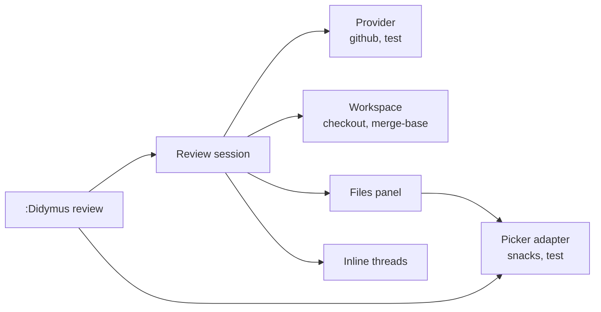
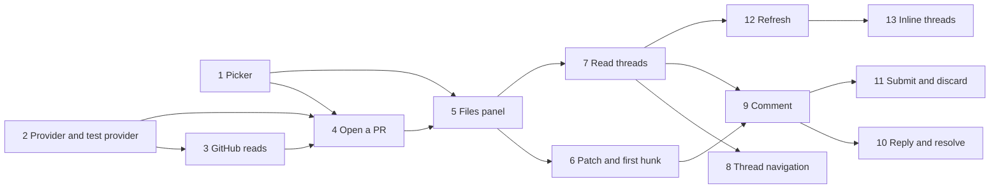

# Review architecture

This file is the design of the `review` epic, with GitHub as the first provider. Read it before you work on the epic. Record changes to the design here.

## Research

The facts in this section were checked on 2026-11-08 with `gh` 2.103.2 and the live GitHub GraphQL schema.

### Other plugins

| Plugin | What it does | Gap for didymus |
| --- | --- | --- |
| octo.nvim | PRs, threads and reviews in scratch buffers. | No real file, so no LSP. No agent. |
| snacks.gh (in snacks.nvim) | PR and issue pickers, a diff picker with comments. | Scratch buffers of the diff. No agent. |

### `gh` commands

| Need | Command | Notes |
| --- | --- | --- |
| List PRs | `gh pr list --json number,title,author,body,isDraft --limit 100` | The fields of `ChangeSummary`. `--search "review-requested:@me"` gives the PRs that wait for you. |
| PR data | `gh api graphql --paginate --slurp`, one query | `id number title body isDraft author baseRefName headRefName baseRefOid headRefOid isCrossRepository headRepositoryOwner`, `files { path changeType additions deletions viewerViewedState }`, `reviews(states: [PENDING]) { id viewerDidAuthor }`. Each page repeats the PR data. `viewerViewedState` is `VIEWED`, `UNVIEWED` or `DISMISSED`. `DISMISSED` is a viewed file with new changes. |
| Commentable lines | `gh api --paginate --slurp repos/{owner}/{repo}/pulls/{n}/files` | Only REST gives `patch`. A large or binary file, or a pure rename, has no `patch`. |
| Threads | `gh api graphql --paginate --slurp`, `node(id:)` of the PR, `reviewThreads` | `id path line startLine diffSide startDiffSide isResolved isOutdated subjectType viewerCanReply viewerCanResolve viewerCanUnresolve`, and `comments { author body state }`. A thread with more than 100 comments gets a second query, `node(id:)` of the thread. `gh` reads the first `pageInfo`, so the `pageInfo` of the threads comes before the comments. |
| General comments | `gh api graphql`, `comments` | Issue comments of the PR. |
| Check out the PR | `gh pr checkout <n>` | Works for fork PRs. Git refuses if a local change conflicts. |

All write actions are GraphQL mutations. Each one is in the live schema:

| Action | Mutation | Input |
| --- | --- | --- |
| Start a pending review | `addPullRequestReview` | `pullRequestId`, `commitOID`. No `event`. |
| Add a thread | `addPullRequestReviewThread` | `pullRequestReviewId`, `path`, `body`, `line`, `side`, `startLine`, `startSide`, `subjectType` (`LINE` or `FILE`). |
| Reply | `addPullRequestReviewThreadReply` | `pullRequestReviewId`, `pullRequestReviewThreadId`, `body`. |
| Resolve | `resolveReviewThread`, `unresolveReviewThread` | `threadId`. |
| Submit | `submitPullRequestReview` | `pullRequestReviewId`, `event` (`COMMENT`, `APPROVE`, `REQUEST_CHANGES`), `body`. |
| Submit with no pending review | `addPullRequestReview` | `pullRequestId`, `commitOID`, `event`, `body`. |
| Discard | `deletePullRequestReview` | `pullRequestReviewId`. |
| Viewed | `markFileAsViewed`, `unmarkFileAsViewed` | `pullRequestId`, `path`. A path that is not in the PR gives the error `Filepath must be part of pull request`. Both work on a merged PR. |

### Pickers

didymus uses a picker in two roles:

| Role | Example | Needs |
| --- | --- | --- |
| Select | The PR list. | A modal list with search and a preview. It closes on a choice. |
| Panel | The files and threads on the left. | A list that stays open while you edit in other windows. A tree. Updates in place. Custom keys. |

| Picker | Select | Panel |
| --- | --- | --- |
| snacks.picker | Yes. | Yes. The explorer is a snacks picker with `layout = { preset = "sidebar" }`, `auto_close = false`, `jump = { close = false }`, `focus = "list"` and `tree = true`. `picker:refresh()` updates it. |
| telescope, fzf-lua | Yes. | No. They are modal. |
| mini.pick | Yes. | No. It reads keys in its own loop, so you cannot edit while it is open. |
| mini.files | No. It shows real directories, not a list of items. | No. |

The MVP supports only snacks. The interface keeps the two roles apart, so that a later picker with only the select role can use a fallback for the panel.

## MVP

The MVP is a full review of a GitHub PR, from the pick to the submit, in the current checkout.

| # | Feature | Notes |
| --- | --- | --- |
| 1 | **Pick a PR.** `:Didymus review open` shows the open PRs in the picker, with the body in the preview. `open 123` or `open <url>` skips the picker. | |
| 2 | **Check out the PR.** If `HEAD` is not the PR head, didymus checks out the PR in the current repo. If there are uncommitted changes, it shows a warning and asks you to confirm first. | Workspace flow below. |
| 3 | **Review tabpage.** The review opens in a new tabpage. `:Didymus review close` closes it. | |
| 4 | **Files panel.** A header (title, author, base ← head), the changed files with status, `+`/`-` counts and thread count, and the threads under each file. `<CR>` opens the file or goes to the thread. `:Didymus review files` shows or hides the panel. | |
| 5 | **Real file at the first change.** The file opens at the first hunk of its patch. | No hunk display. |
| 6 | **Read threads.** A sign at the line of each thread, and the thread under the line, folded or unfolded. `:Didymus review fold` folds or unfolds it. | Outdated threads show only in the panel, and in a float. [#69](https://github.com/nickciaravella/didymus.nvim/issues/69) replaced the float for the threads with a line. |
| 7 | **Navigation.** `:Didymus review next` and `prev` go to the next and the previous thread, changed file or hunk, also in other files. | |
| 8 | **Comment.** Add a line or range comment from the input float. The comment goes into your pending review. didymus finds a pending review that you started on github.com. | Reuse `ui/input.lua`. |
| 9 | **Reply, resolve and unresolve** a thread. | |
| 10 | **Submit or discard** the review: approve, comment or request changes, with an optional body. | |
| 11 | **Refresh.** Get the PR and the threads again. | |
| 12 | **Health check.** The `didymus review` section checks the dependencies of the picker and of the provider, such as snacks and `gh`. | |

Each command has a `<Plug>(didymus-review-…)` mapping. There are no default keymaps.

### Workspace flow

The MVP uses the current checkout.

1. Get the PR head from the provider.
2. If `HEAD` is the PR head, go to step 5.
3. If there are uncommitted changes, show a warning with the changed files. Ask the user to confirm. If the user cancels, stop.
4. Check out the PR with the provider (`gh pr checkout <n>`). If git refuses, show the error and stop. Then run `:checktime`, so the open buffers show the new files.
5. Get the merge-base, and open the review tabpage.

didymus does not stash the uncommitted changes. `:Didymus review close` does not check out the branch from before the review. Its message names that branch.

These rules apply to `open` and `close`:

1. Only one review is open at a time. `open` of the open change goes to its tabpage. `open` of a different change asks to close the open review first.
2. With no argument, `open` shows the picker first. Then rule 1 applies to the choice.
3. Each question uses the select role of the picker, because `vim.fn.confirm()` blocks the UI. The items are the action and "Cancel". A close of the picker with no choice is a cancel.
4. The uncommitted changes are the tracked files with changes, staged or not. Untracked files stay after a checkout, and git refuses the checkout if one of them conflicts.
5. The question about uncommitted changes shows the files in its preview. The snacks `select` layout of the `choice` kind hides the preview. So a warning message also lists the files, and they show also after the picker closes.
6. If git cannot find the merge-base, the review opens with a warning. No MVP feature uses the merge-base yet.
7. A progress message shows while the provider works.
8. A newer `open` wins. The callbacks of an older `open` do nothing.
9. The review tabpage starts with an unlisted scratch buffer. `:tabclose` of the review tabpage also ends the review.

Comments need the line numbers of the PR head. So didymus refuses a new comment if `HEAD` is not the change head, or on a file with local changes: a modified buffer, or a file that is different from the change head. See [Comments](#comments).

### Files panel

The files panel opens with the review tabpage, in the panel role of the picker, with the `files` kind. Its title is `Review #12`. `lua/didymus/review/panel.lua` makes the items.

| Row | Text | Highlights |
| --- | --- | --- |
| Header 1 | `#12 <title>` | `Number`, `Title` |
| Header 2 | `@author main ← feature` | `Comment` |
| Header 3 | `All threads` or `Active threads`: the thread filter | `Comment` |
| File | `M path +12 -3 2 threads [viewed]`, in the order of the provider | `Added`, `Changed`, `Removed`, `Comment`. A viewed file is all `DidymusFileViewed`. `[changed]` is `DiagnosticWarn`. |
| Thread, at depth 1 under its file | `💬 @author <first line of the first comment> [pending] [outdated]`. A resolved thread has ✅. | `DidymusThread` for the author. A resolved thread is all `DidymusThreadResolved`. `[pending]` is `DidymusThreadPending`. `[outdated]` is `DiagnosticWarn`. |

1. The status letters are `A`, `M`, `D` and `R`. The full path comes before the counts. A long path can hide the counts in a narrow panel.
2. The thread count shows only if it is above 0. A count of 0 on each row makes the rows long.
3. `<CR>` on a header row does nothing. A deleted file is not in the checkout. With the diff shown, `<CR>` on it shows its base buffer in the code window. See [Deleted files](diff.md#deleted-files) of the diff. With no diff, it shows a message and opens nothing.
4. Each file row has a `location` for the preview. Its path is the full path: the path from the provider, joined to the directory of the review. `<CR>` uses the same path, so both stay correct if the current directory changes. Its line is the first change of the file, as for `<CR>`. With no hunks, the `location` has no line. A deleted file and the header rows have no `location`.
5. `<CR>` on a file opens the real file in the code window at its first change, and focuses the code window. The code window is the first window of the tabpage. If the user closed it, the file opens in a new window on the right, and that window becomes the code window. See [Patch parser](#patch-parser).
6. In the review tabpage, `:Didymus review files` shows or hides the panel. In a different tabpage, it goes to the review tabpage and shows the panel. A hidden panel is closed, so a new panel starts with the cursor on the first row.
7. `close` and `:tabclose` also close the panel.
8. If the panel cannot open, for example with no snacks.nvim, the review opens without it, and the error shows.
9. If the code window already shows the file, `<CR>` only moves the cursor. `:edit` of a modified buffer gives E37. The move goes into the jumplist, as the `:edit` of a different file does.
10. If Neovim cannot open the file, the error shows, and the focus goes back to the panel. For example, with 'nohidden', a modified buffer in the code window gives E37.
11. The thread count counts the threads of the file that show, also the outdated threads.
12. `<CR>` on a thread with a line opens its file at that line, as rule 5, and unfolds the thread. `<CR>` on a thread that shows only in the panel opens the thread float next to the panel. See [Inline threads](#inline-threads).
13. The icons of the state come from `review.icons`: `active` (default 💬) and `resolved` (default ✅). An active thread is not resolved. An empty icon shows no icon. The threads in the files use the same icons.
14. The key `review.panel.keys.toggle_active` (default `a`, false turns it off) shows only the active threads, or all threads again. The default is all threads. The session keeps the filter, also when the panel opens again. The filter does not change the marks in the files.
15. A thread row with a line has a `location` with the full path, as rule 4, and the line of the thread. A thread with no line has no `location`.
16. A viewed file has the `[viewed]` tag, and the row is dim. A file with new changes since the view (`changed`) has the `[changed]` tag, and the row is not dim. A file with no viewed state has no tag.
17. The key `review.panel.keys.viewed` (default `v`, false turns it off) marks the file at the cursor as viewed, or unmarks it. On a thread row, it uses the file of the thread. On a header row, it does nothing. A deleted file can be marked, as on github.com. No snacks or test picker default uses `v`. The key hides visual mode in the panel list, but the panel does not use a multi-select.
18. `:Didymus review viewed` and `<Plug>(didymus-review-viewed)` use the file of the current window, else the file of the code window, as `next` and `prev` do. If no window shows a file of the change, a warning shows.
19. A `viewed` file becomes `unviewed`. An `unviewed` or a `changed` file becomes `viewed`. `M.viewed()` calls `provider:set_viewed()` with a progress message. Then `Session:set_viewed()` changes the file in the session and updates the panel. If the provider fails, the error shows, and the state does not change. A refresh gets the state again from `get_change()`.
20. If the provider has no `set_viewed`, a warning shows.

### Patch parser

`lua/didymus/review/patch.lua` makes the hunks and the commentable ranges of a file from its `patch`. It does not use editor state.

```lua
---@class didymus.review.Hunk
---@field head didymus.review.Range? The lines of the hunk in the head file, also the context lines. Nil if the hunk has no head lines.
---@field base didymus.review.Range? The lines of the hunk in the base file. Nil if the hunk has no base lines.
---@field first_change integer The head line of the first added or deleted line.

---@class didymus.review.Patch
---@field hunks didymus.review.Hunk[]
---@field commentable table<didymus.review.Side, didymus.review.Range[]>? The lines that accept comments, one range for each hunk. Nil if they are unknown.
```

1. The ranges come from the hunk header, `@@ -a,b +c,d @@`. A count that the header does not give is 1. A count of 0 gives no range on that side.
2. GitHub accepts a comment on each line of a hunk, also on a context line. So each hunk gives one commentable range on each side. git does not make hunks that touch, so the ranges do not merge.
3. A file with no `patch` has no hunks, and its commentable lines are unknown. An empty `patch` has no hunks and no commentable lines.
4. `first_change` is the first added line. If deleted lines have no added lines after them, it is the head line before the deletion, as in a unified diff. At the start of the file, it is line 1.
5. The parser skips `\ No newline at end of file` and the lines before the first hunk. An empty line in a hunk is a context line.
6. The panel parses the patch when it makes the file rows and when it opens a file. There is no cache, because a refresh replaces the change.
7. The cursor goes to the first non-blank character of `first_change` of the first hunk, or to line 1 with no hunks. If the buffer is shorter, the cursor goes to the last line. The file in the checkout can be different from the change head.

### Inline threads

`lua/didymus/review/threads.lua` draws the threads in the files. `lua/didymus/review/markdown.lua` highlights markdown with the built-in treesitter parsers of Neovim 0.12 and wraps styled chunks. `lua/didymus/review/inline_box.lua` manages the embedded inline windows for focus, comments and replies, plus the bottom split for deleted files. The session keeps the fold state.

1. The review gets the threads after the review tabpage opens, with a progress message. Then the session updates the panel and the marks. On an error, the message shows and the review stays open. A close, a newer review or a newer get of the threads ignores the result. See [Refresh](#refresh).
2. A head-side thread shows in the file under the last line of its range, as on GitHub. The `<CR>` of the panel, `next` and `prev` use this line.
3. Outdated threads, threads on the base side and threads on the file show inline above line 1 (`virt_lines_above`), with no sign on line 1. On a deleted file with no buffer, `<CR>` in the panel opens a bottom split under the code window.
4. All `virt_lines` on the same `(row, above)` combine into one extmark in the namespace `didymus.review`, so Neovim keeps them in panel order. Additional threads on the same row get a tracking extmark with `id = index` so `at_cursor()` finds every thread and follows edits.
5. The session draws the marks in all loaded buffers of files with threads (or an active inline box), and again on `BufReadPost`, also after `:checktime` or `:edit!`. The close of the review removes all marks and closes any inline box.
6. The marks show only in the windows of the review tabpage, because the review buffers are the normal buffers of the user. See rule 7.
7. The scope uses `nvim__ns_set(ns, { wins = … })`. Neovim 0.12 marks it as experimental. The session gives it all windows of the review tabpage, at the start and on `WinNew`. The list is never empty, because an empty list shows the marks in all windows. If `vim.api.nvim__ns_set` does not exist, the marks show in all windows, with no error.
8. With `signcolumn=auto`, a window outside the review tabpage that shows a review buffer has an empty sign column. The sign column counts the signs of the buffer, not of the window.

#### Folds and boxes

```text
2 local count = 2
  ┌─ 💬 @octocat ────────────────────────────────────────────┐
  │ Why two?                                                 │
  ├─ @hubot [pending] ───────────────────────────────────────┤
  │ Because.                                                 │
  └─ <Space>rr reply  <Space>rx resolve  <Space>rz fold ─────┘
  local total = count * 2
  ✅ @hubot Rename this.
```

1. A folded thread is one line: the text of its panel row (with `[base]` or `[file]` for top-of-file threads).
2. An unfolded thread shows all comments in a 4-sided box (`┌─┐`, `│ │`, `├─┤`, `└─┘`), aligned to the line indent and the text width of the code window. `DidymusThreadBorder` highlights the border. A pending comment has `[pending]` after its author. Comment bodies get built-in `markdown` and `markdown_inline` treesitter highlights (plus installed parsers for fenced code blocks). A resolved thread is dim.
3. The session keeps the fold state that the user set, by thread id, so a refresh keeps it. With no state, a resolved, outdated or base-side thread is folded, and an active head-side or file-level thread is unfolded. A resolve or an unresolve removes the state, so the thread folds or unfolds with its new state.
4. `fold` folds or unfolds the threads at the cursor line, with no question, because `next` treats them as one stop. Inside a focused thread, `fold` closes focus and folds that thread. `fold all` does the same for all head-line threads of the session. With no thread, a warning shows.
5. `next thread`, `prev thread` and the `<CR>` of the panel unfold the threads at the line. `file` and `hunk` do not.
6. After an unfold at a line, the window scrolls so that the threads under the line show, if they fit. The cursor line stays in the window, also with `'scrolloff'`. `nvim_win_text_height()` counts the `virt_lines` under a line as a part of the next line.
7. The bottom border of an unfolded thread shows the keys that the user mapped to `<Plug>(didymus-review-reply)`, `<Plug>(didymus-review-resolve)`, `<Plug>(didymus-review-fold)` and `<Plug>(didymus-review-focus)`, as `keytrans()` writes them. A buffer mapping comes before a global mapping. A resolved thread shows `unresolve`. The keys show only if they fit. didymus sets no keys in the review buffers, because they are the normal buffers of the user, also in other tabpages.

#### Wrap

1. The styled chunks of a body wrap at spaces, at the inner box width. A word that is longer than a line breaks and keeps its highlight. Spaces at the start of a line stay, because they can be the indent of code. Tabs become spaces, with the `'tabstop'` of the buffer.
2. The text width is the width of the narrowest window of the review tabpage that shows the buffer, minus its `textoff`. A float, such as the preview of a picker, does not count. If no window shows the buffer, the code window gives the width.
3. Only a redraw updates the sign column, and with it the `textoff` of `getwininfo()`. So with `signcolumn=auto`, the first draw of a buffer uses a width that is 2 too large. `on_win` of a decoration provider also gets the old `textoff`, but `on_end` gets the new one.
4. So the session sets a decoration provider on the namespace. At `on_end` of each redraw of the review tabpage, it compares the text width of each buffer with an unfolded thread or inline box to the width of its last draw. If they are different, it draws the buffer again in `vim.schedule()` and syncs any open inline box.

#### Inline focus and bottom split

1. `:Didymus review focus` and `<Plug>(didymus-review-focus)` put a read-only markdown window (`relative = "win"`, `statuscolumn = " "`, 4-sided single border) into the exact `virt_lines` space of the thread, so no code hides under it. Inside it, the user can move the cursor, select text, yank, follow links and scroll long threads.
2. Leaving a read-only focused thread (`q`, `<Esc>` or `WinLeave`) closes the window and restores the `virt_lines` box.
3. `<CR>` on a top-of-file thread (outdated, base side or file level) in the panel opens the file at line 1 and focuses the thread inline above line 1. On a deleted file with no buffer, it opens a bottom split under the code window.
4. The focused thread and the bottom split have the keys of `review.thread.keys`: `r` replies, `x` resolves or unresolves, and `z` folds (in an inline thread). `false` turns a key off.
5. The order of the threads is the order of the panel: the files in the order of the provider. In each file, the threads with a line come first, by line. The other threads stay in the order of the provider.

### Navigation

`Session:go_to()` in `lua/didymus/review/session.lua` does `next` and `prev`. They take a kind: `thread` (the default), `file` or `hunk`.

| Kind | Stops, in the order of the panel |
| --- | --- |
| `thread` | The threads with a line. With the active filter of the panel, only the threads that are not resolved. The threads at the same line are one stop, because a jump unfolds all of them, and `reply` and `resolve` ask which one. |
| `file` | The changed files, at their first change, as `<CR>` of the panel. See [Patch parser](#patch-parser), rule 7. |
| `hunk` | The `first_change` of each hunk of the patch. |

1. A deleted file has no stops, because it is not in the checkout.
2. The start is the cursor of the current window, if it shows a file of the change. Else, it is the cursor of the code window, for example from the panel. If neither shows a file of the change, `next` goes to the first stop, and `prev` to the last stop.
3. `file` compares only the files. So `next file` goes to the next file, also if the first change of the current file is after the cursor. `thread` and `hunk` also compare the lines in the file of the cursor.
4. In a different tabpage, `next` and `prev` go to the review tabpage first, so that the jump shows.
5. The jump uses the line of the stop, not the extmark of a thread, as `<CR>` of the panel does. In the file of the cursor, a line after the end of the buffer counts as the last line. Else, `next` goes to the last line again and again.
6. If the current window shows the file of the stop, the cursor moves in that window. Else, the file opens in the code window, as with `<CR>` of the panel.
7. Each jump adds the old position to the jumplist, as `vim.diagnostic.jump()` does.
8. At the last or the first stop, a message such as `didymus: no next hunk` shows, and the cursor does not move. The navigation does not wrap.
9. The cursor of the panel does not move. `thread` unfolds the threads at the stop, and scrolls so that they show. With the active filter, a resolved thread at the stop does not change. See [Folds](#folds).
10. An unknown kind shows an error, such as `didymus: cannot go to the next line. Use thread, file or hunk.`

### Comments

`:[range]Didymus review comment` adds a thread on the head side. `M.comment()` in `lua/didymus/review/init.lua` does the checks and opens an inline markdown box under the lines.

1. The lines are the range of the command, the selection in visual mode, or the cursor line. The `<Plug>` mapping leaves visual mode, as a `:` command does.
2. The current window must show a file of the change. If a check fails, the reason shows as a warning, and no box opens.
3. The buffer must not be modified, and all lines must be in one commentable range. If the commentable ranges are unknown, the code host decides.
4. didymus refuses a range across two hunks. GitHub accepts it, but keeps only the hunk of the last line. github.com does not let you select it.
5. Then `HEAD` must be the change head. After a [refresh](#refresh) with a new head, git can have no commit of the new head, and `git diff` gives an error that does not tell the reason. A local commit also moves `HEAD`. Then `git diff --quiet <head_sha> -- <path>` checks the file on disk. A file that is different from the change head has different line numbers.
6. The inline box opens under the last line of the range, in `virt_lines` space so it covers no code, and highlights the target lines. Its title is `New comment (path:3)` or `New comment (path:3-5)`. It spans the text width of the code window minus the line indent, and grows up to `review.input.max_height`.
7. The box has two actions: "comment now" (`keys.post`, `<C-s>`) posts the comment at once, and "add to review" (`keys.add`, `<C-y>`) adds it to the pending review. `q` and `<Esc>` in normal mode cancel.
8. An open inline editor stays alive when the user leaves it, scrolls away or opens another file. It hides while off screen and shows again on return. Only submit, cancel or review close removes it. Only one inline editor is open at a time: another `comment` or `reply` at a different place shows a warning, and the same place focuses the open editor.
9. On an action, `provider:add_comment()` runs with a progress message. `draft.pending` is false for "comment now". The session adds the new thread, and updates the panel and the marks. If the review closed, only the message shows.
10. If the first comment of a thread is pending, the thread has the `[pending]` tag, in the panel and at the line. A comment that is posted at once has no tag.
11. If the provider fails, the error shows on one line, because a longer message makes the user press Enter. The session keeps the draft. The next comment on the same file and lines starts with its text, for both actions.
12. The session keeps the provider that gave the change, because only that provider knows its own fields of the change.

### Replies and resolve

`M.reply()` and `M.resolve()` in `lua/didymus/review/init.lua` act on the thread at the cursor. `Session:pick_thread_at_cursor()` finds it.

1. If a focused inline thread or thread split is current, the thread is its thread. Else, the thread is the thread with a mark at the cursor line. If more than one thread is at the line, the select role of the picker asks which one, with the `choice` kind.
2. The cursor cannot go into the `virt_lines` of an unfocused thread. `:Didymus review focus` moves the cursor into the thread inline.
3. The focused thread has the keys of `review.thread.keys`: `r` replies, `x` resolves or unresolves, and `z` folds. They call the same functions as the commands. `false` turns a key off.
4. Before an action, didymus checks `can_reply`, `can_resolve` or `can_unresolve` of the thread. If the viewer cannot do the action, a warning shows, and the provider gets no call. On a resolved thread, `resolve` unresolves it. The description of `<Plug>(didymus-review-resolve)` is "resolve or unresolve".
5. `reply` closes any read-only focus box, unfolds the thread, and opens an inline markdown editor attached to the bottom of the thread box (`├─ Reply ───┤`), in `virt_lines` space. For a deleted file with no buffer, it opens a bottom split. It has the actions of a comment: "reply now" (`keys.post`, `<C-s>`) posts the reply at once, and "add to review" (`keys.add`, `<C-y>`) adds it to the pending review.
6. A reply has no line numbers, so didymus does not check the file on disk. Replies also work on outdated threads, file threads and threads on the base side.
7. On submit, `provider:reply()` runs with a progress message. The session adds the comment to the thread, and updates the panel and the marks. A reply that is posted at once is not pending, so it has no `[pending]` tag. If the provider fails, the session keeps the draft. The next reply to the same thread starts with its text, as for a comment that GitHub refuses.
8. `provider:set_resolved()` gives the thread with its new state, because the `can_…` fields change. The session replaces the thread, and updates the panel and the marks. A resolved thread is dim and folded. See [Folds and boxes](#folds-and-boxes), rule 3.
9. If the review closed before the provider replies, only the message shows.

### Submit and discard

`M.submit()` and `M.discard()` in `lua/didymus/review/init.lua` act on the pending review of the user.

1. `submit` with no verdict asks for one with the select role and the `choice` kind. The items are "Comment", "Approve" and "Request changes", in the order of github.com. A cancel does nothing.
2. Then the input float opens at the cursor line, for the body. Its title is `Comment on #12`, `Approve #12` or `Request changes on #12`. The submit key is `keys.post`, because a submit posts the review at once. The float has no `add` action.
3. An approval needs no body. A comment or a request for changes needs a body if the session has no pending comment, as on GitHub. A comment that is posted at once is not pending, so it does not count. A submit with no text then shows a warning, and the float stays open. If the threads of the session are old, the error of the code host shows.
4. `provider:submit_review()` runs with a progress message. If it fails, the session keeps the body. The next submit starts with it.
5. `discard` asks to confirm with `picker.confirm()`. The preview lists the pending comments of the session. It always asks, because the session can be old. Then `provider:discard_review()` runs with a progress message.
6. After a submit or a discard, the session gets the threads again. After a discard, it removes the pending comments and the empty threads from the result, because GitHub gives the deleted threads for a few seconds. See [Refresh](#refresh), rule 7.
7. The review stays open. If the review closed before the provider replies, only the message shows.

### Refresh

`M.refresh()` in `lua/didymus/review/init.lua` gets the change and the threads again. `R` in the files panel calls it.

1. `provider:get_change()` and `provider:get_threads()` run at the same time, with one progress message: `refresh #12`. `get_threads()` gets the change of the session, because the id of the change does not change.
2. `get_change()` gets the id that `open` used: a PR number or a PR URL. The `change.id` of a URL is only the number, and the GitHub provider looks for a number in the current repo.
3. If both calls work, `Session:set_change()` replaces the change and the threads, and updates the panel and the marks. Then `didymus: refreshed #12` shows. If one call fails, the error shows, and the session keeps its data.
4. The panel stays open and keeps its thread filter, because the filter is in the session. The rows get the new icons and preview locations.
5. If `head_sha` is new, a warning names the new head, and didymus does not check it out. `open` of the open change only goes to its tabpage. So the warning tells the user to close the review and open it again. Until then, a new comment shows a warning before the input float opens, because `HEAD` is not the change head. So both actions of the float need the head. A reply works, because it has no line numbers.
6. Each get of the threads has a number: at the open, after a submit or a discard, and at a refresh. Only the result of the newest get applies. A close ignores all results.
7. For 10 seconds after a discard, the session removes the pending comments and the empty threads from each threads result, also from a refresh. A new comment or reply that goes into the pending review ends this time, because then the pending comments are new. A comment or reply that is posted at once does not end it.
8. `review.panel.keys.refresh` sets the key of the panel, next to `toggle_active`. `false` turns it off.
9. A new comment, a reply or a resolve can finish during a refresh. If the code host gave the threads before that change, the refresh result does not show it. The next refresh shows it.
10. A refresh with a new head can finish while the comment float is open. Then the comment goes to the new head with the lines of the old head. The float closes on a submit, so a check at that time loses the text.

## Parts



| Part | Owns | Does not |
| --- | --- | --- |
| Review session | The change, the threads, the fold state, the tabpage, the order of the threads for navigation, and the provider of the change. | Call `gh` or `git`. |
| Provider | All calls to the code host, also the checkout. It changes host data into didymus types. | Open windows. Know about pickers. |
| Workspace | `HEAD`, the uncommitted changes, the confirm prompt, the merge-base, and the check of a file against the change head. | Know about the code host. |
| Picker adapter | Show items and call back with the choice. | Know about reviews. It gets plain items. |
| Files panel | Make picker items from the review session, and the actions on them. | Draw a buffer. The picker adapter draws it. |
| Patch parser | Make the hunks and the commentable ranges from the patch of a file. | Use editor state. |
| Inline threads | Extmarks for the threads in 4-sided boxes, treesitter markdown highlights, top-of-file threads, and window scope. | Call the provider. |
| Inline boxes | `virt_lines` space, embedded focus and edit windows, height sync, off-screen hide/show, and bottom split for deleted files. | Call the provider. |

The picker adapter goes in `lua/didymus/ui/picker/`, because it does not know about reviews.

The MVP needs no diff provider. The patch from the code host gives the first hunk and the commentable ranges.

## Picker interface

```lua
---@class didymus.picker.Item
---@field text string           Plain text, for search and for pickers with no highlights.
---@field id? string            A stable key. `update()` uses it to keep the cursor on the same item. Default `text`.
---@field segments? [string, string?][] Text and highlight group, for pickers with highlights.
---@field depth? integer        The indent in a tree. 0 is the top level. Default 0.
---@field location? { path: string, line: integer? } A file to show in the preview.
---@field preview? { lines: string[], filetype: string? } Text to show in the preview.
---@field value any             The data that the caller gets back.

---@class didymus.picker.Action
---@field key string
---@field name string
---@field fn fun(item: didymus.picker.Item?) The item under the cursor. Nil if the panel is empty.

---@alias didymus.picker.Kind "changes"|"choice"|"files"

--- `config[kind][adapter_name]` has the options of one adapter for one kind.
---@alias didymus.picker.Config table<didymus.picker.Kind, table<string, table>>

---@class didymus.picker.SelectOpts
---@field title string
---@field kind? didymus.picker.Kind The adapter uses the options of this kind.
---@field items didymus.picker.Item[]
---@field on_choose fun(item: didymus.picker.Item) The picker closes first.
---@field on_cancel? fun()

---@class didymus.picker.PanelOpts
---@field title string
---@field kind? didymus.picker.Kind The adapter uses the options of this kind.
---@field items fun(): didymus.picker.Item[] The panel calls it on open and on `update()`.
---@field on_choose fun(item: didymus.picker.Item) The panel stays open, and its window stays current.
---@field actions? didymus.picker.Action[] Keys in the panel, such as `R` for refresh.
---@field position? "left"|"right" Default "left".
---@field width? number Below 1, a fraction of the editor width. Else columns. Default 40.
---@field buffer_preview? didymus.picker.BufferPreview `get_buf(item, cb)`, `on_show(item, win)` and `on_hide()`. With it, the preview of a `location` shows the buffer of `get_buf()`. If `get_buf()` gives nil, the preview keeps its last buffer until `cb()`.

---@class didymus.picker.Panel
---@field update fun(self) Call `items()` again and show the new items. Keep the cursor on the same item.
---@field focus fun(self)
---@field close fun(self)
---@field is_open fun(self): boolean

---@class didymus.picker.Adapter
---@field select fun(opts: didymus.picker.SelectOpts, config: didymus.picker.Config?)
---@field panel fun(opts: didymus.picker.PanelOpts, config: didymus.picker.Config?): didymus.picker.Panel
---@field health fun() Report the dependencies with `vim.health`.
```

1. `review.picker` in the config is `"snacks"` (the default), `"test"` or an adapter table. A table lets users add a picker with no change to didymus.
2. Get the adapter with `require("didymus.ui.picker").get(review.picker, review.picker_config)`. Its `select()` and `panel()` give `review.picker_config` to the adapter.
3. The health check calls `health()` of the configured adapter. The snacks adapter reports an error if `Snacks.picker` is not available.
4. The `test` adapter records the calls, and lets end-to-end tests choose an item or press the key of an action. It is the same idea as the test backend of the agent. See [`TESTING.md`](../TESTING.md#the-test-picker).
5. `on_choose` of the panel does not move the focus. The caller opens the file in its code window, because the review session owns the tabpage.
6. When the cursor moves in the panel, the code window shows the item: `preview` first, else `location` at its line. A row with neither, such as a header, shows no preview. The preview shows only while the panel has the focus. `<CR>` opens the real file.
   - The files panel sets `buffer_preview`, so that the diff shows in the preview. See [the diff preview](diff.md#preview).
   - With `buffer_preview`, the adapter shows the buffer that the diff view preloads. See [the preload](diff.md#preload).
7. The keys of the actions work only in the list of the panel, not in its search input.
8. The snacks panel is a split, so it shows only in the tabpage where it opened.
9. `picker.confirm()` in `ui/picker/init.lua` asks a question with the select role and the `choice` kind. The workspace flow uses it in place of `vim.fn.confirm()`.

### Picker config

The layout of a list depends on the picker. So `review.picker_config` has options for each kind of list, and in each kind, options for each adapter:

| Kind | List | snacks default |
| --- | --- | --- |
| `changes` | The PR list. | `layout = { preset = "default" }`: a float with the list on the left and the preview on the right. |
| `choice` | A confirm prompt, the verdict, the choice of a thread. | `layout = { preset = "select" }`. |
| `files` | The files panel. | The `sidebar` preset with the preview in the code window, and the options of the snacks explorer. |

```lua
review = {
  picker_config = {
    changes = { snacks = { layout = { preset = "ivy" } } },
    files = { snacks = { layout = { layout = { width = 50, min_width = 50 } } } },
  },
}
```

- The snacks adapter reads `picker_config[kind].snacks`. It merges the options with `vim.tbl_deep_extend()`, in this order: the default of the kind, then the user options, then the options that didymus needs.
- The user cannot change the options that didymus needs: `items`, `finder`, `format`, `confirm`, `on_close`, `show_empty`, `actions` and the keys of the actions.
- With no kind, a select uses the snacks default layout, and a panel uses the `files` default.
- The defaults of each adapter are in the adapter, so that `config.lua` does not know about snacks.

## Provider interface

All methods are async. Each one takes a final `cb(err, result)` and does not block the UI.

```lua
---@class didymus.review.Provider
---@field list_changes fun(self, opts: { search: string? }, cb: fun(err: string?, changes: didymus.review.ChangeSummary[]?))
---@field get_change fun(self, id: string, cb: fun(err: string?, change: didymus.review.Change?)) Files, patches and the pending review.
---@field checkout fun(self, change: didymus.review.Change, cb: fun(err: string?)) Make the change head the current checkout.
---@field get_threads fun(self, change: didymus.review.Change, cb: fun(err: string?, threads: didymus.review.Thread[]?))
---@field add_comment fun(self, change: didymus.review.Change, draft: didymus.review.CommentDraft, cb: fun(err: string?, thread: didymus.review.Thread?)) Add to the pending review, and start one if there is none. Or post at once.
---@field reply fun(self, change: didymus.review.Change, draft: didymus.review.ReplyDraft, cb: fun(err: string?, comment: didymus.review.Comment?)) Add to the pending review, and start one if there is none. Or post at once.
---@field set_resolved fun(self, change: didymus.review.Change, thread_id: string, resolved: boolean, cb: fun(err: string?, thread: didymus.review.Thread?)) Give the thread with its new state.
---@field submit_review fun(self, change: didymus.review.Change, verdict: "approve"|"comment"|"request_changes", body: string?, cb: fun(err: string?))
---@field discard_review fun(self, change: didymus.review.Change, cb: fun(err: string?))
---@field set_viewed? fun(self, change: didymus.review.Change, path: string, viewed: boolean, cb: fun(err: string?)) Mark the file as viewed, or unmark it. Optional.
---@field health fun() Report the dependencies with `vim.health`.
```

- `review.provider` is `"github"` (the default), `"test"` or a provider table.
- The GitHub provider keeps all GraphQL documents as string constants in one module.
- The `test` provider keeps its changes and threads in memory. Tests give it the data. Its `checkout` runs `git checkout` in a temporary repo of the test. It calls each `cb` in `vim.schedule()`, as a real provider does.
- The `add_comment` of the `test` provider adds a thread with one comment of `viewer`. The comment is pending if `draft.pending` is true. Its `reply` adds a comment of `viewer`, pending if `draft.pending` is true. Its `set_resolved` changes `resolved`, and then lets the viewer do only the other action, as GitHub does. `errors.<method>` makes the next call of that method fail.
- The `set_viewed` of the `test` provider changes `viewed` of the file in its `changes`, so that a refresh gives the new state.
- The `submit_review` of the `test` provider records the verdict and the body in `reviews`, and makes the pending comments submitted. Its `discard_review` removes the pending comments, and the threads with no comments left. With no pending comment, it gives an error.

### Review types

The types come from the [reference file](../reference/design-prompt.md#data-model), with only the fields that the MVP uses. Each field was examined against the live GitHub GraphQL schema on 2026-11-08. A task that uses a type can add a field.

```lua
---@alias didymus.review.Side "head"|"base"

---@class didymus.review.Range     Lines, 1-based. The range includes `first` and `last`.
---@field first integer
---@field last integer

---@class didymus.review.ChangeSummary
---@field id string                 The id on the code host, such as the PR number.
---@field title string
---@field author string
---@field body string               Markdown.
---@field is_draft boolean

---@class didymus.review.Change: didymus.review.ChangeSummary
---@field base_branch string
---@field head_branch string
---@field base_sha string
---@field head_sha string
---@field files didymus.review.ChangedFile[]
---@field pending_review_id string?
---@field diff didymus.review.ChangeDiff? The revisions of the diff. Nil gives the merge-base and the working tree.

---@class didymus.review.ChangeDiff
---@field base didymus.diff.Revision
---@field head didymus.diff.Revision

---@alias didymus.review.ViewedState "viewed"|"unviewed"|"changed" "changed" is a viewed file with new changes since the view.

---@class didymus.review.ChangedFile
---@field path string
---@field old_path string?          The path before a rename or a copy.
---@field status "added"|"modified"|"deleted"|"renamed"
---@field additions integer
---@field deletions integer
---@field patch string?             The hunks of the unified diff, with no file header. Nil for a large or binary file, or a pure rename.
---@field viewed didymus.review.ViewedState? Nil if the provider has no viewed state.

---@class didymus.review.Thread
---@field id string
---@field path string
---@field side didymus.review.Side
---@field range didymus.review.Range? Nil if the thread is outdated or on the file.
---@field resolved boolean
---@field outdated boolean
---@field can_reply boolean          The viewer can reply.
---@field can_resolve boolean        The viewer can resolve the thread now.
---@field can_unresolve boolean      The viewer can unresolve the thread now.
---@field comments didymus.review.Comment[]

---@class didymus.review.Comment
---@field author string
---@field body string               Markdown.
---@field pending boolean

---@class didymus.review.CommentDraft A new comment on the head side.
---@field path string
---@field range didymus.review.Range
---@field body string
---@field pending boolean            True adds the comment to the pending review. False posts it at once.

---@class didymus.review.ReplyDraft A reply to a thread.
---@field thread_id string
---@field body string
---@field pending boolean            True adds the reply to the pending review. False posts it at once.
```

1. A provider can add its own fields to a `Change`, such as the GraphQL node id of the PR. The review session gives the same table back to the provider.
2. `ChangedFile` has the raw `patch`, not the commentable ranges. The patch parser makes the hunks and the commentable ranges from it.
3. A thread and a draft use a `Range`, not `line` and `start_line`. Then a draft and a commentable range have the same type.
4. A thread on the base side cannot show at a line of the head file. So `Thread` has `side`. A draft is always on the head side in the MVP.
5. The `can_…` fields come from the code host, because only it knows the permissions of the viewer. On GitHub, they also depend on the state: a resolved thread has `can_resolve` false.
6. `diff` and `old_path` are for the diff target. See [the diff target of a review](diff.md#the-diff-target-of-a-review). No provider sets `diff` yet.

The MVP does not use these fields of the reference file:

| Fields | Why |
| --- | --- |
| `ChangeRef` | There is one provider in the config, and it works on the current repo. |
| `updated_at`, `url`, `state`, `source` | No MVP feature uses them. The provider does the checkout. |
| `original_line` | Outdated threads show only in the panel. |
| `Comment.id`, `created_at` | No MVP feature uses them. |
| `CommentDraft.side`, `file_level` | [More comment kinds](https://github.com/nickciaravella/didymus.nvim/issues/53) is after the MVP. |

### GitHub provider

The `github` provider is in `lua/didymus/review/provider/github/`. It runs the [`gh` commands](#gh-commands) with `vim.system`, in the current directory.

1. `get_change` takes a PR number or a PR URL. A number is a PR of the current repo. `gh` finds the repo with the `{owner}` and `{repo}` placeholders. A URL gives the host, the owner and the repo. `checkout` then uses `--repo`.
2. `get_change` runs the GraphQL query and the REST files at the same time. The files come from GraphQL. Each file gets the `patch` and the `old_path` (`previous_filename`) with the same path from REST, because GraphQL does not have them. A renamed file has its new path.
3. `change.id` is the PR number. The provider keeps its data in `change.github`: the number, the repo of a URL and the GraphQL `node_id`.
4. For a PR from a fork, `head_branch` is `owner:branch`, as github.com shows it.
5. `changeType` `CHANGED` (only the file mode changed) is `modified`. `COPIED` is `added`.
6. `pending_review_id` is the first `PENDING` review with `viewerDidAuthor`.
7. A deleted author is `ghost`, as on github.com. The provider changes `\r\n` in a body to `\n`.
8. An error is `<command>: <the stderr of gh>`, for example `gh pr list: …`. The GraphQL error comes before the REST error, because it is clearer.
9. `health()` runs `gh auth status --active`, and waits for 10 seconds at most. `:checkhealth` is synchronous.
10. `get_threads` uses the GraphQL `node_id` of the PR. A thread with more comments than the first page gets all its comments from a second query. These queries run at the same time.
11. `diffSide` `RIGHT` is `head`, and `LEFT` is `base`. The range is `startLine` (or `line`) to `line`. If the range starts on the other side, the range is only `line`. The range is nil if GitHub gives no `line`, or if the thread is outdated. `pending` is `state == PENDING`.
12. `add_comment` gets the pending review of the viewer before each comment. It does not use `change.pending_review_id`, because the user can start, submit or discard a review on github.com after the open. If there is no pending review, `addPullRequestReview` with `commitOID` of `head_sha` and no `event` starts one. Then `change.pending_review_id` is its id.
13. `addPullRequestReviewThread` gets `side: RIGHT` and `line`. A range also gets `startLine` and `startSide: RIGHT`. The reply has the new thread with the fields of `get_threads`.
14. For a line out of the diff, GitHub gives `thread: null` and no error. Then `add_comment` gives an error.
15. GitHub posts a comment at once only if the viewer has no pending review. So for a draft that is not pending, `add_comment` first gets the pending review. If there is one, it gives an error and writes nothing. Else it starts a review, adds the thread, and submits the review with `event: COMMENT`. Only this order gives the id of the thread, which a reply and a resolve need. REST and `addPullRequestReview` with `threads` do not give it. After the submit, `add_comment` gets the thread again, because the viewer can then resolve it. If this get fails, it gives the thread of the add, because the comment is posted.
16. If GitHub does not add the thread to post, `add_comment` deletes the new review, because an empty pending review blocks the next post. If the submit fails, the comment stays in the pending review, and the error says so.
17. `reply` of a pending draft finds or starts the pending review, as `add_comment` does. Then `addPullRequestReviewThreadReply` gets `pullRequestReviewId`. A reply that is not pending gets no `pullRequestReviewId`, and GitHub posts it at once. But with a pending review, GitHub puts it into that review with no error. So `reply` first gets the pending review, and gives an error if there is one, as `add_comment` does. The reply of GitHub has only the new comment, because a comment has no link to its thread.
18. `set_resolved` runs `resolveReviewThread` or `unresolveReviewThread`. The reply has the thread with the fields of `get_threads`. A thread with more than 100 comments gets its other comments from a second query, as in `get_threads`.
19. `viewerCanReply`, `viewerCanResolve` and `viewerCanUnresolve` give the `can_…` fields. On a thread of a pending review, `viewerCanResolve` and `viewerCanUnresolve` are false, but the mutations work. didymus obeys the fields, as github.com does.
20. `submit_review` gets the pending review of the viewer again, as `add_comment` does. With a pending review, it runs `submitPullRequestReview`. With none, it runs `addPullRequestReview` with the `event`, the `body` and `commitOID` of `head_sha`. Then `change.pending_review_id` is nil.
21. GitHub can refuse a review with an error that has no message. Then `gh` exits with 0, and the payload is `null`. So `submit_review` and `discard_review` check the payload.
22. `discard_review` gets the pending review again, and runs `deletePullRequestReview`. With no pending review, it gives an error.
23. GitHub does not let the author of a PR approve it or request changes on it. The error of GitHub shows.
24. `viewerViewedState` `VIEWED` is `viewed`, `UNVIEWED` is `unviewed`, and `DISMISSED` is `changed`.
25. `set_viewed` runs `markFileAsViewed` or `unmarkFileAsViewed` with the `node_id` of the PR and the path. It checks the payload, as `submit_review` does. The reply has only the PR id, so the session sets the new state.

## Tests

| Part | Test |
| --- | --- |
| Patch parser | Unit tests. |
| Review flows | End-to-end tests with the `test` provider and the `test` picker. |
| Workspace flow | End-to-end tests in a temporary git repo, also with uncommitted changes. |
| snacks adapter | Integration tests with the real snacks.nvim, in `tests/integration/`. `make deps` clones snacks at a fixed commit. CI runs them. |
| GitHub provider | Unit tests of the transforms, with recorded `gh` output. Manual tests on a throwaway PR. [Its long-term plan](https://github.com/nickciaravella/didymus.nvim/issues/50) is a post-MVP task. |


## Work plan

Each task is one GitHub issue and one pull request. Each task adds its tests and updates the docs. After each task, a person can do a manual test.



| Task | Content | Manual test |
| --- | --- | --- |
| 1. [Picker](https://github.com/nickciaravella/didymus.nvim/issues/36) | `ui/picker/`: the interface, the `snacks` and `test` adapters, `review.picker` and `health()`. The snacks integration tests, the `make` target and CI. | A setup file shows a list and a panel in snacks. `:checkhealth didymus` without snacks shows an error. |
| 2. [Provider and test provider](https://github.com/nickciaravella/didymus.nvim/issues/37) | The types, the provider interface, `review.provider` and the `test` provider: `list_changes`, `get_change` and `checkout`. | None. Tests only. |
| 3. [GitHub reads](https://github.com/nickciaravella/didymus.nvim/issues/38) | `list_changes`, `get_change` and `checkout` for GitHub. `health()` checks that `gh` is on `$PATH` and is authenticated. | `:checkhealth didymus`. A setup file prints a real PR. |
| 4. [Open a PR](https://github.com/nickciaravella/didymus.nvim/issues/39) | `:Didymus review open [n\|url]` and `close`. The PR picker. The workspace flow, with the confirm prompt. The review tabpage. | Open a real PR from the picker and by number, also with uncommitted changes. |
| 5. [Files panel](https://github.com/nickciaravella/didymus.nvim/issues/40) | The header and the files in the panel. `<CR>` opens the real file. `:Didymus review files`. | Open files from the panel. |
| 6. [Patch and first hunk](https://github.com/nickciaravella/didymus.nvim/issues/41) | Parse the `patch` of each file into hunks and commentable ranges. The file opens at its first hunk. | Open a file. The cursor is on the first change. |
| 7. [Read threads](https://github.com/nickciaravella/didymus.nvim/issues/42) | `get_threads`. Threads under their files in the panel. Signs and summaries at the lines. The thread float. | Open a PR with comments. |
| 8. [Thread navigation](https://github.com/nickciaravella/didymus.nvim/issues/43) | `:Didymus review next` and `prev` for threads, files and hunks, across files, in the order of the panel. | Go through all threads, files and hunks of a PR. |
| 9. [Comment](https://github.com/nickciaravella/didymus.nvim/issues/44) | Find or start the pending review. A line or range comment from the input float. Check the commentable ranges. Refuse a file with local changes. | Add a comment. It shows as pending on github.com. |
| 10. [Reply and resolve](https://github.com/nickciaravella/didymus.nvim/issues/45) | Reply, resolve and unresolve from the thread float. | Reply to a thread, resolve it, unresolve it. |
| 11. [Submit and discard](https://github.com/nickciaravella/didymus.nvim/issues/46) | `:Didymus review submit [approve\|comment\|request_changes]` with a body. `:Didymus review discard`. | Submit a review on a test PR. |
| 12. [Refresh](https://github.com/nickciaravella/didymus.nvim/issues/47) | `:Didymus review refresh`, and `R` in the panel. | Add a comment on github.com, then refresh. |
| 13. [Inline threads](https://github.com/nickciaravella/didymus.nvim/issues/69) | The threads in the files with folds, in place of the float. `:Didymus review fold [all]`. `next` unfolds. The keys of the user in the thread. | Read and answer the threads of a PR with no float. |

Tasks 1, 2 and 3 can start at the same time. After task 5, tasks 6 and 7 can go in parallel.

Each manual test of a GitHub feature needs a real PR. Use a throwaway PR in a test repo, because tasks 9 to 11 write to it.

### Post-MVP tasks


| Task | Epic | Content |
| --- | --- | --- |
| [Worktree workspace](https://github.com/nickciaravella/didymus.nvim/issues/48) | `review` | Review a PR in a git worktree, with no change to the current checkout. The agent of the review starts in the worktree. |
| [Mark as viewed](https://github.com/nickciaravella/didymus.nvim/issues/49) | `review` | Show the viewed state in the panel, and a key to change it. |
| [GitHub test plan](https://github.com/nickciaravella/didymus.nvim/issues/50) | `review` | Decide how to test the GitHub provider in the long term: recorded `gh` output, a real test repo, or both. |
| Hunk display | `diff` | Show the hunks against the merge-base on the real file. See the [diff work plan](diff.md#work-plan). `next hunk` and `prev hunk` from #43 keep the hunks of the patch. |
| [More pickers](https://github.com/nickciaravella/didymus.nvim/issues/52) | `review` | Adapters for other pickers, such as telescope or fzf-lua. A panel fallback for a picker with only the select role. |
| [More comment kinds](https://github.com/nickciaravella/didymus.nvim/issues/53) | `review` | Suggestion blocks, file-level comments and comments on deleted lines. |
| [Agent primer](https://github.com/nickciaravella/didymus.nvim/issues/54) | `agent` | A first prompt with the PR title, body and merge-base. |
| [Inline focus and comment input](https://github.com/nickciaravella/didymus.nvim/issues/98) | `review` | 4-sided thread boxes with markdown highlights, `:Didymus review focus`, inline comment and reply boxes, and top-of-file threads (no thread float). |
