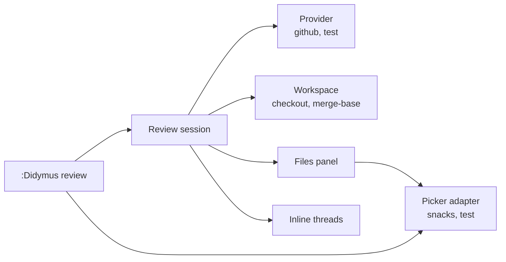
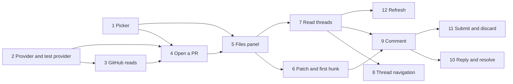

# Review architecture

This file is the design of the `review` epic, with GitHub as the first provider. Read it before you work on the epic. Record changes to the design here.

## Research

The facts in this section were checked on 2026-11-08 with `gh` 2.103.2 and the live GitHub GraphQL schema.

### Other plugins

| Plugin | What it does | Gap for didymus |
| --- | --- | --- |
| octo.nvim | PRs, threads and reviews in scratch buffers. | No real file, so no LSP. No agent. |
| snacks.gh (in snacks.nvim) | PR and issue pickers, a diff picker with comments. | Scratch buffers of the diff. No agent. |

### `gh` commands

| Need | Command | Notes |
| --- | --- | --- |
| List PRs | `gh pr list --json number,title,author,body,isDraft --limit 100` | The fields of `ChangeSummary`. `--search "review-requested:@me"` gives the PRs that wait for you. |
| PR data | `gh api graphql --paginate --slurp`, one query | `id number title body isDraft author baseRefName headRefName baseRefOid headRefOid isCrossRepository headRepositoryOwner`, `files { path changeType additions deletions }`, `reviews(states: [PENDING]) { id viewerDidAuthor }`. Each page repeats the PR data. `viewerViewedState` of `files` is for [#49](https://github.com/nickciaravella/didymus.nvim/issues/49). |
| Commentable lines | `gh api --paginate --slurp repos/{owner}/{repo}/pulls/{n}/files` | Only REST gives `patch`. A large or binary file, or a pure rename, has no `patch`. |
| Threads | `gh api graphql --paginate --slurp`, `node(id:)` of the PR, `reviewThreads` | `id path line startLine diffSide startDiffSide isResolved isOutdated subjectType`, and `comments { author body state }`. A thread with more than 100 comments gets a second query, `node(id:)` of the thread. `gh` reads the first `pageInfo`, so the `pageInfo` of the threads comes before the comments. |
| General comments | `gh api graphql`, `comments` | Issue comments of the PR. |
| Check out the PR | `gh pr checkout <n>` | Works for fork PRs. Git refuses if a local change conflicts. |

All write actions are GraphQL mutations. Each one is in the live schema:

| Action | Mutation | Input |
| --- | --- | --- |
| Start a pending review | `addPullRequestReview` | `pullRequestId`, `commitOID`. No `event`. |
| Add a thread | `addPullRequestReviewThread` | `pullRequestReviewId`, `path`, `body`, `line`, `side`, `startLine`, `startSide`, `subjectType` (`LINE` or `FILE`). |
| Reply | `addPullRequestReviewThreadReply` | `pullRequestReviewId`, `pullRequestReviewThreadId`, `body`. |
| Resolve | `resolveReviewThread`, `unresolveReviewThread` | `threadId`. |
| Submit | `submitPullRequestReview` | `pullRequestReviewId`, `event` (`COMMENT`, `APPROVE`, `REQUEST_CHANGES`), `body`. |
| Discard | `deletePullRequestReview` | `pullRequestReviewId`. |
| Viewed | `markFileAsViewed`, `unmarkFileAsViewed` | `pullRequestId`, `path`. |

### Pickers

didymus uses a picker in two roles:

| Role | Example | Needs |
| --- | --- | --- |
| Select | The PR list. | A modal list with search and a preview. It closes on a choice. |
| Panel | The files and threads on the left. | A list that stays open while you edit in other windows. A tree. Updates in place. Custom keys. |

| Picker | Select | Panel |
| --- | --- | --- |
| snacks.picker | Yes. | Yes. The explorer is a snacks picker with `layout = { preset = "sidebar" }`, `auto_close = false`, `jump = { close = false }`, `focus = "list"` and `tree = true`. `picker:refresh()` updates it. |
| telescope, fzf-lua | Yes. | No. They are modal. |
| mini.pick | Yes. | No. It reads keys in its own loop, so you cannot edit while it is open. |
| mini.files | No. It shows real directories, not a list of items. | No. |

The MVP supports only snacks. The interface keeps the two roles apart, so that a later picker with only the select role can use a fallback for the panel.

## MVP

The MVP is a full review of a GitHub PR, from the pick to the submit, in the current checkout.

| # | Feature | Notes |
| --- | --- | --- |
| 1 | **Pick a PR.** `:Didymus review open` shows the open PRs in the picker, with the body in the preview. `open 123` or `open <url>` skips the picker. | |
| 2 | **Check out the PR.** If `HEAD` is not the PR head, didymus checks out the PR in the current repo. If there are uncommitted changes, it shows a warning and asks you to confirm first. | Workspace flow below. |
| 3 | **Review tabpage.** The review opens in a new tabpage. `:Didymus review close` closes it. | |
| 4 | **Files panel.** A header (title, author, base ← head), the changed files with status, `+`/`-` counts and thread count, and the threads under each file. `<CR>` opens the file or goes to the thread. `:Didymus review files` shows or hides the panel. | |
| 5 | **Real file at the first change.** The file opens at the first hunk of its patch. | No hunk display. |
| 6 | **Read threads.** A sign and a one-line summary at the line of each thread. `:Didymus review thread` opens the full thread in a float. | Outdated threads show only in the panel. |
| 7 | **Thread navigation.** `:Didymus review next` and `prev` go to the next and the previous thread, also in other files. | |
| 8 | **Comment.** Add a line or range comment from the input float. The comment goes into your pending review. didymus finds a pending review that you started on github.com. | Reuse `ui/input.lua`. |
| 9 | **Reply, resolve and unresolve** a thread. | |
| 10 | **Submit or discard** the review: approve, comment or request changes, with an optional body. | |
| 11 | **Refresh.** Get the PR and the threads again. | |
| 12 | **Health check.** The `didymus review` section checks the dependencies of the picker and of the provider, such as snacks and `gh`. | |

Each command has a `<Plug>(didymus-review-…)` mapping. There are no default keymaps.

### Workspace flow

The MVP uses the current checkout.

1. Get the PR head from the provider.
2. If `HEAD` is the PR head, go to step 5.
3. If there are uncommitted changes, show a warning with the changed files. Ask the user to confirm. If the user cancels, stop.
4. Check out the PR with the provider (`gh pr checkout <n>`). If git refuses, show the error and stop. Then run `:checktime`, so the open buffers show the new files.
5. Get the merge-base, and open the review tabpage.

didymus does not stash the uncommitted changes. `:Didymus review close` does not check out the branch from before the review. Its message names that branch.

These rules apply to `open` and `close`:

1. Only one review is open at a time. `open` of the open change goes to its tabpage. `open` of a different change asks to close the open review first.
2. With no argument, `open` shows the picker first. Then rule 1 applies to the choice.
3. Each question uses the select role of the picker, because `vim.fn.confirm()` blocks the UI. The items are the action and "Cancel". A close of the picker with no choice is a cancel.
4. The uncommitted changes are the tracked files with changes, staged or not. Untracked files stay after a checkout, and git refuses the checkout if one of them conflicts.
5. The question about uncommitted changes shows the files in its preview. A warning message also lists them, so that they show after the picker closes.
6. If git cannot find the merge-base, the review opens with a warning. No MVP feature uses the merge-base yet.
7. A progress message shows while the provider works.
8. A newer `open` wins. The callbacks of an older `open` do nothing.
9. The review tabpage starts with an unlisted scratch buffer. `:tabclose` of the review tabpage also ends the review.

Comments need the line numbers of the PR head. So didymus refuses a new comment on a file with local changes: a modified buffer, or a file that is different from the change head. See [Comments](#comments).

### Files panel

The files panel opens with the review tabpage, in the panel role of the picker. Its title is `Review #12`. `lua/didymus/review/panel.lua` makes the items.

| Row | Text | Highlights |
| --- | --- | --- |
| Header 1 | `#12 <title>` | `Number`, `Title` |
| Header 2 | `@author main ← feature` | `Comment` |
| File | `M path +12 -3 2 threads`, in the order of the provider | `Added`, `Changed`, `Removed`, `Comment` |
| Thread, at depth 1 under its file | `@author <first line of the first comment> [pending] [resolved] [outdated]` | `DidymusThread` for the author. A resolved thread is all `DidymusThreadResolved`. `[pending]` is `DidymusThreadPending`. `[outdated]` is `DiagnosticWarn`. |

1. The status letters are `A`, `M`, `D` and `R`. The full path comes before the counts. A long path can hide the counts in a narrow panel.
2. The thread count shows only if it is above 0. A count of 0 on each row makes the rows long.
3. `<CR>` on a header row does nothing. On a deleted file, it shows a message and opens nothing, because the file is not in the checkout.
4. `<CR>` on a file opens the real file in the code window at its first change, and focuses the code window. The code window is the first window of the tabpage. If the user closed it, the file opens in a new window on the right, and that window becomes the code window. See [Patch parser](#patch-parser).
5. In the review tabpage, `:Didymus review files` shows or hides the panel. In a different tabpage, it goes to the review tabpage and shows the panel. A hidden panel is closed, so a new panel starts with the cursor on the first row.
6. `close` and `:tabclose` also close the panel.
7. If the panel cannot open, for example with no snacks.nvim, the review opens without it, and the error shows.
8. If the code window already shows the file, `<CR>` only moves the cursor. `:edit` of a modified buffer gives E37. The move goes into the jumplist, as the `:edit` of a different file does.
9. If Neovim cannot open the file, the error shows, and the focus goes back to the panel. For example, with 'nohidden', a modified buffer in the code window gives E37.
10. The thread count counts all threads of the file, also the resolved and outdated threads.
11. `<CR>` on a thread with a line opens its file at that line, as rule 4. `<CR>` on a thread that shows only in the panel opens the thread float next to the panel. See [Inline threads](#inline-threads).

### Patch parser

`lua/didymus/review/patch.lua` makes the hunks and the commentable ranges of a file from its `patch`. It does not use editor state.

```lua
---@class didymus.review.Hunk
---@field head didymus.review.Range? The lines of the hunk in the head file, also the context lines. Nil if the hunk has no head lines.
---@field base didymus.review.Range? The lines of the hunk in the base file. Nil if the hunk has no base lines.
---@field first_change integer The head line of the first added or deleted line.

---@class didymus.review.Patch
---@field hunks didymus.review.Hunk[]
---@field commentable table<didymus.review.Side, didymus.review.Range[]>? The lines that accept comments, one range for each hunk. Nil if they are unknown.
```

1. The ranges come from the hunk header, `@@ -a,b +c,d @@`. A count that the header does not give is 1. A count of 0 gives no range on that side.
2. GitHub accepts a comment on each line of a hunk, also on a context line. So each hunk gives one commentable range on each side. git does not make hunks that touch, so the ranges do not merge.
3. A file with no `patch` has no hunks, and its commentable lines are unknown. An empty `patch` has no hunks and no commentable lines.
4. `first_change` is the first added line. If deleted lines have no added lines after them, it is the head line before the deletion, as in a unified diff. At the start of the file, it is line 1.
5. The parser skips `\ No newline at end of file` and the lines before the first hunk. An empty line in a hunk is a context line.
6. The panel parses the patch when it opens a file. There is no cache, because a refresh replaces the change.
7. The cursor goes to the first non-blank character of `first_change` of the first hunk, or to line 1 with no hunks. If the buffer is shorter, the cursor goes to the last line. The file in the checkout can be different from the change head.

### Inline threads

`lua/didymus/review/threads.lua` draws the threads in the files, and opens the thread float.

1. The review gets the threads after the review tabpage opens, with a progress message. Then the session updates the panel and the marks. On an error, the message shows and the review stays open. A close or a newer review ignores the result.
2. A thread shows in the file at the last line of its range, as on GitHub. The `<CR>` of the panel and `thread` use this line.
3. Outdated threads, threads on the base side and threads on the file show only in the panel.
4. Each thread has one extmark in the namespace `didymus.review`. It has a sign with the comment count (`9+` above 9), and a summary in `virt_lines` under the line, with the indent of the line. The summary is the text of the panel row.
5. The id of an extmark is the index of its thread in the session. `thread` reads the extmarks at the cursor line, so it follows edits of the text.
6. The session draws the marks in all loaded buffers of files with threads, and again on `BufReadPost`, also after `:checktime` or `:edit!`. The close of the review removes all marks.
7. The marks show only in the windows of the review tabpage, because the review buffers are the normal buffers of the user. See rule 8.
8. The scope uses `nvim__ns_set(ns, { wins = … })`. Neovim 0.12 marks it as experimental. The session gives it all windows of the review tabpage, at the start and on `WinNew`. The list is never empty, because an empty list shows the marks in all windows. If `vim.api.nvim__ns_set` does not exist, the marks show in all windows, with no error.
9. With `signcolumn=auto`, a window outside the review tabpage that shows a review buffer has an empty sign column. The sign column counts the signs of the buffer, not of the window.
10. `thread` opens the float with `vim.lsp.util.open_floating_preview()`, as a hover: next to the cursor, closed by a move of the cursor, focused by a second call, closed by `q`. The float is markdown. Each comment is `**@author**`, with `*pending*` for a pending comment, then the body. A line separates the comments. The title is the path, the line, and the tags `base`, `resolved` and `outdated`.
11. A float that opens from the panel is not wider than the panel, because the float of Neovim is not wider than the current window.
12. If more than one thread is at the line, `thread` asks which one with the select role of the picker.
13. The order of the threads is the order of the panel: the files in the order of the provider. In each file, the threads with a line come first, by line. The other threads stay in the order of the provider.

### Thread navigation

`Session:go_to_thread()` in `lua/didymus/review/session.lua` does `next` and `prev`.

1. The stops are the threads with a line, in the order of the panel. The threads at the same line are one stop, because `thread` asks which one to open.
2. The start is the cursor of the current window, if it shows a file of the change. Else, it is the cursor of the code window, for example from the panel. If neither shows a file of the change, `next` goes to the first thread, and `prev` to the last thread.
3. In a different tabpage, `next` and `prev` go to the review tabpage first, so that the jump shows.
4. The jump uses the line of the thread, as `<CR>` of the panel does, not the extmark. In the file of the cursor, a line after the end of the buffer counts as the last line. Else, `next` goes to the last line again and again.
5. If the current window shows the file of the thread, the cursor moves in that window. Else, the file opens in the code window, as with `<CR>` of the panel.
6. Each jump adds the old position to the jumplist, as `vim.diagnostic.jump()` does.
7. At the last or the first thread, `didymus: no next thread` or `didymus: no previous thread` shows, and the cursor does not move. The navigation does not wrap.
8. The cursor of the panel does not move, and the thread float does not open.

### Comments

`:[range]Didymus review comment` adds a thread on the head side. `M.comment()` in `lua/didymus/review/init.lua` does the checks and opens the input float.

1. The lines are the range of the command, the selection in visual mode, or the cursor line. The `<Plug>` mapping leaves visual mode, as a `:` command does.
2. The current window must show a file of the change, in any tabpage. If a check fails, the reason shows as a warning, and no float opens.
3. The buffer must not be modified, and all lines must be in one commentable range. If the commentable ranges are unknown, the code host decides.
4. didymus refuses a range across two hunks. GitHub accepts it, but keeps only the hunk of the last line. github.com does not let you select it.
5. Then `git diff --quiet <head_sha> -- <path>` checks the file on disk. A file that is different from the change head has different line numbers, also after a local commit.
6. The input float opens above the lines. Its title is `path:3` or `path:3-5`. `review.input` sets its size and its keys.
7. On submit, `provider:add_comment()` runs with a progress message. The session adds the new thread, and updates the panel and the marks. If the review closed, only the message shows.
8. If the first comment of a thread is pending, the thread has the `[pending]` tag, in the panel and at the line.
9. If the provider fails, the error shows on one line, because a longer message makes the user press Enter. The session keeps the draft. The next comment on the same file and lines starts with its text.
10. The session keeps the provider that gave the change, because only that provider knows its own fields of the change.

## Parts



| Part | Owns | Does not |
| --- | --- | --- |
| Review session | The change, the threads, the tabpage, the order of the threads for navigation, and the provider of the change. | Call `gh` or `git`. |
| Provider | All calls to the code host, also the checkout. It changes host data into didymus types. | Open windows. Know about pickers. |
| Workspace | `HEAD`, the uncommitted changes, the confirm prompt, the merge-base, and the check of a file against the change head. | Know about the code host. |
| Picker adapter | Show items and call back with the choice. | Know about reviews. It gets plain items. |
| Files panel | Make picker items from the review session, and the actions on them. | Draw a buffer. The picker adapter draws it. |
| Patch parser | Make the hunks and the commentable ranges from the patch of a file. | Use editor state. |
| Inline threads | Extmarks for the threads, their window scope, and the thread float. | Call the provider. |

The picker adapter goes in `lua/didymus/ui/picker/`, because it does not know about reviews.

The MVP needs no diff provider. The patch from the code host gives the first hunk and the commentable ranges.

## Picker interface

```lua
---@class didymus.picker.Item
---@field text string           Plain text, for search and for pickers with no highlights.
---@field id? string            A stable key. `update()` uses it to keep the cursor on the same item. Default `text`.
---@field segments? [string, string?][] Text and highlight group, for pickers with highlights.
---@field depth? integer        The indent in a tree. 0 is the top level. Default 0.
---@field location? { path: string, line: integer? } A file to show in the preview.
---@field preview? { lines: string[], filetype: string? } Text to show in the preview.
---@field value any             The data that the caller gets back.

---@class didymus.picker.Action
---@field key string
---@field name string
---@field fn fun(item: didymus.picker.Item?) The item under the cursor. Nil if the panel is empty.

---@class didymus.picker.SelectOpts
---@field title string
---@field items didymus.picker.Item[]
---@field on_choose fun(item: didymus.picker.Item) The picker closes first.
---@field on_cancel? fun()

---@class didymus.picker.PanelOpts
---@field title string
---@field items fun(): didymus.picker.Item[] The panel calls it on open and on `update()`.
---@field on_choose fun(item: didymus.picker.Item) The panel stays open, and its window stays current.
---@field actions? didymus.picker.Action[] Keys in the panel, such as `R` for refresh.
---@field position? "left"|"right" Default "left".
---@field width? number Below 1, a fraction of the editor width. Else columns. Default 40.

---@class didymus.picker.Panel
---@field update fun(self) Call `items()` again and show the new items. Keep the cursor on the same item.
---@field focus fun(self)
---@field close fun(self)
---@field is_open fun(self): boolean

---@class didymus.picker.Adapter
---@field select fun(opts: didymus.picker.SelectOpts)
---@field panel fun(opts: didymus.picker.PanelOpts): didymus.picker.Panel
---@field health fun() Report the dependencies with `vim.health`.
```

1. `review.picker` in the config is `"snacks"` (the default), `"test"` or an adapter table. A table lets users add a picker with no change to didymus.
2. The health check calls `health()` of the configured adapter. The snacks adapter reports an error if `Snacks.picker` is not available.
3. The `test` adapter records the calls, and lets end-to-end tests choose an item or press the key of an action. It is the same idea as the test backend of the agent. See [`TESTING.md`](../TESTING.md#the-test-picker).
4. `on_choose` of the panel does not move the focus. The caller opens the file in its code window, because the review session owns the tabpage.
5. The panel has no preview. A preview in the sidebar shows in the code window, and changes it at each move of the cursor.
6. The keys of the actions work only in the list of the panel, not in its search input.
7. The snacks panel is a split, so it shows only in the tabpage where it opened.
8. `picker.confirm()` in `ui/picker/init.lua` asks a question with the select role. The workspace flow uses it in place of `vim.fn.confirm()`.

## Provider interface

All methods are async. Each one takes a final `cb(err, result)` and does not block the UI.

```lua
---@class didymus.review.Provider
---@field list_changes fun(self, opts: { search: string? }, cb: fun(err: string?, changes: didymus.review.ChangeSummary[]?))
---@field get_change fun(self, id: string, cb: fun(err: string?, change: didymus.review.Change?)) Files, patches and the pending review.
---@field checkout fun(self, change: didymus.review.Change, cb: fun(err: string?)) Make the change head the current checkout.
---@field get_threads fun(self, change: didymus.review.Change, cb: fun(err: string?, threads: didymus.review.Thread[]?))
---@field add_comment fun(self, change: didymus.review.Change, draft: didymus.review.CommentDraft, cb: fun(err: string?, thread: didymus.review.Thread?)) Start a pending review if there is none.
---@field reply fun(self, change: didymus.review.Change, thread_id: string, body: string, cb: fun(err: string?))
---@field set_resolved fun(self, change: didymus.review.Change, thread_id: string, resolved: boolean, cb: fun(err: string?))
---@field submit_review fun(self, change: didymus.review.Change, verdict: "approve"|"comment"|"request_changes", body: string?, cb: fun(err: string?))
---@field discard_review fun(self, change: didymus.review.Change, cb: fun(err: string?))
---@field health fun() Report the dependencies with `vim.health`.
```

- `review.provider` is `"github"` (the default), `"test"` or a provider table.
- The GitHub provider keeps all GraphQL documents as string constants in one module.
- The `test` provider keeps its changes and threads in memory. Tests give it the data. Its `checkout` runs `git checkout` in a temporary repo of the test. It calls each `cb` in `vim.schedule()`, as a real provider does.
- The `add_comment` of the `test` provider adds a thread with one pending comment of `viewer`. `errors.<method>` makes the next call of that method fail.

### Review types

The types come from the [reference file](../reference/design-prompt.md#data-model), with only the fields that the MVP uses. Each field was examined against the live GitHub GraphQL schema on 2026-11-08. A task that uses a type can add a field.

```lua
---@alias didymus.review.Side "head"|"base"

---@class didymus.review.Range     Lines, 1-based. The range includes `first` and `last`.
---@field first integer
---@field last integer

---@class didymus.review.ChangeSummary
---@field id string                 The id on the code host, such as the PR number.
---@field title string
---@field author string
---@field body string               Markdown.
---@field is_draft boolean

---@class didymus.review.Change: didymus.review.ChangeSummary
---@field base_branch string
---@field head_branch string
---@field base_sha string
---@field head_sha string
---@field files didymus.review.ChangedFile[]
---@field pending_review_id string?

---@class didymus.review.ChangedFile
---@field path string
---@field status "added"|"modified"|"deleted"|"renamed"
---@field additions integer
---@field deletions integer
---@field patch string?             The hunks of the unified diff, with no file header. Nil for a large or binary file, or a pure rename.

---@class didymus.review.Thread
---@field id string
---@field path string
---@field side didymus.review.Side
---@field range didymus.review.Range? Nil if the thread is outdated or on the file.
---@field resolved boolean
---@field outdated boolean
---@field comments didymus.review.Comment[]

---@class didymus.review.Comment
---@field author string
---@field body string               Markdown.
---@field pending boolean

---@class didymus.review.CommentDraft A new comment on the head side.
---@field path string
---@field range didymus.review.Range
---@field body string
```

1. A provider can add its own fields to a `Change`, such as the GraphQL node id of the PR. The review session gives the same table back to the provider.
2. `ChangedFile` has the raw `patch`, not the commentable ranges. The patch parser makes the hunks and the commentable ranges from it.
3. A thread and a draft use a `Range`, not `line` and `start_line`. Then a draft and a commentable range have the same type.
4. A thread on the base side cannot show at a line of the head file. So `Thread` has `side`. A draft is always on the head side in the MVP.

The MVP does not use these fields of the reference file:

| Fields | Why |
| --- | --- |
| `ChangeRef` | There is one provider in the config, and it works on the current repo. |
| `updated_at`, `url`, `state`, `source` | No MVP feature uses them. The provider does the checkout. |
| `old_path` | The GraphQL `PullRequestChangedFile` does not have it. |
| `viewed` | [Mark as viewed](https://github.com/nickciaravella/didymus.nvim/issues/49) is after the MVP. |
| `original_line` | Outdated threads show only in the panel. |
| `Comment.id`, `created_at` | No MVP feature uses them. |
| `CommentDraft.side`, `file_level` | [More comment kinds](https://github.com/nickciaravella/didymus.nvim/issues/53) is after the MVP. |

### GitHub provider

The `github` provider is in `lua/didymus/review/provider/github/`. It runs the [`gh` commands](#gh-commands) with `vim.system`, in the current directory.

1. `get_change` takes a PR number or a PR URL. A number is a PR of the current repo. `gh` finds the repo with the `{owner}` and `{repo}` placeholders. A URL gives the host, the owner and the repo. `checkout` then uses `--repo`.
2. `get_change` runs the GraphQL query and the REST files at the same time. The files come from GraphQL. Each file gets the `patch` with the same path from REST. A renamed file has its new path.
3. `change.id` is the PR number. The provider keeps its data in `change.github`: the number, the repo of a URL and the GraphQL `node_id`.
4. For a PR from a fork, `head_branch` is `owner:branch`, as github.com shows it.
5. `changeType` `CHANGED` (only the file mode changed) is `modified`. `COPIED` is `added`.
6. `pending_review_id` is the first `PENDING` review with `viewerDidAuthor`.
7. A deleted author is `ghost`, as on github.com. The provider changes `\r\n` in a body to `\n`.
8. An error is `<command>: <the stderr of gh>`, for example `gh pr list: …`. The GraphQL error comes before the REST error, because it is clearer.
9. `health()` runs `gh auth status --active`, and waits for 10 seconds at most. `:checkhealth` is synchronous.
10. `get_threads` uses the GraphQL `node_id` of the PR. A thread with more comments than the first page gets all its comments from a second query. These queries run at the same time.
11. `diffSide` `RIGHT` is `head`, and `LEFT` is `base`. The range is `startLine` (or `line`) to `line`. If the range starts on the other side, the range is only `line`. The range is nil if GitHub gives no `line`, or if the thread is outdated. `pending` is `state == PENDING`.
12. `add_comment` gets the pending review of the viewer before each comment. It does not use `change.pending_review_id`, because the user can start, submit or discard a review on github.com after the open. If there is no pending review, `addPullRequestReview` with `commitOID` of `head_sha` and no `event` starts one. Then `change.pending_review_id` is its id.
13. `addPullRequestReviewThread` gets `side: RIGHT` and `line`. A range also gets `startLine` and `startSide: RIGHT`. The reply has the new thread with the fields of `get_threads`.
14. For a line out of the diff, GitHub gives `thread: null` and no error. Then `add_comment` gives an error.

## Tests

| Part | Test |
| --- | --- |
| Patch parser | Unit tests. |
| Review flows | End-to-end tests with the `test` provider and the `test` picker. |
| Workspace flow | End-to-end tests in a temporary git repo, also with uncommitted changes. |
| snacks adapter | Integration tests with the real snacks.nvim, in `tests/integration/`. `make deps` clones snacks at a fixed commit. CI runs them. |
| GitHub provider | Unit tests of the transforms, with recorded `gh` output. Manual tests on a throwaway PR. [Its long-term plan](https://github.com/nickciaravella/didymus.nvim/issues/50) is a post-MVP task. |


## Work plan

Each task is one GitHub issue and one pull request. Each task adds its tests and updates the docs. After each task, a person can do a manual test.



| Task | Content | Manual test |
| --- | --- | --- |
| 1. [Picker](https://github.com/nickciaravella/didymus.nvim/issues/36) | `ui/picker/`: the interface, the `snacks` and `test` adapters, `review.picker` and `health()`. The snacks integration tests, the `make` target and CI. | A setup file shows a list and a panel in snacks. `:checkhealth didymus` without snacks shows an error. |
| 2. [Provider and test provider](https://github.com/nickciaravella/didymus.nvim/issues/37) | The types, the provider interface, `review.provider` and the `test` provider: `list_changes`, `get_change` and `checkout`. | None. Tests only. |
| 3. [GitHub reads](https://github.com/nickciaravella/didymus.nvim/issues/38) | `list_changes`, `get_change` and `checkout` for GitHub. `health()` checks that `gh` is on `$PATH` and is authenticated. | `:checkhealth didymus`. A setup file prints a real PR. |
| 4. [Open a PR](https://github.com/nickciaravella/didymus.nvim/issues/39) | `:Didymus review open [n\|url]` and `close`. The PR picker. The workspace flow, with the confirm prompt. The review tabpage. | Open a real PR from the picker and by number, also with uncommitted changes. |
| 5. [Files panel](https://github.com/nickciaravella/didymus.nvim/issues/40) | The header and the files in the panel. `<CR>` opens the real file. `:Didymus review files`. | Open files from the panel. |
| 6. [Patch and first hunk](https://github.com/nickciaravella/didymus.nvim/issues/41) | Parse the `patch` of each file into hunks and commentable ranges. The file opens at its first hunk. | Open a file. The cursor is on the first change. |
| 7. [Read threads](https://github.com/nickciaravella/didymus.nvim/issues/42) | `get_threads`. Threads under their files in the panel. Signs and summaries at the lines. The thread float. | Open a PR with comments. |
| 8. [Thread navigation](https://github.com/nickciaravella/didymus.nvim/issues/43) | `:Didymus review next` and `prev`, across files, in the order of the panel. | Go through all threads of a PR. |
| 9. [Comment](https://github.com/nickciaravella/didymus.nvim/issues/44) | Find or start the pending review. A line or range comment from the input float. Check the commentable ranges. Refuse a file with local changes. | Add a comment. It shows as pending on github.com. |
| 10. [Reply and resolve](https://github.com/nickciaravella/didymus.nvim/issues/45) | Reply, resolve and unresolve from the thread float. | Reply to a thread, resolve it, unresolve it. |
| 11. [Submit and discard](https://github.com/nickciaravella/didymus.nvim/issues/46) | `:Didymus review submit [approve\|comment\|request_changes]` with a body. `:Didymus review discard`. | Submit a review on a test PR. |
| 12. [Refresh](https://github.com/nickciaravella/didymus.nvim/issues/47) | `:Didymus review refresh`, and `R` in the panel. | Add a comment on github.com, then refresh. |

Tasks 1, 2 and 3 can start at the same time. After task 5, tasks 6 and 7 can go in parallel.

Each manual test of a GitHub feature needs a real PR. Use a throwaway PR in a test repo, because tasks 9 to 11 write to it.

### Post-MVP tasks


| Task | Epic | Content |
| --- | --- | --- |
| [Worktree workspace](https://github.com/nickciaravella/didymus.nvim/issues/48) | `review` | Review a PR in a git worktree, with no change to the current checkout. The agent of the review starts in the worktree. |
| [Mark as viewed](https://github.com/nickciaravella/didymus.nvim/issues/49) | `review` | Show the viewed state in the panel, and a key to change it. |
| [GitHub test plan](https://github.com/nickciaravella/didymus.nvim/issues/50) | `review` | Decide how to test the GitHub provider in the long term: recorded `gh` output, a real test repo, or both. |
| [Hunk display](https://github.com/nickciaravella/didymus.nvim/issues/51) | `diff` | Show the hunks against the merge-base on the real file. Keys for the next and the previous hunk. |
| [More pickers](https://github.com/nickciaravella/didymus.nvim/issues/52) | `review` | Adapters for other pickers, such as telescope or fzf-lua. A panel fallback for a picker with only the select role. |
| [More comment kinds](https://github.com/nickciaravella/didymus.nvim/issues/53) | `review` | Suggestion blocks, file-level comments and comments on deleted lines. |
| [Agent primer](https://github.com/nickciaravella/didymus.nvim/issues/54) | `agent` | A first prompt with the PR title, body and merge-base. |
